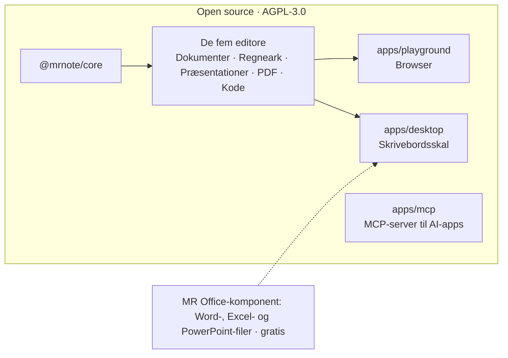

# MR Office — Dansk

<p align="center"><sub>🌐 <a href="../README.md">English</a> · <a href="../i18n/README.en-GB.md">English (UK)</a> · <a href="../i18n/README.zh.md">简体中文</a> · <a href="../i18n/README.zh-TW.md">繁體中文</a> · <a href="../i18n/README.ja.md">日本語</a> · <a href="../i18n/README.ko.md">한국어</a> · <a href="../i18n/README.de.md">Deutsch</a> · <a href="../i18n/README.fr.md">Français</a> · <a href="../i18n/README.es.md">Español</a> · <a href="../i18n/README.es-419.md">Español (Latinoamérica)</a> · <a href="../i18n/README.pt-BR.md">Português (Brasil)</a> · <a href="../i18n/README.it.md">Italiano</a> · <a href="../i18n/README.nl.md">Nederlands</a> · <a href="../i18n/README.sv.md">Svenska</a> · <a href="../i18n/README.da.md">Dansk</a> · <a href="../i18n/README.no.md">Norsk</a> · <a href="../i18n/README.fi.md">Suomi</a> · <a href="../i18n/README.id.md">Bahasa Indonesia</a> · <a href="../i18n/README.th.md">ไทย</a> · <a href="../i18n/README.vi.md">Tiếng Việt</a></sub></p>

<p align="center"><b>De open source-editore i MR Office, den editor der ligner Microsoft Office mest — dokumenter, regneark, præsentationer, PDF og kode — der kører i browseren.</b></p>

<p align="center"><a href="https://mroffice.ai/da"><b>▶ Prøv online</b></a> · <a href="https://mroffice.ai/da/office/download"><b>⬇ Download</b></a> · <a href="https://mroffice.ai">🌐 mroffice.ai</a><br><a href="https://mroffice.ai/da/developers">🧑‍💻 Udviklere</a> · <a href="https://mroffice.ai/da/developers/embed">🧩 Indlejr</a> · <a href="https://mroffice.ai/da/developers/mcp">🤖 MCP til AI-apps</a> · <a href="https://www.npmjs.com/package/mroffice-embed">📦 npm-SDK</a> · <a href="https://mroffice.ai/da/developers/oauth">🔑 Log ind med MR Office</a></p>

<p align="center"><a href="../LICENSE"></a> <a href="https://github.com/XinaTian/MROffice/releases"></a> <a href="https://github.com/XinaTian/MROffice/actions/workflows/ci.yml"></a> <a href="https://github.com/XinaTian/MROffice/stargazers"></a></p>

<p align="center"><a href="https://mroffice.ai/da"></a></p>

<p align="center"><a href="https://demo.mroffice.ai/media/mr-office-demo.mp4">🔊 Se den 50 sekunder lange rundvisning med lyd</a></p>

<table>
<tr>
<td align="center" width="50%"><a href="https://mroffice.ai/da"></a><br><b>Dokumenter</b></td>
<td align="center" width="50%"><a href="https://mroffice.ai/da"></a><br><b>Regneark</b></td>
</tr>
<tr>
<td align="center" width="50%"><a href="https://mroffice.ai/da"></a><br><b>Præsentationer</b></td>
<td align="center" width="50%"><a href="https://mroffice.ai/da"></a><br><b>PDF</b></td>
</tr>
<tr>
<td align="center" width="50%"><a href="https://mroffice.ai/da"></a><br><b>Kode</b></td>
</tr>
</table>

MR Office er et arbejdsområde til noter, AI og rigtige filer. Dette repository udgiver kildekoden til dets editorer: de samme editorer, som MR Office kører, og som du selv kan bygge, køre og indlejre. Sammen med den gratis MR Office-skrivebordsapp eller det hostede embed åbner og gemmer de rigtige Word-, Excel- og PowerPoint-filer.

## For udviklere

Alt for udviklere findes på **[MR Office Developers](https://mroffice.ai/da/developers)** — selvbetjening, ingen ansøgning: log ind med en hvilken som helst MR Office-konto og kom i gang.

### Indlejr editorerne i din webapp (anbefalet)

MR Office hoster editorerne; din server signerer et kortlivet sessionstoken, og din side åbner editoren. Den redigerer rigtige Word-, Excel-, PowerPoint- og PDF-filer (.docx, .xlsx, .pptx, .pdf) med samredigering, uploads, alle eksportformater, udskrivning og gem, der sendes tilbage til din server i et signeret callback. Gratis plan: 1.000 sessioner om måneden på localhost, 100 på dine egne domæner, op til 2 apps. Som hostet tjeneste pålægger den ikke din egen app nogen AGPL-forpligtelser.

1. Kør `npx mroffice-embed init` i projektets mappe (eller opret en app i udviklerkonsollen): ét klik på "Tillad" i browseren, så skrives appens nøgler til `.env.local` / `.env`.
2. Din server laver et sessionstoken med `createSessionToken` fra `mroffice-embed/server`; den hemmelige nøgle forlader aldrig serveren.
3. Din side åbner editoren med `open()` fra `mroffice-embed` (eller scriptet `https://mroffice.ai/embed/v1/embed.js`).

```js
// server: GET /api/mroffice/session (check who is signed in first)
import { createSessionToken } from "mroffice-embed/server";
const token = await createSessionToken({
  appId: process.env.MROFFICE_APP_ID,
  secretKey: process.env.MROFFICE_SECRET_KEY, // mro_sk_..., server only
  file: { key: "contract-42", name: "contract.docx", url: signedUrlToTheFile },
  user: { id: user.id, name: user.name },
  mode: "edit",
});

// page
import { open } from "mroffice-embed";
open({ container: "#editor", token: () => fetch("/api/mroffice/session").then((r) => r.json()).then((b) => b.token) });
```

[Guide til indlejring](https://mroffice.ai/da/developers/embed) · [Guiden som Markdown (til AI-agenter)](https://mroffice.ai/developers/embed.md) · [Priser og grænser](https://mroffice.ai/da/developers/pricing) · [Udviklerkonsol](https://mroffice.ai/da/developers/console) · [Livedemo](https://mroffice.ai/da/developers/embed/demo)

### AI-apps: MCP-serveren

AI-apps åbner, læser, redigerer og eksporterer dokumenter i den rigtige MR Office-editor via dens MCP-server: forbind det hostede endpoint `https://mcp.mroffice.ai/mcp` (log ind med din MR Office-konto, ingen nøgle), eller kør `npx -y mroffice-mcp` på din egen computer. Kildekoden ligger i `apps/mcp`. [MCP-guide →](https://mroffice.ai/da/developers/mcp)

### Log ind med MR Office (OAuth)

MR Office er en OAuth 2.1-autorisationsserver (PKCE, metadatadokumenter for klient-id, dynamisk registrering): din app kan logge folk ind med deres MR Office-konto og handle med de rettigheder, de tillader. [OAuth-guide →](https://mroffice.ai/da/developers/oauth)

### Host selv open source-editorerne

De fem editore i dette repository kan bygges ind i dit eget produkt under AGPL-3.0: hvis folk bruger en ændret version over et netværk, skal du tilbyde dem dens komplette kildekode og bevare "MR Office"-krediteringen (NOTICE.md). De åbner deres egne formater, CSV, HTML, Markdown og PDF; til Word-, Excel- og PowerPoint-filer skal du bruge den hostede embed ovenfor. En kommerciel licens fås hos support@mr-note.com. [Open source-guide →](https://mroffice.ai/da/developers/open-source)

Editorene findes på npm som React-komponenter: `npm i mroffice-docs mroffice-core` (og `mroffice-sheets`, `mroffice-slides`, `mroffice-pdf`, `mroffice-code`); hver pakkes README viser, hvordan den indlejres.

## Editorerne

Hvad hver editor gør i dette repository:

- **Dokumenter** — en ordbehandler med sider: skrifttyper, afsnitsformatering, lister og typografier under Hjem; forside og tomme sider, sideskift, tabeller, billeder, figurer, SmartArt, diagrammer, links, bogmærker, kommentarer, sidehoveder, sidefødder og sidetal, ligninger, symboler, tekstbokse og WordArt under Indsæt. Gemmer sit eget format (.mrdoc); åbner HTML, Markdown og almindelig tekst.
- **Regneark** — celler og formler med skrifttyper, justering, talformater, betinget formatering, cellestile og indsættelse eller sletning af celler under Hjem; tabeller, billeder, figurer, ikoner, afkrydsningsfelter, diagrammer og sparklines under Indsæt; flere ark med sum og gennemsnit af markeringen. Aritmetik mellem celler (=A1*B1+10) beregnes i browseren, mens du skriver; formler med funktioner (SUM, IF, VLOOKUP …) bevares som skrevet. Gemmer sit eget format (.mrsheet); åbner og gemmer CSV og TSV.
- **Præsentationer** — slides med layouts og sektioner, tekst, skrifttyper og afsnit samt figurer med deres arrangement under Hjem; tabeller, billeder, ikoner, SmartArt, diagrammer, tekstbokse, WordArt, sidehoveder og sidefødder, ligninger, symboler og video under Indsæt; talernoter, kommentarer og præsentation. Gemmer sit eget format (.mrslides).
- **PDF** — læs, præsentér og udskriv PDF-filer: enkelt- og tosidesvisning, kontinuerlig rulning, rotation, miniaturer og læsetilstand, søgning og kopiering af deres tekst samt kommentarer, mens en fil er åben; gemning giver filen tilbage, som den blev åbnet.
- **Kode** — en letvægts-kodeeditor med syntaksfremhævning til mange sprog, en dispositionsvisning, søgning, hurtig åbning, en filbrowser og en problemliste.

Formler med funktioner, diagrammer og SmartArt beregnes og tegnes af MR Offices motor, i den gratis skrivebordsapp og i den hostede tjeneste; editorerne her bevarer hver formel, diagram og SmartArt, som en fil indeholder, og viser SmartArt, som det blev gemt.

## Kør editorerne

**▶ [Prøv live-demoen – ingen installation](https://mroffice.ai/da)**

De fem editore findes i `packages/` (`@mrnote/docs`, `sheets`, `slides`, `pdf`, `code`, som deler `@mrnote/core`) og kører sammen i `apps/playground`:

```bash
npm install
npm run fonts     # the open substitutes for Office's fonts
npm run build
npm run preview   # http://localhost:5178
```

`npm run dev` starter en udviklingsserver på samme adresse, og `npm run smoke` tjekker et build. Hver pakkes README beskriver i detaljer, hvad den gør, og hvordan den indlejres.

## Skrivebordsapp

[`apps/desktop`](../apps/desktop) indeholder **MR Office Editors**: kilden til MR Office-skrivebordsappens shell (Electron) under sin egen identitet. Med den gratis MR Office-komponent fra Releases er det MR Office-skrivebordsappen med Word-, Excel-, PowerPoint- og PDF-filer, login og AI. Uden komponenten kører den open source-editorene alene, som åbner .mrdoc-, .mrsheet- og .mrslides-filer, CSV, HTML, Markdown og PDF. Shellen og editorene er AGPL-kildekode; komponenten er en gratis download fra Releases. Efter `npm run build` startes den med:

```bash
npm run desktop
```

## Få alle funktioner: installér MR Offices skrivebordsapp (gratis)

MR Office-skrivebordsappen er gratis, har disse editorer og den fulde tjeneste og virker offline på din egen computer. Oven i editorerne tilføjer den:

- Åbne og gemme Word-, Excel- og PowerPoint-filer (.docx, .xlsx, .pptx)
- Beregne formler med funktioner (SUM, HVIS, LOPSLAG …)
- Diagrammer
- Redigering af SmartArt
- Gemme ændringer i en PDF tilbage i filen

**[Download MR Office (gratis) →](https://mroffice.ai/da/office/download)**

### Word-, Excel-, PowerPoint- og PDF-filer

Arbejd på rigtige Word-, Excel- og PowerPoint-filer (.docx, .xlsx, .pptx) og gem PDF-redigeringer direkte i filen med den gratis MR Office-skrivebordsapp, som har alle disse editorer og virker offline på din egen computer:

## Sådan hænger delene sammen



## Licens

Open source under GNU Affero General Public License v3.0 (LICENSE) med de yderligere vilkår i NOTICE.md: bevar angivelsen "MR Office" og linket til https://mroffice.ai, og ingen rettigheder til navnet eller logoet MR Office. En kommerciel licens fås via support@mr-note.com. Software og data fra tredjeparter står i THIRD_PARTY_NOTICES.md. Bidrag: se CONTRIBUTING.md.

## Mere

Websted og hele produktet: **https://mroffice.ai** · Spørgsmål og feedback: support@mr-note.com

<p align="center">Hvis MR Office er nyttigt for dig, hjælper en ⭐ på GitHub andre med at finde det.</p>
