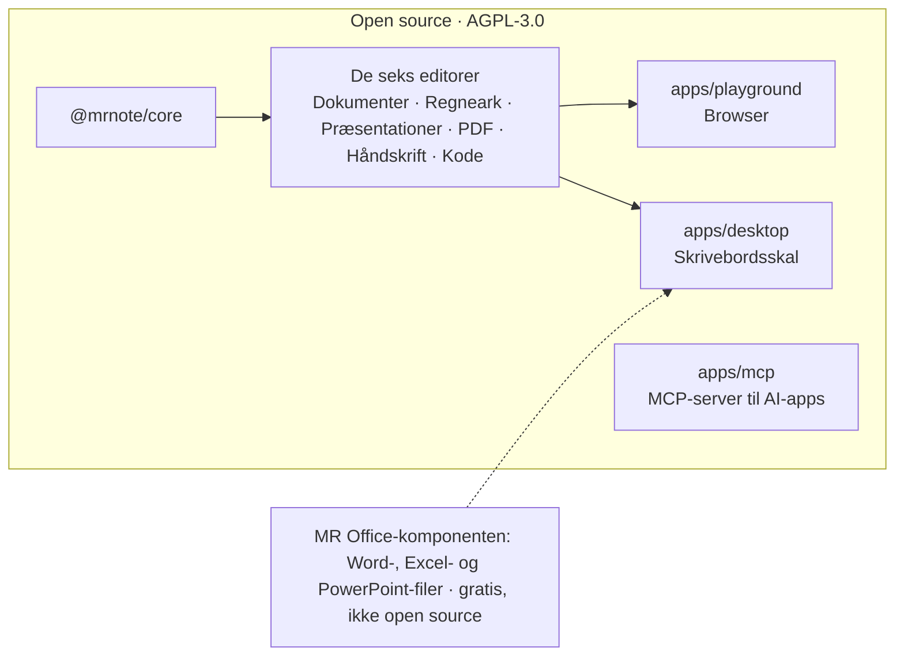

# MR Office — Dansk

<p align="center"><sub>🌐 <a href="../README.md">English</a> · <a href="../i18n/README.en-GB.md">English (UK)</a> · <a href="../i18n/README.zh.md">简体中文</a> · <a href="../i18n/README.zh-TW.md">繁體中文</a> · <a href="../i18n/README.ja.md">日本語</a> · <a href="../i18n/README.ko.md">한국어</a> · <a href="../i18n/README.de.md">Deutsch</a> · <a href="../i18n/README.fr.md">Français</a> · <a href="../i18n/README.es.md">Español</a> · <a href="../i18n/README.es-419.md">Español (Latinoamérica)</a> · <a href="../i18n/README.pt-BR.md">Português (Brasil)</a> · <a href="../i18n/README.it.md">Italiano</a> · <a href="../i18n/README.nl.md">Nederlands</a> · <a href="../i18n/README.sv.md">Svenska</a> · <a href="../i18n/README.da.md">Dansk</a> · <a href="../i18n/README.no.md">Norsk</a> · <a href="../i18n/README.fi.md">Suomi</a> · <a href="../i18n/README.id.md">Bahasa Indonesia</a> · <a href="../i18n/README.th.md">ไทย</a> · <a href="../i18n/README.vi.md">Tiếng Việt</a></sub></p>

<p align="center"><b>MR Offices open source-editorer – dokumenter, regneark, præsentationer, PDF, håndskrift og kode – i browseren.</b></p>

<p align="center"><a href="https://mroffice.ai/da"><b>▶ Prøv online</b></a> · <a href="https://mroffice.ai/da/office/download"><b>⬇ Download</b></a> · <a href="https://mroffice.ai">🌐 mroffice.ai</a><br><a href="https://mroffice.ai/da/developers">🧑‍💻 Udviklere</a> · <a href="https://mroffice.ai/da/developers/embed">🧩 Indlejr</a> · <a href="https://mroffice.ai/da/developers/mcp">🤖 MCP til AI-apps</a> · <a href="https://www.npmjs.com/package/mroffice-embed">📦 npm-SDK</a> · <a href="https://mroffice.ai/da/developers/oauth">🔑 Log ind med MR Office</a></p>

<p align="center"><a href="../LICENSE"></a> <a href="https://github.com/XinaTian/MROffice/releases"></a> <a href="https://github.com/XinaTian/MROffice/actions/workflows/ci.yml"></a> <a href="https://github.com/XinaTian/MROffice/stargazers"></a></p>

<p align="center"><a href="https://mroffice.ai/da"></a></p>

<p align="center"><a href="https://demo.mroffice.ai/media/mr-office-demo.mp4">🔊 Se den 50 sekunder lange rundvisning med lyd</a></p>

<table>
<tr>
<td align="center" width="50%"><a href="https://mroffice.ai/da"></a><br><b>Dokumenter</b></td>
<td align="center" width="50%"><a href="https://mroffice.ai/da"></a><br><b>Regneark</b></td>
</tr>
<tr>
<td align="center" width="50%"><a href="https://mroffice.ai/da"></a><br><b>Præsentationer</b></td>
<td align="center" width="50%"><a href="https://mroffice.ai/da"></a><br><b>PDF</b></td>
</tr>
<tr>
<td align="center" width="50%"><a href="https://mroffice.ai/da"></a><br><b>Håndskrift</b></td>
<td align="center" width="50%"><a href="https://mroffice.ai/da"></a><br><b>Kode</b></td>
</tr>
</table>

MR Office er et arbejdsområde til noter, AI og rigtige filer. Dette repository udgiver kildekoden til dets editorer: de samme editorer, som MR Office kører, og som du selv kan bygge, køre og indlejre. Det er open source-editorer, ikke en komplet open source-kontorpakke: læsning og skrivning af Microsoft Office-filer bliver i MR Office (se nedenfor).

## For udviklere

Alt for udviklere findes på **[MR Office Developers](https://mroffice.ai/da/developers)** — selvbetjening, ingen ansøgning: log ind med en hvilken som helst MR Office-konto og kom i gang.

### Indlejr editorerne i din webapp (anbefalet)

MR Office hoster editorerne; din server signerer et kortlivet sessionstoken, og din side åbner editoren med det. Den redigerer rigtige Word-, Excel-, PowerPoint- og PDF-filer (.docx, .xlsx, .pptx, .pdf) med fælles redigering, uploads, alle eksportformater, udskrivning og gemte filer, der sendes til din server i et signeret callback. Gratisplan: 1.000 sessioner om måneden på localhost, 100 på dine egne domæner, op til 2 apps. Det er en hostet kommerciel tjeneste, så din egen app er ikke bundet af dette depots AGPL-licens.

1. Kør `npx mroffice-embed init` i projektets mappe (eller opret en app i udviklerkonsollen): ét klik på "Tillad" i browseren, så skrives appens nøgler til `.env.local` / `.env`.
2. Din server laver et sessionstoken med `createSessionToken` fra `mroffice-embed/server`; den hemmelige nøgle forlader aldrig serveren.
3. Din side åbner editoren med `open()` fra `mroffice-embed` (eller scriptet `https://mroffice.ai/embed/v1/embed.js`).

```js
// server: GET /api/mroffice/session (check who is signed in first)
import { createSessionToken } from "mroffice-embed/server";
const token = await createSessionToken({
  appId: process.env.MROFFICE_APP_ID,
  secretKey: process.env.MROFFICE_SECRET_KEY, // mro_sk_..., server only
  file: { key: "contract-42", name: "contract.docx", url: signedUrlToTheFile },
  user: { id: user.id, name: user.name },
  mode: "edit",
});

// page
import { open } from "mroffice-embed";
open({ container: "#editor", token: () => fetch("/api/mroffice/session").then((r) => r.json()).then((b) => b.token) });
```

[Guide til indlejring](https://mroffice.ai/da/developers/embed) · [Guiden som Markdown (til AI-agenter)](https://mroffice.ai/developers/embed.md) · [Priser og grænser](https://mroffice.ai/da/developers/pricing) · [Udviklerkonsol](https://mroffice.ai/da/developers/console) · [Livedemo](https://mroffice.ai/da/developers/embed/demo)

### AI-apps: MCP-serveren

AI-apps åbner, læser, redigerer og eksporterer dokumenter i den rigtige MR Office-editor via dens MCP-server: forbind det hostede endpoint `https://mcp.mroffice.ai/mcp` (log ind med din MR Office-konto, ingen nøgle), eller kør `npx -y mroffice-mcp` på din egen computer. Kildekoden ligger i `apps/mcp`. [MCP-guide →](https://mroffice.ai/da/developers/mcp)

### Log ind med MR Office (OAuth)

MR Office er en OAuth 2.1-autorisationsserver (PKCE, metadatadokumenter for klient-id, dynamisk registrering): din app kan logge folk ind med deres MR Office-konto og handle med de rettigheder, de tillader. [OAuth-guide →](https://mroffice.ai/da/developers/oauth)

### Host selv open source-editorerne

De seks editorer i dette depot kan bygges ind i dit eget produkt under AGPL-3.0: hvis andre bruger en ændret version over et netværk, skal du tilbyde dem den fulde kildekode og bevare angivelsen "MR Office" (NOTICE.md). De åbner deres egne formater, CSV, HTML, Markdown og PDF; Word-, Excel- og PowerPoint-filer er ikke en del af open source-editorerne (den hostede indlejring ovenfor har dem). En kommerciel licens fås via support@mr-note.com. [Open source-guide →](https://mroffice.ai/da/developers/open-source)

Editorerne findes på npm som React-komponenter: `npm i mroffice-docs mroffice-core` (og `mroffice-sheets`, `mroffice-slides`, `mroffice-pdf`, `mroffice-ink`, `mroffice-code`); hver pakkes README viser, hvordan den indlejres.

## Editorerne

Hvad hver editor gør i dette repository:

- **Dokumenter** — et sideopdelt tekstbehandlingsprogram: typografier, skrifttyper, lister, tabeller, sidehoveder og sidefødder, sektioner og spalter, figurer og ligninger, forsider og indholdsfortegnelser, kommentarer og registrering af ændringer samt håndskrift på siden. Gemmer i eget format (.mrdoc); åbner HTML, Markdown og ren tekst.
- **Regneark** — celler og formler, talformater, betinget formatering, sortering og filtrering, frosne ruder og flere ark, med sum og gennemsnit af markeringen. Regning mellem celler (=A1*B1+10) beregnes i browseren, mens du skriver; formler med funktioner (SUM, HVIS, LOPSLAG …) bevares, som de er skrevet. Gemmer i eget format (.mrsheet); åbner og gemmer CSV og TSV.
- **Præsentationer** — dias med otte egne temaer, layout, diasmaster- og layoutvisning, tekst, figurer, tekstfelter, tabeller, WordArt og ligninger, kommentarer, sektioner, overgange og animationer med eksempel samt diasshow. Gemmer i eget format (.mrslides).
- **PDF** — læse, søge i, præsentere og udskrive PDF-filer, kopiere og læse teksten højt og markere valgt tekst (fremhævning, understregning, gennemstregning, bølgelinje) med noter og en kommentarrude, mens filen er åben; når du gemmer, gives filen tilbage, som den blev åbnet.
- **Håndskrift** — håndskrevne noter med trykfølsomme penne, overstregningstuscher, viskelædere, lasso og lineal, og håndskrift der bliver til figurer. Gemmer i eget format (.mrink).
- **Kode** — en let kodeeditor med syntaksfremhævning til mange sprog, en disposition samt søg og erstat; JavaScript/TypeScript, Python, SQL, Lua og shell kører direkte i browseren.

Beregning af formler med funktioner, tegning af diagrammer og opsætning af SmartArt klares af MR Offices egen motor i MR Offices skrivebordsapp: open source-editorerne bevarer en fils formler, diagrammer og SmartArt og viser SmartArt, som det blev gemt.

## Kør editorerne

**▶ [Prøv live-demoen – ingen installation](https://mroffice.ai/da)**

De seks editorer ligger i `packages/` (`@mrnote/docs`, `sheets`, `slides`, `pdf`, `ink`, `code`, som deler `@mrnote/core`) og kører sammen i `apps/playground`:

```bash
npm install
npm run fonts     # the open substitutes for Office's fonts
npm run build
npm run preview   # http://localhost:5178
```

`npm run dev` starter en udviklingsserver på samme adresse, og `npm run smoke` tjekker et build. Hver pakkes README beskriver i detaljer, hvad den gør, og hvordan den indlejres.

## Skrivebordsapp

[`apps/desktop`](../apps/desktop) indeholder **MR Office Editors**: kildekoden til MR Offices skrivebordsapps skal (Electron) med sin egen app-identitet. Med den gratis MR Office-komponent fra Releases er det MR Offices skrivebordsapp med Word-, Excel-, PowerPoint- og PDF-filer, login og AI. Uden komponenten kører kun editorerne med åben kildekode; de åbner .mrdoc-, .mrsheet-, .mrslides- og .mrink-filer samt CSV, HTML, Markdown og PDF. Skallen og editorerne er AGPL-kildekode; komponenten er kompileret, gratis at bruge og ikke open source. Efter `npm run build` starter du den med:

```bash
npm run desktop
```

## Få alle funktioner: installér MR Offices skrivebordsapp (gratis)

MR Offices skrivebordsapp er gratis, indeholder disse editorer og hele tjenesten og virker offline på din egen computer. Den tilføjer det, som open source-editorerne mangler:

- Åbne og gemme Word-, Excel- og PowerPoint-filer (.docx, .xlsx, .pptx)
- Beregne formler med funktioner (SUM, HVIS, LOPSLAG …)
- Diagrammer
- Redigering af SmartArt
- Gemme ændringer i en PDF tilbage i filen

**[Download MR Office (gratis) →](https://mroffice.ai/da/office/download)**

### Word-, Excel-, PowerPoint- og PDF-filer

At åbne og gemme Word-, Excel- og PowerPoint-filer (.docx, .xlsx, .pptx) og gemme ændringer i en PDF tilbage i filen klares af MR Offices gratis skrivebordsapp. Den indeholder alle disse editorer og virker offline på din egen computer:

## Sådan hænger delene sammen



## Licens

Open source under GNU Affero General Public License v3.0 (LICENSE) med de yderligere vilkår i NOTICE.md: bevar angivelsen "MR Office" og linket til https://mroffice.ai, og ingen rettigheder til navnet eller logoet MR Office. En kommerciel licens fås via support@mr-note.com. Software og data fra tredjeparter står i THIRD_PARTY_NOTICES.md. Bidrag: se CONTRIBUTING.md.

## Mere

Websted og hele produktet: **https://mroffice.ai** · Spørgsmål og feedback: support@mr-note.com

<p align="center">Hvis MR Office er nyttigt for dig, hjælper en ⭐ på GitHub andre med at finde det.</p>
