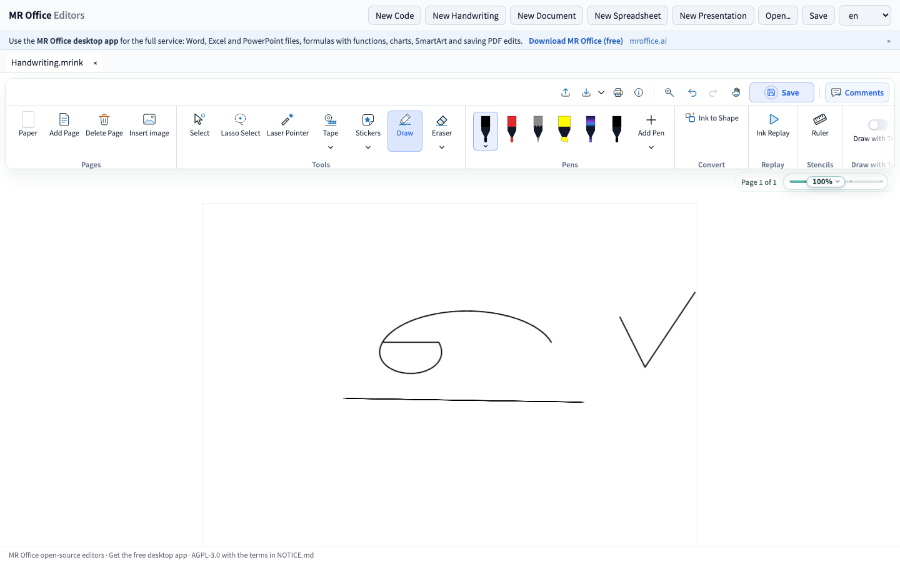
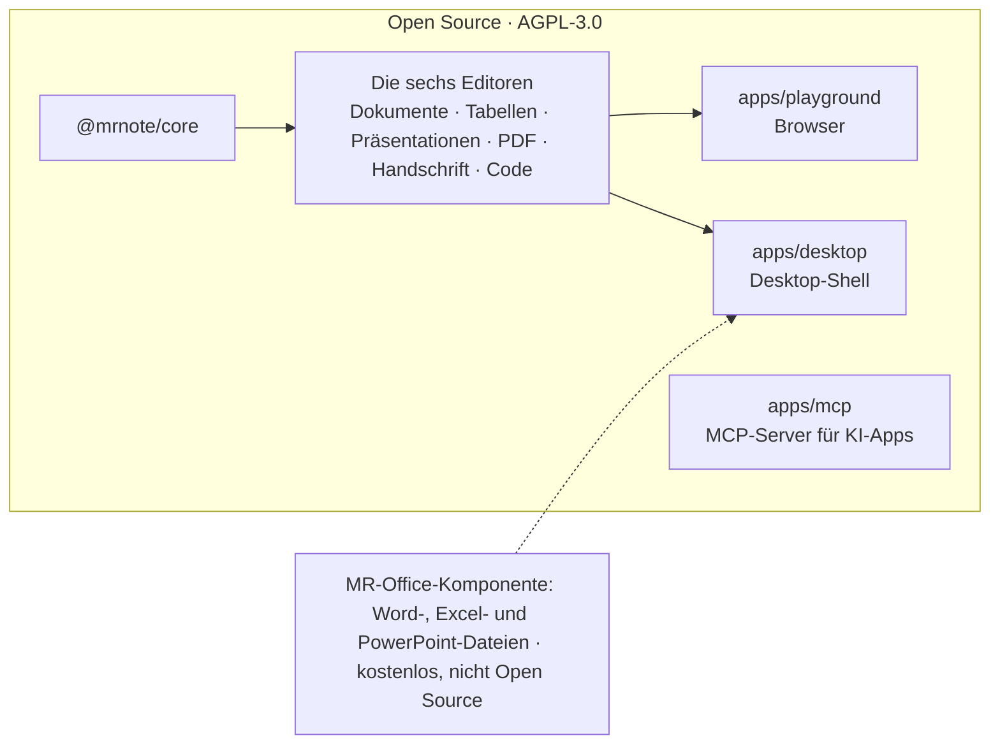

# MR Office — Deutsch

<p align="center"><sub>🌐 <a href="../README.md">English</a> · <a href="../i18n/README.en-GB.md">English (UK)</a> · <a href="../i18n/README.zh.md">简体中文</a> · <a href="../i18n/README.zh-TW.md">繁體中文</a> · <a href="../i18n/README.ja.md">日本語</a> · <a href="../i18n/README.ko.md">한국어</a> · <a href="../i18n/README.de.md">Deutsch</a> · <a href="../i18n/README.fr.md">Français</a> · <a href="../i18n/README.es.md">Español</a> · <a href="../i18n/README.es-419.md">Español (Latinoamérica)</a> · <a href="../i18n/README.pt-BR.md">Português (Brasil)</a> · <a href="../i18n/README.it.md">Italiano</a> · <a href="../i18n/README.nl.md">Nederlands</a> · <a href="../i18n/README.sv.md">Svenska</a> · <a href="../i18n/README.da.md">Dansk</a> · <a href="../i18n/README.no.md">Norsk</a> · <a href="../i18n/README.fi.md">Suomi</a> · <a href="../i18n/README.id.md">Bahasa Indonesia</a> · <a href="../i18n/README.th.md">ไทย</a> · <a href="../i18n/README.vi.md">Tiếng Việt</a></sub></p>

<p align="center"><b>Die Open-Source-Editoren von MR Office – Dokumente, Tabellen, Präsentationen, PDF, Handschrift und Code – im Browser.</b></p>

<p align="center"><a href="https://mroffice.ai/de"><b>▶ Online testen</b></a> · <a href="https://mroffice.ai/de/office/download"><b>⬇ Download</b></a> · <a href="https://mroffice.ai">🌐 mroffice.ai</a><br><a href="https://mroffice.ai/de/developers">🧑‍💻 Entwickler</a> · <a href="https://mroffice.ai/de/developers/embed">🧩 Einbetten</a> · <a href="https://mroffice.ai/de/developers/mcp">🤖 MCP für KI-Apps</a> · <a href="https://www.npmjs.com/package/mroffice-embed">📦 npm-SDK</a> · <a href="https://mroffice.ai/de/developers/oauth">🔑 Mit MR Office anmelden</a></p>

<p align="center"><a href="../LICENSE"></a> <a href="https://github.com/XinaTian/MROffice/releases"></a> <a href="https://github.com/XinaTian/MROffice/actions/workflows/ci.yml"></a> <a href="https://github.com/XinaTian/MROffice/stargazers"></a></p>

<p align="center"><a href="https://mroffice.ai/de"></a></p>

<p align="center"><a href="https://demo.mroffice.ai/media/mr-office-demo.mp4">🔊 Die 50-Sekunden-Tour mit Ton ansehen</a></p>

<table>
<tr>
<td align="center" width="50%"><a href="https://mroffice.ai/de"></a><br><b>Dokumente</b></td>
<td align="center" width="50%"><a href="https://mroffice.ai/de"></a><br><b>Tabellen</b></td>
</tr>
<tr>
<td align="center" width="50%"><a href="https://mroffice.ai/de"></a><br><b>Präsentationen</b></td>
<td align="center" width="50%"><a href="https://mroffice.ai/de"></a><br><b>PDF</b></td>
</tr>
<tr>
<td align="center" width="50%"><a href="https://mroffice.ai/de"></a><br><b>Handschrift</b></td>
<td align="center" width="50%"><a href="https://mroffice.ai/de"></a><br><b>Code</b></td>
</tr>
</table>

MR Office ist ein Arbeitsbereich für Notizen, KI und echte Dateien. Dieses Repository veröffentlicht den Quellcode seiner Editoren: dieselben Editoren, die in MR Office laufen, zum Selbstbauen, Ausführen und Einbetten. Es sind Open-Source-Editoren, keine vollständige Open-Source-Office-Suite: Das Lesen und Schreiben von Microsoft-Office-Dateien bleibt in MR Office (siehe unten).

## Für Entwickler

Alles für Entwickler finden Sie bei **[MR Office Developers](https://mroffice.ai/de/developers)** – Self-Service, ohne Antrag: mit einem beliebigen MR Office-Konto anmelden und loslegen.

### Die Editoren in Ihre Web-App einbetten (empfohlen)

MR Office hostet die Editoren; Ihr Server signiert ein kurzlebiges Sitzungstoken, und Ihre Seite öffnet damit den Editor. Er bearbeitet echte Word-, Excel-, PowerPoint- und PDF-Dateien (.docx, .xlsx, .pptx, .pdf), mit gemeinsamer Bearbeitung, Uploads, allen Exportformaten, Drucken und Speicherungen, die per signiertem Callback an Ihren Server gehen. Kostenloser Plan: 1.000 Sitzungen im Monat auf localhost, 100 auf Ihren eigenen Domains, bis zu 2 Apps. Es ist ein gehosteter kommerzieller Dienst, Ihre eigene App ist also nicht an die AGPL-Lizenz dieses Repositorys gebunden.

1. Führen Sie im Ordner Ihres Projekts `npx mroffice-embed init` aus (oder legen Sie eine App in der Entwicklerkonsole an): ein Klick auf „Erlauben“ im Browser, und die Schlüssel der App stehen in `.env.local` / `.env`.
2. Ihr Server erzeugt ein Sitzungstoken mit `createSessionToken` aus `mroffice-embed/server`; der geheime Schlüssel verlässt den Server nie.
3. Ihre Seite öffnet den Editor mit `open()` aus `mroffice-embed` (oder dem Skript `https://mroffice.ai/embed/v1/embed.js`).

```js
// server: GET /api/mroffice/session (check who is signed in first)
import { createSessionToken } from "mroffice-embed/server";
const token = await createSessionToken({
  appId: process.env.MROFFICE_APP_ID,
  secretKey: process.env.MROFFICE_SECRET_KEY, // mro_sk_..., server only
  file: { key: "contract-42", name: "contract.docx", url: signedUrlToTheFile },
  user: { id: user.id, name: user.name },
  mode: "edit",
});

// page
import { open } from "mroffice-embed";
open({ container: "#editor", token: () => fetch("/api/mroffice/session").then((r) => r.json()).then((b) => b.token) });
```

[Einbettungsleitfaden](https://mroffice.ai/de/developers/embed) · [Der Leitfaden als Markdown (für KI-Agenten)](https://mroffice.ai/developers/embed.md) · [Preise und Limits](https://mroffice.ai/de/developers/pricing) · [Entwicklerkonsole](https://mroffice.ai/de/developers/console) · [Live-Demo](https://mroffice.ai/de/developers/embed/demo)

### KI-Apps: der MCP-Server

KI-Apps öffnen, lesen, bearbeiten und exportieren Dokumente im echten MR Office-Editor über dessen MCP-Server: Verbinden Sie den gehosteten Endpunkt `https://mcp.mroffice.ai/mcp` (Anmeldung mit Ihrem MR Office-Konto, kein Schlüssel) oder führen Sie `npx -y mroffice-mcp` auf Ihrem Rechner aus. Der Quellcode liegt in `apps/mcp`. [MCP-Leitfaden →](https://mroffice.ai/de/developers/mcp)

### Mit MR Office anmelden (OAuth)

MR Office ist ein OAuth-2.1-Autorisierungsserver (PKCE, Client-ID-Metadatendokumente, dynamische Registrierung): Ihre App kann Personen mit ihrem MR Office-Konto anmelden und mit den erlaubten Scopes handeln. [OAuth-Leitfaden →](https://mroffice.ai/de/developers/oauth)

### Die Open-Source-Editoren selbst hosten

Die sechs Editoren dieses Repositorys können unter der AGPL-3.0 in Ihr eigenes Produkt eingebaut werden: Nutzen Personen eine geänderte Fassung über ein Netzwerk, müssen Sie ihnen den vollständigen Quellcode anbieten und den Hinweis „MR Office“ (NOTICE.md) beibehalten. Sie öffnen ihre eigenen Formate, CSV, HTML, Markdown und PDF; Word-, Excel- und PowerPoint-Dateien gehören nicht zu den Open-Source-Editoren (die gehostete Einbettung oben kann sie). Eine kommerzielle Lizenz erhalten Sie über support@mr-note.com. [Open-Source-Leitfaden →](https://mroffice.ai/de/developers/open-source)

npm-Pakete werden unter den Namen `mroffice-core`, `mroffice-docs`, `mroffice-sheets`, `mroffice-slides`, `mroffice-pdf`, `mroffice-ink` und `mroffice-code` vorbereitet; bis sie veröffentlicht sind, bauen Sie die Editoren aus diesem Repository (siehe unten).

## Die Editoren

Was jeder Editor in diesem Repository kann:

- **Dokumente** — eine seitenbasierte Textverarbeitung: Formatvorlagen, Schriften, Listen, Tabellen, Kopf- und Fußzeilen, Abschnitte und Spalten, Formen und Formeln, Deckblätter und Inhaltsverzeichnisse, Kommentare und Änderungsverfolgung sowie Freihand auf der Seite. Speichert im eigenen Format (.mrdoc); öffnet HTML, Markdown und Text.
- **Tabellen** — Zellen und Formeln, Zahlenformate, bedingte Formatierung, Sortieren und Filtern, fixierte Bereiche und mehrere Blätter, mit Summe und Mittelwert der Auswahl. Rechnen zwischen Zellen (=A1*B1+10) geschieht beim Tippen im Browser; Formeln mit Funktionen (SUMME, WENN, SVERWEIS …) bleiben, wie sie geschrieben sind. Speichert im eigenen Format (.mrsheet); öffnet und speichert CSV und TSV.
- **Präsentationen** — Folien mit acht eigenen Designs, Layouts, Folienmaster- und Layoutansicht, Text, Formen, Textfeldern, Tabellen, WordArt und Formeln, Kommentaren, Abschnitten, Übergängen und Animationen mit Vorschau sowie Bildschirmpräsentation. Speichert im eigenen Format (.mrslides).
- **PDF** — PDF-Dateien lesen, durchsuchen, präsentieren und drucken, Text kopieren und vorlesen lassen und markierten Text, solange die Datei geöffnet ist, hervorheben, unter-, durch- oder wellenförmig unterstreichen, mit Notizen und einem Kommentarbereich; Speichern gibt die Datei so zurück, wie sie geöffnet wurde.
- **Handschrift** — handschriftliche Notizen mit drucksensitiven Stiften, Textmarkern, Radierern, Lasso und Lineal; Freihand wird zu Formen. Speichert im eigenen Format (.mrink).
- **Code** — ein schlanker Code-Editor mit Syntaxhervorhebung für viele Sprachen, Gliederung sowie Suchen und Ersetzen; JavaScript/TypeScript, Python, SQL, Lua und Shell laufen direkt im Browser.

Formeln mit Funktionen berechnen, Diagramme zeichnen und SmartArt anordnen übernimmt die eigene Engine von MR Office in der MR Office Desktop-App: Die Open-Source-Editoren bewahren die Formeln, Diagramme und SmartArt einer Datei und zeigen SmartArt so an, wie es gespeichert wurde.

## Die Editoren ausführen

**▶ [Live-Demo ausprobieren – ohne Installation](https://mroffice.ai/de)**

Die sechs Editoren liegen in `packages/` (`@mrnote/docs`, `sheets`, `slides`, `pdf`, `ink`, `code`, gemeinsam `@mrnote/core`) und laufen zusammen in `apps/playground`:

```bash
npm install
npm run fonts     # the open substitutes for Office's fonts
npm run build
npm run preview   # http://localhost:5178
```

`npm run dev` startet einen Entwicklungsserver unter derselben Adresse, `npm run smoke` prüft einen Build. Die README jedes Pakets beschreibt im Einzelnen, was es kann und wie man es einbettet.

## Desktop-App

[`apps/desktop`](../apps/desktop) enthält **MR Office Editors**: den Quellcode der Hülle der MR-Office-Desktop-App (Electron) mit einer eigenen App-Identität. Mit der kostenlosen MR-Office-Komponente aus den Releases ist es die MR-Office-Desktop-App, mit Word-, Excel-, PowerPoint- und PDF-Dateien, Anmeldung und KI. Ohne die Komponente laufen nur die Open-Source-Editoren; sie öffnen .mrdoc-, .mrsheet-, .mrslides- und .mrink-Dateien sowie CSV, HTML, Markdown und PDF. Hülle und Editoren sind AGPL-Quellcode; die Komponente ist kompiliert, kostenlos nutzbar und nicht Open Source. Nach `npm run build` starten Sie sie mit:

```bash
npm run desktop
```

## Für den vollen Funktionsumfang: die MR Office Desktop-App installieren (kostenlos)

Die MR Office Desktop-App ist kostenlos, enthält diese Editoren und den vollen Dienst und funktioniert offline auf Ihrem eigenen Computer. Sie bietet, was den Open-Source-Editoren fehlt:

- Word-, Excel- und PowerPoint-Dateien (.docx, .xlsx, .pptx) öffnen und speichern
- Formeln mit Funktionen (SUMME, WENN, SVERWEIS …) berechnen
- Diagramme
- SmartArt bearbeiten
- PDF-Änderungen in die Datei zurückschreiben

**[MR Office herunterladen (kostenlos) →](https://mroffice.ai/de/office/download)**

### Word-, Excel-, PowerPoint- und PDF-Dateien

Word-, Excel- und PowerPoint-Dateien (.docx, .xlsx, .pptx) öffnen und speichern sowie PDF-Änderungen in die Datei zurückschreiben bietet die kostenlose MR Office Desktop-App. Sie enthält alle diese Editoren und funktioniert offline auf Ihrem eigenen Computer:

## Wie die Teile zusammenpassen



## Lizenz

Open Source unter der GNU Affero General Public License v3.0 (LICENSE) mit den zusätzlichen Bedingungen in NOTICE.md: Die Nennung „MR Office“ und der Link auf https://mroffice.ai bleiben erhalten, Rechte am Namen und Logo von MR Office werden nicht eingeräumt. Eine kommerzielle Lizenz ist über support@mr-note.com erhältlich. Software und Daten Dritter stehen in THIRD_PARTY_NOTICES.md. Beiträge: siehe CONTRIBUTING.md.

## Mehr

Website und das vollständige Produkt: **https://mroffice.ai** · Fragen und Feedback: support@mr-note.com

<p align="center">Wenn dir MR Office nützt, hilft ein ⭐ auf GitHub anderen, es zu finden.</p>
