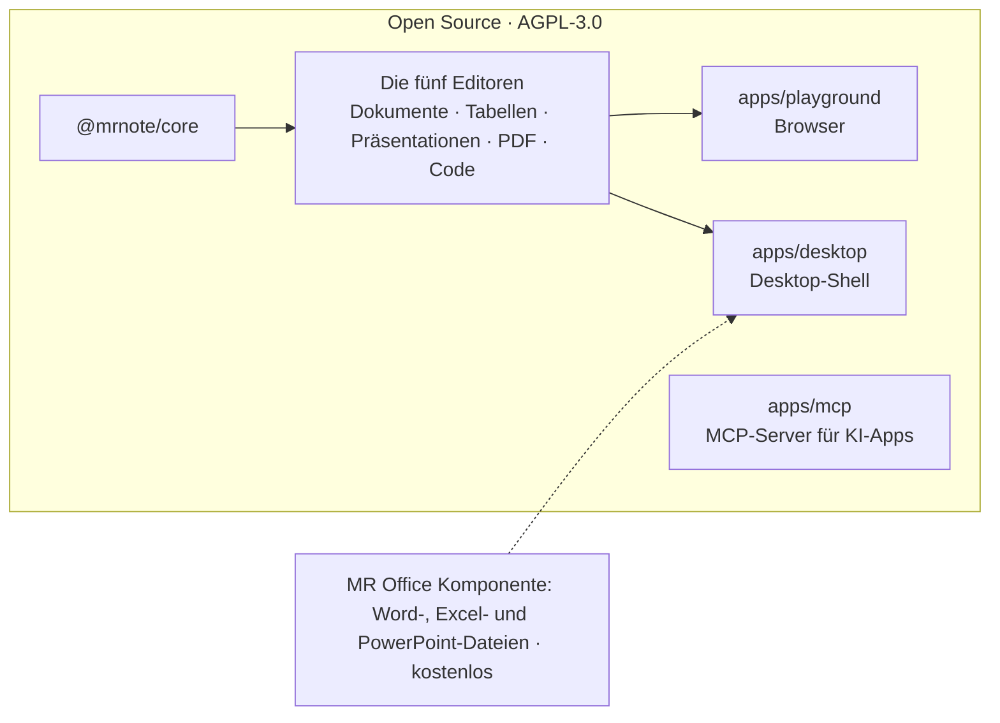

# MR Office — Deutsch

<p align="center"><sub>🌐 <a href="../README.md">English</a> · <a href="../i18n/README.en-GB.md">English (UK)</a> · <a href="../i18n/README.zh.md">简体中文</a> · <a href="../i18n/README.zh-TW.md">繁體中文</a> · <a href="../i18n/README.ja.md">日本語</a> · <a href="../i18n/README.ko.md">한국어</a> · <a href="../i18n/README.de.md">Deutsch</a> · <a href="../i18n/README.fr.md">Français</a> · <a href="../i18n/README.es.md">Español</a> · <a href="../i18n/README.es-419.md">Español (Latinoamérica)</a> · <a href="../i18n/README.pt-BR.md">Português (Brasil)</a> · <a href="../i18n/README.it.md">Italiano</a> · <a href="../i18n/README.nl.md">Nederlands</a> · <a href="../i18n/README.sv.md">Svenska</a> · <a href="../i18n/README.da.md">Dansk</a> · <a href="../i18n/README.no.md">Norsk</a> · <a href="../i18n/README.fi.md">Suomi</a> · <a href="../i18n/README.id.md">Bahasa Indonesia</a> · <a href="../i18n/README.th.md">ไทย</a> · <a href="../i18n/README.vi.md">Tiếng Việt</a></sub></p>

<p align="center"><b>Die Open-Source-Editoren von MR Office, dem Editor, der Microsoft Office am nächsten kommt — Dokumente, Tabellen, Präsentationen, PDF und Code — im Browser.</b></p>

<p align="center"><a href="https://mroffice.ai/de"><b>▶ Online testen</b></a> · <a href="https://mroffice.ai/de/office/download"><b>⬇ Download</b></a> · <a href="https://mroffice.ai">🌐 mroffice.ai</a><br><a href="https://mroffice.ai/de/developers">🧑‍💻 Entwickler</a> · <a href="https://mroffice.ai/de/developers/embed">🧩 Einbetten</a> · <a href="https://mroffice.ai/de/developers/mcp">🤖 MCP für KI-Apps</a> · <a href="https://www.npmjs.com/package/mroffice-embed">📦 npm-SDK</a> · <a href="https://mroffice.ai/de/developers/oauth">🔑 Mit MR Office anmelden</a></p>

<p align="center"><a href="../LICENSE"></a> <a href="https://github.com/XinaTian/MROffice/releases"></a> <a href="https://github.com/XinaTian/MROffice/actions/workflows/ci.yml"></a> <a href="https://github.com/XinaTian/MROffice/stargazers"></a></p>

<p align="center"><a href="https://mroffice.ai/de"></a></p>

<p align="center"><a href="https://demo.mroffice.ai/media/mr-office-demo.mp4">🔊 Die 50-Sekunden-Tour mit Ton ansehen</a></p>

<table>
<tr>
<td align="center" width="50%"><a href="https://mroffice.ai/de"></a><br><b>Dokumente</b></td>
<td align="center" width="50%"><a href="https://mroffice.ai/de"></a><br><b>Tabellen</b></td>
</tr>
<tr>
<td align="center" width="50%"><a href="https://mroffice.ai/de"></a><br><b>Präsentationen</b></td>
<td align="center" width="50%"><a href="https://mroffice.ai/de"></a><br><b>PDF</b></td>
</tr>
<tr>
<td align="center" width="50%"><a href="https://mroffice.ai/de"></a><br><b>Code</b></td>
</tr>
</table>

MR Office ist ein Arbeitsbereich für Notizen, KI und echte Dateien. Dieses Repository veröffentlicht den Quellcode der Editoren: dieselben Editoren, die MR Office ausführt, die du selbst bauen, ausführen und einbetten kannst. Zusammen mit der kostenlosen MR Office Desktop-App oder dem gehosteten Embed öffnen und speichern sie echte Word-, Excel- und PowerPoint-Dateien.

## Für Entwickler

Alles für Entwickler finden Sie bei **[MR Office Developers](https://mroffice.ai/de/developers)** – Self-Service, ohne Antrag: mit einem beliebigen MR Office-Konto anmelden und loslegen.

### Die Editoren in Ihre Web-App einbetten (empfohlen)

MR Office hostet die Editoren; dein Server signiert ein kurzlebiges Sitzungstoken und deine Seite öffnet den Editor. Er bearbeitet echte Word-, Excel-, PowerPoint- und PDF-Dateien (.docx, .xlsx, .pptx, .pdf), mit Co-Editing, Uploads, jedem Exportformat, Drucken und Speicherungen, die per signiertem Callback an deinen Server zurückgesendet werden. Kostenloser Plan: 1.000 Sitzungen pro Monat auf localhost, 100 auf deinen eigenen Domains, bis zu 2 Apps. Als gehosteter Dienst legt er deiner eigenen App keine AGPL-Pflichten auf.

1. Führen Sie im Ordner Ihres Projekts `npx mroffice-embed init` aus (oder legen Sie eine App in der Entwicklerkonsole an): ein Klick auf „Erlauben“ im Browser, und die Schlüssel der App stehen in `.env.local` / `.env`.
2. Ihr Server erzeugt ein Sitzungstoken mit `createSessionToken` aus `mroffice-embed/server`; der geheime Schlüssel verlässt den Server nie.
3. Ihre Seite öffnet den Editor mit `open()` aus `mroffice-embed` (oder dem Skript `https://mroffice.ai/embed/v1/embed.js`).

```js
// server: GET /api/mroffice/session (check who is signed in first)
import { createSessionToken } from "mroffice-embed/server";
const token = await createSessionToken({
  appId: process.env.MROFFICE_APP_ID,
  secretKey: process.env.MROFFICE_SECRET_KEY, // mro_sk_..., server only
  file: { key: "contract-42", name: "contract.docx", url: signedUrlToTheFile },
  user: { id: user.id, name: user.name },
  mode: "edit",
});

// page
import { open } from "mroffice-embed";
open({ container: "#editor", token: () => fetch("/api/mroffice/session").then((r) => r.json()).then((b) => b.token) });
```

[Einbettungsleitfaden](https://mroffice.ai/de/developers/embed) · [Der Leitfaden als Markdown (für KI-Agenten)](https://mroffice.ai/developers/embed.md) · [Preise und Limits](https://mroffice.ai/de/developers/pricing) · [Entwicklerkonsole](https://mroffice.ai/de/developers/console) · [Live-Demo](https://mroffice.ai/de/developers/embed/demo)

### KI-Apps: der MCP-Server

KI-Apps öffnen, lesen, bearbeiten und exportieren Dokumente im echten MR Office-Editor über dessen MCP-Server: Verbinden Sie den gehosteten Endpunkt `https://mcp.mroffice.ai/mcp` (Anmeldung mit Ihrem MR Office-Konto, kein Schlüssel) oder führen Sie `npx -y mroffice-mcp` auf Ihrem Rechner aus. Der Quellcode liegt in `apps/mcp`. [MCP-Leitfaden →](https://mroffice.ai/de/developers/mcp)

### Mit MR Office anmelden (OAuth)

MR Office ist ein OAuth-2.1-Autorisierungsserver (PKCE, Client-ID-Metadatendokumente, dynamische Registrierung): Ihre App kann Personen mit ihrem MR Office-Konto anmelden und mit den erlaubten Scopes handeln. [OAuth-Leitfaden →](https://mroffice.ai/de/developers/oauth)

### Die Open-Source-Editoren selbst hosten

Die fünf Editoren in diesem Repository lassen sich unter der AGPL-3.0 in ein eigenes Produkt einbauen: Wenn Personen eine veränderte Version über ein Netzwerk nutzen, musst du ihnen den vollständigen Quellcode anbieten und die Nennung „MR Office“ beibehalten (NOTICE.md). Sie öffnen ihre eigenen Formate, CSV, HTML, Markdown und PDF; für Word-, Excel- und PowerPoint-Dateien nutze das gehostete Embed oben. Eine kommerzielle Lizenz ist unter support@mr-note.com erhältlich. [Open-Source-Leitfaden →](https://mroffice.ai/de/developers/open-source)

Die Editoren sind als React-Komponenten auf npm verfügbar: `npm i mroffice-docs mroffice-core` (sowie `mroffice-sheets`, `mroffice-slides`, `mroffice-pdf`, `mroffice-code`); die README jedes Pakets zeigt, wie man es einbettet.

## Die Editoren

Was jeder Editor in diesem Repository kann:

- **Dokumente** — eine seitenbasierte Textverarbeitung: Schriftarten, Absatzformatierung, Listen und Formatvorlagen unter Start; Deckblatt und leere Seiten, Seitenumbrüche, Tabellen, Bilder, Formen, SmartArt, Diagramme, Links, Lesezeichen, Kommentare, Kopf- und Fußzeilen und Seitenzahlen, Gleichungen, Symbole, Textfelder und WordArt unter Einfügen. Speichert das eigene Format (.mrdoc); öffnet HTML, Markdown und reinen Text.
- **Tabellen** — Zellen und Formeln mit Schriftarten, Ausrichtung, Zahlenformaten, bedingter Formatierung, Zellformatvorlagen sowie Einfügen oder Löschen von Zellen unter Start; Tabellen, Bilder, Formen, Symbole, Kontrollkästchen, Diagramme und Sparklines unter Einfügen; mehrere Tabellenblätter, mit Summen und Mittelwerten der Auswahl. Arithmetik zwischen Zellen (=A1*B1+10) wird beim Tippen im Browser berechnet; Formeln mit Funktionen (SUMME, WENN, SVERWEIS …) bleiben wie geschrieben erhalten. Speichert das eigene Format (.mrsheet); öffnet und speichert CSV und TSV.
- **Präsentationen** — Folien mit Layouts und Abschnitten, Text, Schriftarten und Absätzen sowie Formen mit ihrer Anordnung unter Start; Tabellen, Bilder, Symbole, SmartArt, Diagramme, Textfelder, WordArt, Kopf- und Fußzeilen, Gleichungen, Symbole und Video unter Einfügen; Notizen, Kommentare und Präsentieren. Speichert das eigene Format (.mrslides).
- **PDF** — PDF-Dateien lesen, präsentieren und drucken: Einzel- und Doppelseitenansicht, fortlaufendes Scrollen, Drehen, Miniaturansichten und Lesemodus, Suchen und Kopieren des Textes sowie Kommentare, solange eine Datei geöffnet ist; beim Speichern wird die Datei so zurückgegeben, wie sie geöffnet wurde.
- **Code** — ein schlanker Code-Editor mit Syntaxhervorhebung für viele Sprachen, einer Gliederung, Suchen, Schnellöffnen, einem Datei-Explorer und einer Problemliste.

Formeln mit Funktionen, Diagramme und SmartArt werden von der Engine von MR Office berechnet und gezeichnet, in der kostenlosen Desktop-App und im gehosteten Dienst; die Editoren hier bewahren jede Formel, jedes Diagramm und jedes SmartArt einer Datei und zeigen SmartArt so an, wie es gespeichert wurde.

## Die Editoren ausführen

**▶ [Live-Demo ausprobieren – ohne Installation](https://mroffice.ai/de)**

Die fünf Editoren liegen in `packages/` (`@mrnote/docs`, `sheets`, `slides`, `pdf`, `code`, gemeinsam genutzt wird `@mrnote/core`) und laufen zusammen in `apps/playground`:

```bash
npm install
npm run fonts     # the open substitutes for Office's fonts
npm run build
npm run preview   # http://localhost:5178
```

`npm run dev` startet einen Entwicklungsserver unter derselben Adresse, `npm run smoke` prüft einen Build. Die README jedes Pakets beschreibt im Einzelnen, was es kann und wie man es einbettet.

## Desktop-App

[`apps/desktop`](../apps/desktop) enthält **MR Office Editors**: den Quellcode der Shell der MR Office Desktop-App (Electron), unter eigener Identität. Mit der kostenlosen MR Office-Komponente aus Releases ist es die MR Office Desktop-App, mit Word-, Excel-, PowerPoint- und PDF-Dateien, Anmeldung und KI. Ohne die Komponente laufen die Open-Source-Editoren eigenständig und öffnen .mrdoc-, .mrsheet- und .mrslides-Dateien, CSV, HTML, Markdown und PDF. Die Shell und die Editoren sind AGPL-Quellcode; die Komponente ist ein kostenloser Download aus Releases. Nach `npm run build` startest du sie mit:

```bash
npm run desktop
```

## Für den vollen Funktionsumfang: die MR Office Desktop-App installieren (kostenlos)

Die MR Office Desktop-App ist kostenlos, enthält diese Editoren und den vollen Dienst und funktioniert offline auf deinem eigenen Computer. Zusätzlich zu den Editoren bietet sie:

- Word-, Excel- und PowerPoint-Dateien (.docx, .xlsx, .pptx) öffnen und speichern
- Formeln mit Funktionen (SUMME, WENN, SVERWEIS …) berechnen
- Diagramme
- SmartArt bearbeiten
- PDF-Änderungen in die Datei zurückschreiben

**[MR Office herunterladen (kostenlos) →](https://mroffice.ai/de/office/download)**

### Word-, Excel-, PowerPoint- und PDF-Dateien

Arbeite mit echten Word-, Excel- und PowerPoint-Dateien (.docx, .xlsx, .pptx) und speichere PDF-Bearbeitungen direkt in der Datei mit der kostenlosen MR Office Desktop-App, die all diese Editoren enthält und offline auf deinem eigenen Computer funktioniert:

## Wie die Teile zusammenpassen



## Lizenz

Open Source unter der GNU Affero General Public License v3.0 (LICENSE) mit den zusätzlichen Bedingungen in NOTICE.md: Die Nennung „MR Office“ und der Link auf https://mroffice.ai bleiben erhalten, Rechte am Namen und Logo von MR Office werden nicht eingeräumt. Eine kommerzielle Lizenz ist über support@mr-note.com erhältlich. Software und Daten Dritter stehen in THIRD_PARTY_NOTICES.md. Beiträge: siehe CONTRIBUTING.md.

## Mehr

Website und das vollständige Produkt: **https://mroffice.ai** · Fragen und Feedback: support@mr-note.com

<p align="center">Wenn dir MR Office nützt, hilft ein ⭐ auf GitHub anderen, es zu finden.</p>
