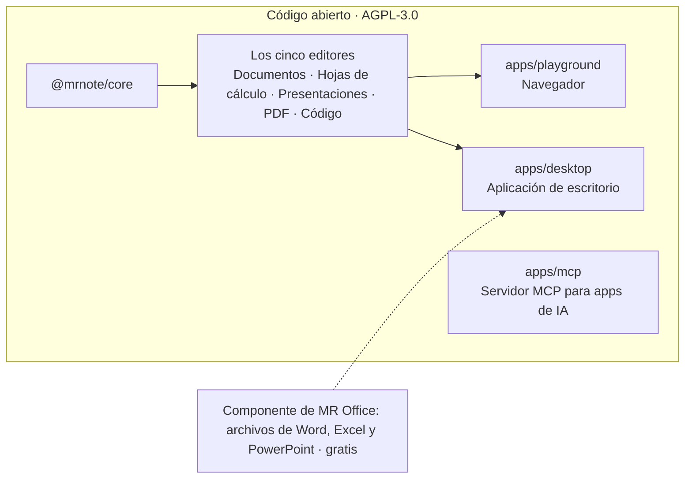

# MR Office — Español (Latinoamérica)

<p align="center"><sub>🌐 <a href="../README.md">English</a> · <a href="../i18n/README.en-GB.md">English (UK)</a> · <a href="../i18n/README.zh.md">简体中文</a> · <a href="../i18n/README.zh-TW.md">繁體中文</a> · <a href="../i18n/README.ja.md">日本語</a> · <a href="../i18n/README.ko.md">한국어</a> · <a href="../i18n/README.de.md">Deutsch</a> · <a href="../i18n/README.fr.md">Français</a> · <a href="../i18n/README.es.md">Español</a> · <a href="../i18n/README.es-419.md">Español (Latinoamérica)</a> · <a href="../i18n/README.pt-BR.md">Português (Brasil)</a> · <a href="../i18n/README.it.md">Italiano</a> · <a href="../i18n/README.nl.md">Nederlands</a> · <a href="../i18n/README.sv.md">Svenska</a> · <a href="../i18n/README.da.md">Dansk</a> · <a href="../i18n/README.no.md">Norsk</a> · <a href="../i18n/README.fi.md">Suomi</a> · <a href="../i18n/README.id.md">Bahasa Indonesia</a> · <a href="../i18n/README.th.md">ไทย</a> · <a href="../i18n/README.vi.md">Tiếng Việt</a></sub></p>

<p align="center"><b>Los editores de código abierto de MR Office, la suite ofimática con IA más cercana a Microsoft Office: documentos, hojas de cálculo, presentaciones, PDF y código en el navegador, y una IA que edita contigo archivos reales de Word, Excel y PowerPoint.</b></p>

<p align="center"><a href="https://mroffice.ai/es-419"><b>▶ Probar en línea</b></a> · <a href="https://mroffice.ai/es-419/office/download"><b>⬇ Descargar</b></a> · <a href="https://mroffice.ai">🌐 mroffice.ai</a><br><a href="https://mroffice.ai/es-419/developers">🧑‍💻 Desarrolladores</a> · <a href="https://mroffice.ai/es-419/developers/embed">🧩 Insertar</a> · <a href="https://mroffice.ai/es-419/developers/mcp">🤖 MCP para apps de IA</a> · <a href="https://www.npmjs.com/package/mroffice-embed">📦 SDK de npm</a> · <a href="https://mroffice.ai/es-419/developers/oauth">🔑 Iniciar sesión con MR Office</a></p>

<p align="center"><a href="../LICENSE"></a> <a href="https://github.com/XinaTian/MROffice/releases"></a> <a href="https://github.com/XinaTian/MROffice/actions/workflows/ci.yml"></a> <a href="https://github.com/XinaTian/MROffice/stargazers"></a></p>

<p align="center"><a href="https://mroffice.ai/es-419"></a></p>

<p align="center"><a href="https://demo.mroffice.ai/media/mr-office-demo.mp4">🔊 Ver el recorrido de 50 segundos con sonido</a></p>

<table>
<tr>
<td align="center" width="50%"><a href="https://mroffice.ai/es-419"></a><br><b>Documentos</b></td>
<td align="center" width="50%"><a href="https://mroffice.ai/es-419"></a><br><b>Hojas de cálculo</b></td>
</tr>
<tr>
<td align="center" width="50%"><a href="https://mroffice.ai/es-419"></a><br><b>Presentaciones</b></td>
<td align="center" width="50%"><a href="https://mroffice.ai/es-419"></a><br><b>PDF</b></td>
</tr>
<tr>
<td align="center" width="50%"><a href="https://mroffice.ai/es-419"></a><br><b>Código</b></td>
</tr>
</table>

MR Office es una suite ofimática con IA para archivos reales: Word, Excel, PowerPoint y PDF, en la web y en una app de escritorio gratuita, con una IA junto a cada documento y coedición en vivo. Este repositorio publica el código fuente de sus editores: los mismos editores que ejecuta MR Office, que puedes compilar, ejecutar e integrar por tu cuenta.

## Una IA que trabaja dentro de tus archivos

En MR Office la IA trabaja sobre el documento mismo, no sobre texto pegado en un chat. Lee el archivo, hace el cambio en los objetos propios del archivo y te muestra qué tocó antes de que lo conserves.

- **Copilot en cada editor** — documentos, hojas de cálculo, presentaciones, PDF y código. Selecciona o rodea lo que quieres decir y di qué necesitas: edita párrafos, tablas, celdas y fórmulas, formas y diapositivas en su sitio, pregunta cuando la petición no está clara, previsualiza el cambio antes de aplicarlo y cada cambio se puede deshacer.
- **Cambios que revisas** — lo que propone la IA se aplica solo cuando lo confirmas; si el archivo cambió mientras tanto, la propuesta queda anulada y no se sobrescribe nada de lo que escribiste.
- **Una ventana de IA que conoce tu espacio de trabajo** — pregunta por tus archivos, notas y lienzo y obtén respuestas que citan sus fuentes; redacta nuevos documentos, hojas y presentaciones, y crea una pequeña herramienta en el lienzo cuando la necesites.
- **Memoria** — un grafo de memoria conserva las personas, los proyectos y las decisiones que importan, para que la IA no empiece de cero en cada conversación.
- **Modelos líderes** — elige el modelo para cada conversación entre los principales modelos de IA actuales; tus archivos se quedan en tu espacio de trabajo, o en tu propio equipo con la app de escritorio.

**[Prueba la IA en MR Office, gratis →](https://mroffice.ai/es-419)**

### Deja que tu agente de IA edite archivos de Office (MCP)

Claude, ChatGPT, Cursor, Codex, VS Code y cualquier otro cliente MCP pueden crear, abrir, editar, releer, ilustrar y exportar documentos y hojas de cálculo mediante el servidor MCP de MR Office (`create_document`, `open_document`, `update_document`, `get_document`, `render_page`, `export_document` a docx, xlsx, pptx, pdf, md, html o csv). En las apps que muestran MCP Apps el editor aparece directamente en la conversación; en las demás, las herramientas responden con un enlace al mismo editor y una imagen de la página. Tú y la IA editáis el mismo documento: el asistente relee tus cambios antes de continuar, y una actualización hecha sobre ediciones que no ha visto se rechaza en lugar de perderse.

```bash
# Claude Code
claude mcp add mroffice -- npx -y mroffice-mcp
# Codex
codex mcp add mroffice -- npx -y mroffice-mcp
```

Claude Desktop, Cursor y otras apps que aceptan una configuración JSON:

```json
{ "mcpServers": { "mroffice": { "command": "npx", "args": ["-y", "mroffice-mcp"] } } }
```

Sin instalación: conecta el endpoint alojado `https://mcp.mroffice.ai/mcp` e inicia sesión con tu cuenta de MR Office. Los archivos de Word, Excel y PowerPoint pasan por el motor de Office de MR Office como tu propia cuenta; el código fuente del servidor MCP está en `apps/mcp`. [Guía de MCP →](https://mroffice.ai/es-419/developers/mcp)

## Para desarrolladores

Todo lo que necesitan los desarrolladores está en **[MR Office Developers](https://mroffice.ai/es-419/developers)**: autoservicio, sin solicitud. Inicia sesión con cualquier cuenta de MR Office y empieza.

### Insertar los editores en tu aplicación web (recomendado)

MR Office aloja los editores; tu servidor firma un token de sesión de corta duración y tu página abre el editor. Edita archivos reales de Word, Excel, PowerPoint y PDF (.docx, .xlsx, .pptx, .pdf), con coedición, cargas, todos los formatos de exportación, impresión y guardados enviados de vuelta a tu servidor en un callback firmado. Plan gratuito: 1,000 sesiones al mes en localhost, 100 en tus propios dominios, hasta 2 apps. Como servicio alojado, no impone obligaciones AGPL a tu propia app.

1. En la carpeta de tu proyecto ejecuta `npx mroffice-embed init` (o crea una aplicación en la consola para desarrolladores): un clic en «Permitir» en el navegador y las claves de la aplicación quedan en `.env.local` / `.env`.
2. Tu servidor crea un token de sesión con `createSessionToken` de `mroffice-embed/server`; la clave secreta nunca sale del servidor.
3. Tu página abre el editor con `open()` de `mroffice-embed` (o el script `https://mroffice.ai/embed/v1/embed.js`).

```js
// server: GET /api/mroffice/session (check who is signed in first)
import { createSessionToken } from "mroffice-embed/server";
const token = await createSessionToken({
  appId: process.env.MROFFICE_APP_ID,
  secretKey: process.env.MROFFICE_SECRET_KEY, // mro_sk_..., server only
  file: { key: "contract-42", name: "contract.docx", url: signedUrlToTheFile },
  user: { id: user.id, name: user.name },
  mode: "edit",
});

// page
import { open } from "mroffice-embed";
open({ container: "#editor", token: () => fetch("/api/mroffice/session").then((r) => r.json()).then((b) => b.token) });
```

[Guía de inserción](https://mroffice.ai/es-419/developers/embed) · [La guía en Markdown (para agentes de IA)](https://mroffice.ai/developers/embed.md) · [Precios y límites](https://mroffice.ai/es-419/developers/pricing) · [Consola para desarrolladores](https://mroffice.ai/es-419/developers/console) · [Demo en vivo](https://mroffice.ai/es-419/developers/embed/demo)

### Aplicaciones de IA: el servidor MCP

El servidor MCP anterior es también la forma en que tus propias funciones de IA pueden abrir, leer, editar y exportar documentos en el editor real de MR Office: el endpoint alojado `https://mcp.mroffice.ai/mcp` (inicio de sesión OAuth, sin clave) o `npx -y mroffice-mcp` en tu propio equipo. [Guía de MCP →](https://mroffice.ai/es-419/developers/mcp)

### Iniciar sesión con MR Office (OAuth)

MR Office es un servidor de autorización OAuth 2.1 (PKCE, documentos de metadatos de ID de cliente, registro dinámico): tu aplicación puede iniciar la sesión de las personas con su cuenta de MR Office y actuar con los permisos que autoricen. [Guía de OAuth →](https://mroffice.ai/es-419/developers/oauth)

### Alojar tú mismo los editores de código abierto

Los cinco editores de este repositorio se pueden integrar en tu propio producto bajo la AGPL-3.0: si las personas usan una versión modificada a través de una red, debes ofrecerles su código fuente completo y mantener la atribución de "MR Office" (NOTICE.md). Abren sus propios formatos, CSV, HTML, Markdown y PDF; para archivos de Word, Excel y PowerPoint, usa el embed alojado de arriba. Hay una licencia comercial disponible en support@mr-note.com. [Guía de código abierto →](https://mroffice.ai/es-419/developers/open-source)

Los editores están en npm como componentes de React: `npm i mroffice-docs mroffice-core` (y `mroffice-sheets`, `mroffice-slides`, `mroffice-pdf`, `mroffice-code`); el README de cada paquete muestra cómo integrarlo.

## Los editores

Lo que hace cada editor en este repositorio:

- **Documentos** — un procesador de textos paginado: fuentes, formato de párrafo, listas y estilos en Inicio; portadas y páginas en blanco, saltos de página, tablas, imágenes, formas, SmartArt, gráficos, vínculos, marcadores, comentarios, encabezados, pies de página y números de página, ecuaciones, símbolos, cuadros de texto y WordArt en Insertar. Guarda su propio formato (.mrdoc); abre HTML, Markdown y texto sin formato.
- **Hojas de cálculo** — celdas y fórmulas con fuentes, alineación, formatos de número, formato condicional, estilos de celda e inserción o eliminación de celdas en Inicio; tablas, imágenes, formas, iconos, casillas de verificación, gráficos y minigráficos en Insertar; varias hojas, con sumas y promedios de la selección. La aritmética entre celdas (=A1*B1+10) se calcula en el navegador mientras escribes; las fórmulas con funciones (SUM, IF, VLOOKUP …) se conservan tal como se escriben. Guarda su propio formato (.mrsheet); abre y guarda CSV y TSV.
- **Presentaciones** — diapositivas con diseños y secciones, texto, fuentes y párrafos, y formas con su disposición en Inicio; tablas, imágenes, iconos, SmartArt, gráficos, cuadros de texto, WordArt, encabezados y pies de página, ecuaciones, símbolos y video en Insertar; notas del orador, comentarios y presentación. Guarda su propio formato (.mrslides).
- **PDF** — lee, presenta e imprime archivos PDF: vistas de una y dos páginas, desplazamiento continuo, rotación, miniaturas y modo de lectura, búsqueda y copia de su texto, y comentarios mientras un archivo está abierto; al guardar, devuelve el archivo tal como se abrió.
- **Código** — un editor de código ligero con resaltado de sintaxis para muchos lenguajes, un esquema, búsqueda, apertura rápida, un explorador de archivos y una lista de problemas.

Las fórmulas con funciones, los gráficos y SmartArt se calculan y dibujan con el motor de MR Office, en la app de escritorio gratuita y en el servicio alojado; los editores de aquí conservan cada fórmula, gráfico y SmartArt que contiene un archivo, y muestran SmartArt tal como se guardó.

## Ejecutar los editores

**▶ [Prueba la demo en línea, sin instalar nada](https://mroffice.ai/es-419)**

Los cinco editores están en `packages/` (`@mrnote/docs`, `sheets`, `slides`, `pdf`, `code`, compartiendo `@mrnote/core`) y se ejecutan juntos en `apps/playground`:

```bash
npm install
npm run fonts     # the open substitutes for Office's fonts
npm run build
npm run preview   # http://localhost:5178
```

`npm run dev` inicia un servidor de desarrollo en la misma dirección y `npm run smoke` comprueba una compilación. El README de cada paquete detalla lo que hace y cómo integrarlo.

## Aplicación de escritorio

[`apps/desktop`](../apps/desktop) contiene **MR Office Editors**: el código fuente del shell de la aplicación de escritorio de MR Office (Electron), bajo una identidad propia. Con el componente gratuito de MR Office de Releases, es la aplicación de escritorio de MR Office, con archivos de Word, Excel, PowerPoint y PDF, inicio de sesión e IA. Sin el componente, ejecuta los editores de código abierto por sí solos, que abren archivos .mrdoc, .mrsheet y .mrslides, CSV, HTML, Markdown y PDF. El shell y los editores son código fuente AGPL; el componente es una descarga gratuita desde Releases. Después de `npm run build`, inícialo con:

```bash
npm run desktop
```

## Para todas las funciones, instala la aplicación de escritorio de MR Office (gratis)

La app de escritorio de MR Office es gratuita, incluye estos editores y el servicio completo, y funciona sin conexión en tu propia computadora. Además de los editores, agrega:

- Abrir y guardar archivos de Word, Excel y PowerPoint (.docx, .xlsx, .pptx)
- Calcular fórmulas con funciones (SUMA, SI, BUSCARV …)
- Gráficos
- Edición de SmartArt
- Guardar en el archivo los cambios hechos en un PDF

**[Descargar MR Office (gratis) →](https://mroffice.ai/es-419/office/download)**

## Cómo encajan las piezas



## Licencia

Código abierto bajo la GNU Affero General Public License v3.0 (LICENSE), con los términos adicionales de NOTICE.md: conservar la atribución «MR Office» y el enlace a https://mroffice.ai, sin derechos sobre el nombre ni el logotipo de MR Office. Hay una licencia comercial disponible en support@mr-note.com. El software y los datos de terceros figuran en THIRD_PARTY_NOTICES.md. Contribuciones: consulta CONTRIBUTING.md.

## Más

Sitio web y el producto completo: **https://mroffice.ai** · Preguntas y comentarios: support@mr-note.com

<p align="center">Si MR Office te resulta útil, una ⭐ en GitHub ayuda a que otras personas lo encuentren.</p>
