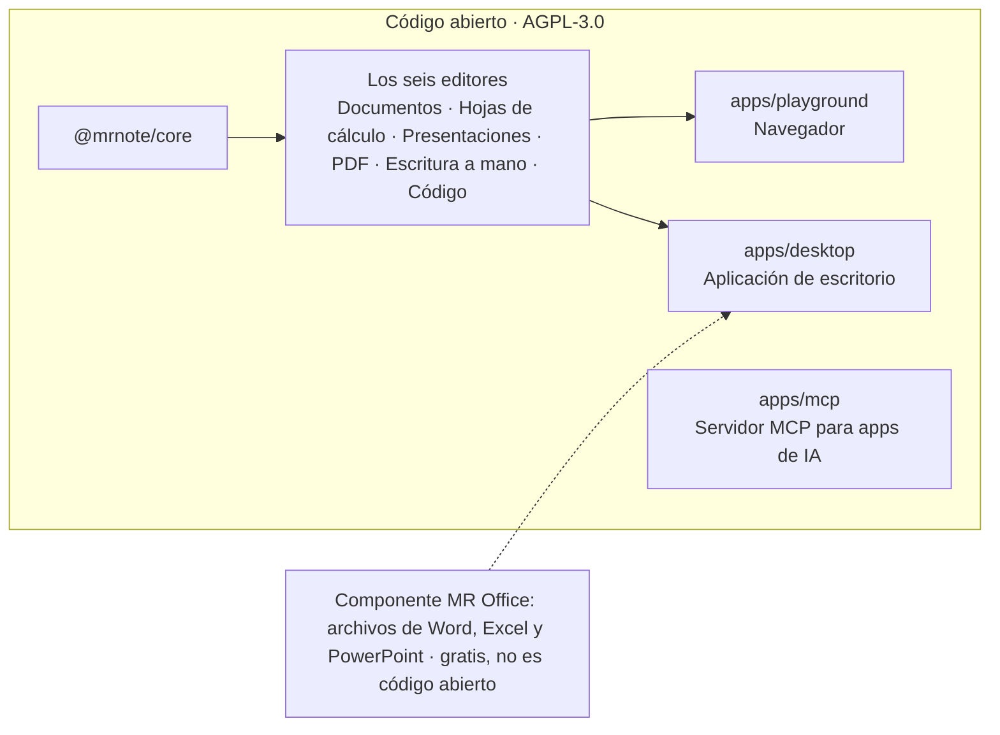

# MR Office — Español

<p align="center"><sub>🌐 <a href="../README.md">English</a> · <a href="../i18n/README.en-GB.md">English (UK)</a> · <a href="../i18n/README.zh.md">简体中文</a> · <a href="../i18n/README.zh-TW.md">繁體中文</a> · <a href="../i18n/README.ja.md">日本語</a> · <a href="../i18n/README.ko.md">한국어</a> · <a href="../i18n/README.de.md">Deutsch</a> · <a href="../i18n/README.fr.md">Français</a> · <a href="../i18n/README.es.md">Español</a> · <a href="../i18n/README.es-419.md">Español (Latinoamérica)</a> · <a href="../i18n/README.pt-BR.md">Português (Brasil)</a> · <a href="../i18n/README.it.md">Italiano</a> · <a href="../i18n/README.nl.md">Nederlands</a> · <a href="../i18n/README.sv.md">Svenska</a> · <a href="../i18n/README.da.md">Dansk</a> · <a href="../i18n/README.no.md">Norsk</a> · <a href="../i18n/README.fi.md">Suomi</a> · <a href="../i18n/README.id.md">Bahasa Indonesia</a> · <a href="../i18n/README.th.md">ไทย</a> · <a href="../i18n/README.vi.md">Tiếng Việt</a></sub></p>

<p align="center"><b>Los editores de código abierto de MR Office (documentos, hojas de cálculo, presentaciones, PDF, escritura a mano y código) en el navegador.</b></p>

<p align="center"><a href="https://mroffice.ai/es"><b>▶ Probar en línea</b></a> · <a href="https://mroffice.ai/es/office/download"><b>⬇ Descargar</b></a> · <a href="https://mroffice.ai">🌐 mroffice.ai</a><br><a href="https://mroffice.ai/es/developers">🧑‍💻 Desarrolladores</a> · <a href="https://mroffice.ai/es/developers/embed">🧩 Insertar</a> · <a href="https://mroffice.ai/es/developers/mcp">🤖 MCP para apps de IA</a> · <a href="https://www.npmjs.com/package/mroffice-embed">📦 SDK de npm</a> · <a href="https://mroffice.ai/es/developers/oauth">🔑 Iniciar sesión con MR Office</a></p>

<p align="center"><a href="../LICENSE"></a> <a href="https://github.com/XinaTian/MROffice/releases"></a> <a href="https://github.com/XinaTian/MROffice/actions/workflows/ci.yml"></a> <a href="https://github.com/XinaTian/MROffice/stargazers"></a></p>

<p align="center"><a href="https://mroffice.ai/es"></a></p>

<p align="center"><a href="https://demo.mroffice.ai/media/mr-office-demo.mp4">🔊 Ver el recorrido de 50 segundos con sonido</a></p>

<table>
<tr>
<td align="center" width="50%"><a href="https://mroffice.ai/es"></a><br><b>Documentos</b></td>
<td align="center" width="50%"><a href="https://mroffice.ai/es"></a><br><b>Hojas de cálculo</b></td>
</tr>
<tr>
<td align="center" width="50%"><a href="https://mroffice.ai/es"></a><br><b>Presentaciones</b></td>
<td align="center" width="50%"><a href="https://mroffice.ai/es"></a><br><b>PDF</b></td>
</tr>
<tr>
<td align="center" width="50%"><a href="https://mroffice.ai/es"></a><br><b>Escritura a mano</b></td>
<td align="center" width="50%"><a href="https://mroffice.ai/es"></a><br><b>Código</b></td>
</tr>
</table>

MR Office es un espacio de trabajo para notas, IA y archivos reales. Este repositorio publica el código fuente de sus editores: los mismos editores que usa MR Office, que puedes compilar, ejecutar e integrar por tu cuenta. Son editores de código abierto, no una suite ofimática de código abierto completa: la lectura y escritura de archivos de Microsoft Office se queda en MR Office (ver más abajo).

## Para desarrolladores

Todo lo que necesitan los desarrolladores está en **[MR Office Developers](https://mroffice.ai/es/developers)**: autoservicio, sin solicitud. Inicie sesión con cualquier cuenta de MR Office y empiece.

### Insertar los editores en su aplicación web (recomendado)

MR Office aloja los editores; su servidor firma un token de sesión de corta duración y su página abre el editor con él. Edita archivos reales de Word, Excel, PowerPoint y PDF (.docx, .xlsx, .pptx, .pdf), con coedición, subidas, todos los formatos de exportación, impresión y guardados que llegan a su servidor en un callback firmado. Plan gratuito: 1000 sesiones al mes en localhost, 100 en sus propios dominios, hasta 2 aplicaciones. Es un servicio comercial alojado, así que su aplicación no queda sujeta a la licencia AGPL de este repositorio.

1. En la carpeta de su proyecto ejecute `npx mroffice-embed init` (o cree una aplicación en la consola para desarrolladores): un clic en «Permitir» en el navegador y las claves de la aplicación quedan en `.env.local` / `.env`.
2. Su servidor crea un token de sesión con `createSessionToken` de `mroffice-embed/server`; la clave secreta nunca sale del servidor.
3. Su página abre el editor con `open()` de `mroffice-embed` (o el script `https://mroffice.ai/embed/v1/embed.js`).

```js
// server: GET /api/mroffice/session (check who is signed in first)
import { createSessionToken } from "mroffice-embed/server";
const token = await createSessionToken({
  appId: process.env.MROFFICE_APP_ID,
  secretKey: process.env.MROFFICE_SECRET_KEY, // mro_sk_..., server only
  file: { key: "contract-42", name: "contract.docx", url: signedUrlToTheFile },
  user: { id: user.id, name: user.name },
  mode: "edit",
});

// page
import { open } from "mroffice-embed";
open({ container: "#editor", token: () => fetch("/api/mroffice/session").then((r) => r.json()).then((b) => b.token) });
```

[Guía de inserción](https://mroffice.ai/es/developers/embed) · [La guía en Markdown (para agentes de IA)](https://mroffice.ai/developers/embed.md) · [Precios y límites](https://mroffice.ai/es/developers/pricing) · [Consola para desarrolladores](https://mroffice.ai/es/developers/console) · [Demo en vivo](https://mroffice.ai/es/developers/embed/demo)

### Aplicaciones de IA: el servidor MCP

Las aplicaciones de IA abren, leen, editan y exportan documentos en el editor real de MR Office mediante su servidor MCP: conecte el endpoint alojado `https://mcp.mroffice.ai/mcp` (inicio de sesión con su cuenta de MR Office, sin clave) o ejecute `npx -y mroffice-mcp` en su ordenador. Su código está en `apps/mcp`. [Guía de MCP →](https://mroffice.ai/es/developers/mcp)

### Iniciar sesión con MR Office (OAuth)

MR Office es un servidor de autorización OAuth 2.1 (PKCE, documentos de metadatos de ID de cliente, registro dinámico): su aplicación puede iniciar la sesión de las personas con su cuenta de MR Office y actuar con los permisos que autoricen. [Guía de OAuth →](https://mroffice.ai/es/developers/oauth)

### Alojar usted mismo los editores de código abierto

Los seis editores de este repositorio pueden integrarse en su producto bajo la AGPL-3.0: si otras personas usan una versión modificada a través de una red, debe ofrecerles su código fuente completo y mantener la atribución «MR Office» (NOTICE.md). Abren sus propios formatos, CSV, HTML, Markdown y PDF; los archivos de Word, Excel y PowerPoint no forman parte de los editores de código abierto (la inserción alojada de arriba sí los admite). Hay una licencia comercial disponible en support@mr-note.com. [Guía de código abierto →](https://mroffice.ai/es/developers/open-source)

Los editores están en npm como componentes de React: `npm i mroffice-docs mroffice-core` (y `mroffice-sheets`, `mroffice-slides`, `mroffice-pdf`, `mroffice-ink`, `mroffice-code`); el README de cada paquete explica cómo integrarlo.

## Los editores

Lo que hace cada editor en este repositorio:

- **Documentos** — un procesador de textos paginado: estilos, fuentes, listas, tablas, encabezados y pies de página, secciones y columnas, formas y ecuaciones, portadas e índices, comentarios y control de cambios, y tinta en la página. Guarda en su propio formato (.mrdoc); abre HTML, Markdown y texto sin formato.
- **Hojas de cálculo** — celdas y fórmulas, formatos de número, formato condicional, ordenación y filtros, paneles inmovilizados y varias hojas, con la suma y el promedio de la selección. La aritmética entre celdas (=A1*B1+10) se calcula en el navegador al escribir; las fórmulas con funciones (SUMA, SI, BUSCARV…) se conservan tal como se escriben. Guarda en su propio formato (.mrsheet); abre y guarda CSV y TSV.
- **Presentaciones** — diapositivas con ocho temas propios, diseños, vistas de patrón y de diseño, texto, formas, cuadros de texto, tablas, WordArt y ecuaciones, comentarios, secciones, transiciones y animaciones con vista previa, y presentación con diapositivas. Guarda en su propio formato (.mrslides).
- **PDF** — leer, buscar, presentar e imprimir archivos PDF, copiar y leer en voz alta su texto, y marcar el texto seleccionado (resaltado, subrayado, tachado, ondulado) con notas y un panel de comentarios mientras el archivo está abierto; al guardar se devuelve el archivo tal como se abrió.
- **Escritura a mano** — notas manuscritas con bolígrafos sensibles a la presión, resaltadores, borradores, lazo y regla, y tinta convertida en formas. Guarda en su propio formato (.mrink).
- **Código** — un editor de código ligero con resaltado de sintaxis para muchos lenguajes, un esquema y buscar y reemplazar; JavaScript/TypeScript, Python, SQL, Lua y shell se ejecutan directamente en el navegador.

El cálculo de fórmulas con funciones, el dibujo de gráficos y la composición de SmartArt los hace el motor propio de MR Office, en la aplicación de escritorio de MR Office: los editores de código abierto conservan las fórmulas, los gráficos y los SmartArt de un archivo, y muestran los SmartArt tal como se guardaron.

## Ejecutar los editores

**▶ [Prueba la demo en línea, sin instalar nada](https://mroffice.ai/es)**

Los seis editores están en `packages/` (`@mrnote/docs`, `sheets`, `slides`, `pdf`, `ink`, `code`, que comparten `@mrnote/core`) y se ejecutan juntos en `apps/playground`:

```bash
npm install
npm run fonts     # the open substitutes for Office's fonts
npm run build
npm run preview   # http://localhost:5178
```

`npm run dev` inicia un servidor de desarrollo en la misma dirección y `npm run smoke` comprueba una compilación. El README de cada paquete detalla lo que hace y cómo integrarlo.

## Aplicación de escritorio

[`apps/desktop`](../apps/desktop) contiene **MR Office Editors**: el código fuente de la capa de la aplicación de escritorio de MR Office (Electron), con su propia identidad de aplicación. Con el componente gratuito de MR Office de Releases, es la aplicación de escritorio de MR Office, con archivos de Word, Excel, PowerPoint y PDF, inicio de sesión e IA. Sin el componente, solo ejecuta los editores de código abierto, que abren archivos .mrdoc, .mrsheet, .mrslides y .mrink, además de CSV, HTML, Markdown y PDF. La capa y los editores son código fuente AGPL; el componente está compilado, es gratuito y no es de código abierto. Después de `npm run build`, iníciala con:

```bash
npm run desktop
```

## Para todas las funciones, instala la aplicación de escritorio de MR Office (gratis)

La aplicación de escritorio de MR Office es gratuita, incluye estos editores y el servicio completo, y funciona sin conexión en tu propio ordenador. Añade lo que los editores de código abierto no tienen:

- Abrir y guardar archivos de Word, Excel y PowerPoint (.docx, .xlsx, .pptx)
- Calcular fórmulas con funciones (SUMA, SI, BUSCARV …)
- Gráficos
- Edición de SmartArt
- Guardar en el archivo los cambios hechos en un PDF

**[Descargar MR Office (gratis) →](https://mroffice.ai/es/office/download)**

### Archivos de Word, Excel, PowerPoint y PDF

Abrir y guardar archivos de Word, Excel y PowerPoint (.docx, .xlsx, .pptx), y guardar en el archivo los cambios hechos en un PDF, lo ofrece la aplicación de escritorio de MR Office (gratis), que incluye todos estos editores y funciona sin conexión en tu propio ordenador:

## Cómo encajan las piezas



## Licencia

Código abierto bajo la GNU Affero General Public License v3.0 (LICENSE), con los términos adicionales de NOTICE.md: conservar la atribución «MR Office» y el enlace a https://mroffice.ai, sin derechos sobre el nombre ni el logotipo de MR Office. Hay una licencia comercial disponible en support@mr-note.com. El software y los datos de terceros figuran en THIRD_PARTY_NOTICES.md. Contribuciones: consulta CONTRIBUTING.md.

## Más

Sitio web y el producto completo: **https://mroffice.ai** · Preguntas y comentarios: support@mr-note.com

<p align="center">Si MR Office te resulta útil, una ⭐ en GitHub ayuda a que otras personas lo encuentren.</p>
