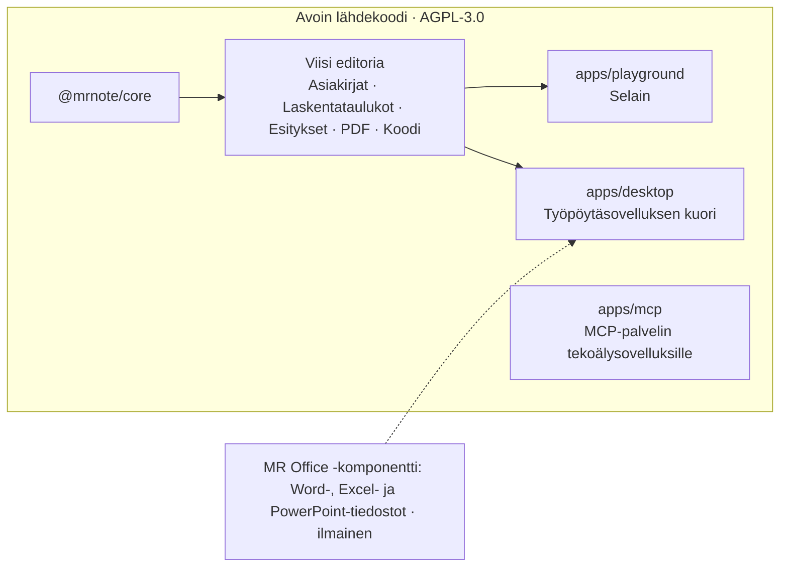

# MR Office — Suomi

<p align="center"><sub>🌐 <a href="../README.md">English</a> · <a href="../i18n/README.en-GB.md">English (UK)</a> · <a href="../i18n/README.zh.md">简体中文</a> · <a href="../i18n/README.zh-TW.md">繁體中文</a> · <a href="../i18n/README.ja.md">日本語</a> · <a href="../i18n/README.ko.md">한국어</a> · <a href="../i18n/README.de.md">Deutsch</a> · <a href="../i18n/README.fr.md">Français</a> · <a href="../i18n/README.es.md">Español</a> · <a href="../i18n/README.es-419.md">Español (Latinoamérica)</a> · <a href="../i18n/README.pt-BR.md">Português (Brasil)</a> · <a href="../i18n/README.it.md">Italiano</a> · <a href="../i18n/README.nl.md">Nederlands</a> · <a href="../i18n/README.sv.md">Svenska</a> · <a href="../i18n/README.da.md">Dansk</a> · <a href="../i18n/README.no.md">Norsk</a> · <a href="../i18n/README.fi.md">Suomi</a> · <a href="../i18n/README.id.md">Bahasa Indonesia</a> · <a href="../i18n/README.th.md">ไทย</a> · <a href="../i18n/README.vi.md">Tiếng Việt</a></sub></p>

<p align="center"><b>MR Office -toimisto-ohjelmiston avoimen lähdekoodin editorit, lähimpänä Microsoft Officea oleva tekoälytoimisto-ohjelmisto: asiakirjat, laskentataulukot, esitykset, PDF ja koodi selaimessa sekä tekoäly, joka muokkaa kanssasi oikeita Word-, Excel- ja PowerPoint-tiedostoja.</b></p>

<p align="center"><a href="https://mroffice.ai/fi"><b>▶ Kokeile verkossa</b></a> · <a href="https://mroffice.ai/fi/office/download"><b>⬇ Lataa</b></a> · <a href="https://mroffice.ai">🌐 mroffice.ai</a><br><a href="https://mroffice.ai/fi/developers">🧑‍💻 Kehittäjät</a> · <a href="https://mroffice.ai/fi/developers/embed">🧩 Upota</a> · <a href="https://mroffice.ai/fi/developers/mcp">🤖 MCP tekoälysovelluksille</a> · <a href="https://www.npmjs.com/package/mroffice-embed">📦 npm-SDK</a> · <a href="https://mroffice.ai/fi/developers/oauth">🔑 Kirjaudu MR Officella</a></p>

<p align="center"><a href="../LICENSE"></a> <a href="https://github.com/XinaTian/MROffice/releases"></a> <a href="https://github.com/XinaTian/MROffice/actions/workflows/ci.yml"></a> <a href="https://github.com/XinaTian/MROffice/stargazers"></a></p>

<p align="center"><a href="https://mroffice.ai/fi"></a></p>

<p align="center"><a href="https://demo.mroffice.ai/media/mr-office-demo.mp4">🔊 Katso 50 sekunnin esittely äänen kanssa</a></p>

<table>
<tr>
<td align="center" width="50%"><a href="https://mroffice.ai/fi"></a><br><b>Asiakirjat</b></td>
<td align="center" width="50%"><a href="https://mroffice.ai/fi"></a><br><b>Laskentataulukot</b></td>
</tr>
<tr>
<td align="center" width="50%"><a href="https://mroffice.ai/fi"></a><br><b>Esitykset</b></td>
<td align="center" width="50%"><a href="https://mroffice.ai/fi"></a><br><b>PDF</b></td>
</tr>
<tr>
<td align="center" width="50%"><a href="https://mroffice.ai/fi"></a><br><b>Koodi</b></td>
</tr>
</table>

MR Office on tekoälytoimisto-ohjelmisto oikeille tiedostoille: Word, Excel, PowerPoint ja PDF, verkossa ja ilmaisessa työpöytäsovelluksessa, tekoäly jokaisen asiakirjan vierellä ja reaaliaikainen yhteismuokkaus. Tämä repositorio julkaisee sen editorien lähdekoodin: samat editorit, joita MR Office käyttää ja jotka voit kääntää, ajaa ja upottaa omiin sovelluksiisi.

## Tekoäly, joka toimii tiedostojesi sisällä

MR Officessa tekoäly työskentelee itse asiakirjalla, ei chattiin liitetyllä tekstillä. Se lukee tiedoston, tekee muutoksen tiedoston omiin objekteihin ja näyttää, mitä se kosketti, ennen kuin hyväksyt muutoksen.

- **Copilot jokaisessa editorissa** — asiakirjat, laskentataulukot, esitykset, PDF ja koodi. Valitse tai ympyröi haluamasi kohta ja kerro, mitä haluat: se muokkaa kappaleita, taulukoita, soluja ja kaavoja, muotoja ja dioja paikan päällä, kysyy, jos pyyntö on epäselvä, esikatselee muutoksen ennen sen toteuttamista, ja jokainen muutos voidaan kumota.
- **Muutokset, jotka tarkistat** — tekoälyn ehdottama muutos toteutetaan vain, kun vahvistat sen; jos tiedosto on muuttunut sillä välin, ehdotus raukeaa eikä mitään kirjoittamaasi ylikirjoiteta.
- **Tekoälyikkuna, joka tuntee työtilasi** — kysy tiedostoistasi, muistiinpanoistasi ja kanvaksestasi ja saa vastauksia, jotka viittaavat lähteisiinsä; se luonnostelee uusia asiakirjoja, taulukoita ja esityksiä ja rakentaa pienen työkalun kanvakselle, kun tarvitset sellaisen.
- **Muisti** — muistiverkko pitää tallessa tärkeät henkilöt, projektit ja päätökset, joten tekoäly ei aloita nollasta joka keskustelussa.
- **Johtavat mallit** — valitse malli kullekin keskustelulle tämän hetken johtavista tekoälymalleista; tiedostosi pysyvät työtilassasi tai omalla tietokoneellasi työpöytäsovelluksen kanssa.

**[Kokeile tekoälyä MR Officessa ilmaiseksi →](https://mroffice.ai/fi)**

### Anna tekoälyagenttisi muokata Office-tiedostoja (MCP)

Claude, ChatGPT, Cursor, Codex, VS Code ja mikä tahansa muu MCP-asiakas voi luoda, avata, muokata, lukea takaisin, kuvittaa ja viedä asiakirjoja ja laskentataulukoita MR Officen MCP-palvelimen kautta (`create_document`, `open_document`, `update_document`, `get_document`, `render_page`, `export_document` muotoon docx, xlsx, pptx, pdf, md, html tai csv). Sovelluksissa, jotka näyttävät MCP Apps -sisältöä, editori ilmestyy suoraan keskusteluun; muualla työkalut vastaavat linkillä samaan editoriin ja kuvalla sivusta. Sinä ja tekoäly muokkaatte samaa asiakirjaa: avustaja lukee muokkauksesi takaisin ennen kuin jatkaa, ja päivitys, joka tehdään sen näkemättömien muokkausten päälle, hylätään sen sijaan että se häviäisi.

```bash
# Claude Code
claude mcp add mroffice -- npx -y mroffice-mcp
# Codex
codex mcp add mroffice -- npx -y mroffice-mcp
```

Claude Desktop, Cursor ja muut sovellukset, jotka ottavat vastaan JSON-määrityksen:

```json
{ "mcpServers": { "mroffice": { "command": "npx", "args": ["-y", "mroffice-mcp"] } } }
```

Ei asennusta: yhdistä isännöityyn päätepisteeseen `https://mcp.mroffice.ai/mcp` ja kirjaudu sisään MR Office -tililläsi. Word-, Excel- ja PowerPoint-tiedostot kulkevat MR Officen Office-moottorin kautta omana tilinäsi; MCP-palvelimen lähdekoodi on kansiossa `apps/mcp`. [MCP-opas →](https://mroffice.ai/fi/developers/mcp)

## Kehittäjille

Kaikki kehittäjille on osoitteessa **[MR Office Developers](https://mroffice.ai/fi/developers)** — itsepalvelu, ei hakemusta: kirjaudu millä tahansa MR Office -tilillä ja aloita.

### Upota editorit verkkosovellukseesi (suositus)

MR Office hostaa editoreja; palvelimesi allekirjoittaa lyhytikäisen istuntotunnisteen ja sivusi avaa editorin. Se muokkaa oikeita Word-, Excel-, PowerPoint- ja PDF-tiedostoja (.docx, .xlsx, .pptx, .pdf), ja siinä on yhteismuokkaus, lataukset, kaikki vientimuodot, tulostus ja allekirjoitetulla takaisinkutsulla palvelimellesi lähetettävät tallennukset. Ilmainen suunnitelma: 1 000 istuntoa kuukaudessa localhostissa, 100 omilla verkkotunnuksillasi, enintään 2 sovellusta. Hostattuna palveluna se ei aseta AGPL-velvoitteita omalle sovelluksellesi.

1. Suorita projektin kansiossa `npx mroffice-embed init` (tai luo sovellus kehittäjäkonsolissa): yksi "Salli"-napsautus selaimessa, ja sovelluksen avaimet kirjoitetaan tiedostoon `.env.local` / `.env`.
2. Palvelimesi luo istuntotunnuksen `mroffice-embed/server`-moduulin `createSessionToken`-funktiolla; salainen avain ei koskaan poistu palvelimelta.
3. Sivusi avaa editorin `mroffice-embed`-paketin `open()`-funktiolla (tai skriptillä `https://mroffice.ai/embed/v1/embed.js`).

```js
// server: GET /api/mroffice/session (check who is signed in first)
import { createSessionToken } from "mroffice-embed/server";
const token = await createSessionToken({
  appId: process.env.MROFFICE_APP_ID,
  secretKey: process.env.MROFFICE_SECRET_KEY, // mro_sk_..., server only
  file: { key: "contract-42", name: "contract.docx", url: signedUrlToTheFile },
  user: { id: user.id, name: user.name },
  mode: "edit",
});

// page
import { open } from "mroffice-embed";
open({ container: "#editor", token: () => fetch("/api/mroffice/session").then((r) => r.json()).then((b) => b.token) });
```

[Upotusopas](https://mroffice.ai/fi/developers/embed) · [Opas Markdownina (tekoälyagenteille)](https://mroffice.ai/developers/embed.md) · [Hinnat ja rajat](https://mroffice.ai/fi/developers/pricing) · [Kehittäjäkonsoli](https://mroffice.ai/fi/developers/console) · [Live-demo](https://mroffice.ai/fi/developers/embed/demo)

### Tekoälysovellukset: MCP-palvelin

Yllä oleva MCP-palvelin on myös se, miten omat tekoälyominaisuutesi voivat avata, lukea, muokata ja viedä asiakirjoja oikeassa MR Office -editorissa: isännöity päätepiste `https://mcp.mroffice.ai/mcp` (OAuth-kirjautuminen, ei avainta) tai `npx -y mroffice-mcp` omalla tietokoneellasi. [MCP-opas →](https://mroffice.ai/fi/developers/mcp)

### Kirjaudu MR Officella (OAuth)

MR Office on OAuth 2.1 -valtuutuspalvelin (PKCE, asiakastunnuksen metatietoasiakirjat, dynaaminen rekisteröinti): sovelluksesi voi kirjata ihmiset sisään heidän MR Office -tilillään ja toimia heidän sallimillaan oikeuksilla. [OAuth-opas →](https://mroffice.ai/fi/developers/oauth)

### Ylläpidä avoimen lähdekoodin editoreja itse

Tämän tietovaraston viisi editoria voidaan rakentaa omaan tuotteeseen AGPL-3.0-lisenssin alaisina: jos ihmiset käyttävät muokattua versiota verkon yli, sinun on tarjottava heille sen täydellinen lähdekoodi ja säilytettävä "MR Office" -nimeäminen (NOTICE.md). Ne avaavat omia formaattejaan, CSV-, HTML-, Markdown- ja PDF-tiedostoja; Word-, Excel- ja PowerPoint-tiedostoja varten käytä yllä olevaa isännöityä upotusta. Kaupallinen lisenssi on saatavilla osoitteesta support@mr-note.com. [Avoimen lähdekoodin opas →](https://mroffice.ai/fi/developers/open-source)

Editorit ovat npm:ssä React-komponentteina: `npm i mroffice-docs mroffice-core` (sekä `mroffice-sheets`, `mroffice-slides`, `mroffice-pdf`, `mroffice-code`); kunkin paketin README näyttää, miten se upotetaan.

## Editorit

Mitä kukin editori tekee tässä tietovarastossa:

- **Asiakirjat** — sivutettu tekstinkäsittelyohjelma: fontit, kappaleiden muotoilu, luettelot ja tyylit Aloitus-välilehdellä; kansi- ja tyhjät sivut, sivunvaihdot, taulukot, kuvat, muodot, SmartArt, kaaviot, linkit, kirjanmerkit, kommentit, ylä- ja alatunnisteet sekä sivunumerot, yhtälöt, symbolit, tekstiruudut ja WordArt Lisää-välilehdellä. Tallentaa oman formaattinsa (.mrdoc); avaa HTML-, Markdown- ja pelkän tekstin tiedostoja.
- **Laskentataulukot** — solut ja kaavat fonteilla, tasauksella, lukumuodoilla, ehdollisella muotoilulla, solutyyleillä sekä solujen lisäämisellä ja poistamisella Aloitus-välilehdellä; taulukot, kuvat, muodot, kuvakkeet, valintaruudut, kaaviot ja sparklinet Lisää-välilehdellä; useita taulukoita, valinnan summat ja keskiarvot. Solujen välinen aritmetiikka (=A1*B1+10) lasketaan selaimessa kirjoittaessasi; funktioita sisältävät kaavat (SUM, IF, VLOOKUP …) säilytetään kirjoitetussa muodossa. Tallentaa oman formaattinsa (.mrsheet); avaa ja tallentaa CSV- ja TSV-tiedostoja.
- **Esitykset** — diat asetteluilla ja osioilla, teksti, fontit ja kappaleet sekä muodot järjestelyineen Aloitus-välilehdellä; taulukot, kuvat, kuvakkeet, SmartArt, kaaviot, tekstiruudut, WordArt, ylä- ja alatunnisteet, yhtälöt, symbolit ja video Lisää-välilehdellä; muistiinpanot, kommentit ja esittäminen. Tallentaa oman formaattinsa (.mrslides).
- **PDF** — PDF-tiedostojen luku, esittäminen ja tulostus: yhden ja kahden sivun näkymät, jatkuva vieritys, kierto, pikkukuvat ja lukutila, tekstin haku ja kopiointi sekä kommentit tiedoston ollessa auki; tallennus palauttaa tiedoston sellaisena kuin se avattiin.
- **Koodi** — kevyt koodieditori, jossa on syntaksikorostus monille kielille, jäsennyspuu, haku, pikahaku, tiedostoselain ja ongelmaluettelo.

Kaavat funktioineen, kaaviot ja SmartArt lasketaan ja piirretään MR Officen moottorilla sekä ilmaisessa työpöytäsovelluksessa että hostatussa palvelussa; tämän repositorion editorit säilyttävät jokaisen tiedoston sisältämän kaavan, kaavion ja SmartArtin ja näyttävät SmartArtin sellaisena kuin se on tallennettu.

## Editorien ajaminen

**▶ [Kokeile live-demoa – ei asennusta](https://mroffice.ai/fi)**

Viisi editoria ovat hakemistossa `packages/` (`@mrnote/docs`, `sheets`, `slides`, `pdf`, `code`, jotka jakavat `@mrnote/core`) ja toimivat yhdessä hakemistossa `apps/playground`:

```bash
npm install
npm run fonts     # the open substitutes for Office's fonts
npm run build
npm run preview   # http://localhost:5178
```

`npm run dev` käynnistää kehityspalvelimen samaan osoitteeseen, ja `npm run smoke` tarkistaa koontiversion. Jokaisen paketin README kertoo tarkemmin, mitä se tekee ja miten sen voi upottaa.

## Työpöytäsovellus

[`apps/desktop`](../apps/desktop) sisältää **MR Office Editors** -sovelluksen: MR Office -työpöytäsovelluksen kuoren (Electron) lähdekoodin omalla identiteetillään. Releases-julkaisuista ladattavan ilmaisen MR Office -komponentin kanssa se on MR Office -työpöytäsovellus, jossa on Word-, Excel-, PowerPoint- ja PDF-tiedostot, kirjautuminen ja AI. Ilman komponenttia se ajaa avoimen lähdekoodin editoreja sellaisinaan, ja ne avaavat .mrdoc-, .mrsheet- ja .mrslides-tiedostoja, CSV-, HTML-, Markdown- ja PDF-tiedostoja. Kuori ja editorit ovat AGPL-lähdekoodia; komponentti on ilmainen lataus Releases-julkaisuista. Kun `npm run build` on suoritettu, käynnistä se komennolla:

```bash
npm run desktop
```

## Kaikki ominaisuudet: asenna MR Officen työpöytäsovellus (maksuton)

MR Office -työpöytäsovellus on ilmainen, sisältää nämä editorit ja koko palvelun, ja toimii offline-tilassa omalla tietokoneellasi. Editorien lisäksi se tarjoaa:

- Word-, Excel- ja PowerPoint-tiedostojen (.docx, .xlsx, .pptx) avaaminen ja tallentaminen
- Funktioita sisältävien kaavojen (SUMMA, JOS, PHAKU …) laskenta
- Kaaviot
- SmartArtin muokkaus
- PDF-muokkausten tallentaminen takaisin tiedostoon

**[Lataa MR Office (ilmainen) →](https://mroffice.ai/fi/office/download)**

## Miten osat liittyvät toisiinsa



## Lisenssi

Avointa lähdekoodia GNU Affero General Public License v3.0 -lisenssillä (LICENSE) ja NOTICE.md-tiedoston lisäehdoin: säilytä maininta ”MR Office” ja linkki osoitteeseen https://mroffice.ai; MR Office -nimeen ja -logoon ei anneta oikeuksia. Kaupallisen lisenssin saa osoitteesta support@mr-note.com. Kolmansien osapuolten ohjelmistot ja aineistot on lueteltu tiedostossa THIRD_PARTY_NOTICES.md. Osallistuminen: katso CONTRIBUTING.md.

## Lisää

Verkkosivusto ja koko tuote: **https://mroffice.ai** · Kysymykset ja palaute: support@mr-note.com

<p align="center">Jos MR Office on sinulle hyödyllinen, ⭐ GitHubissa auttaa muita löytämään sen.</p>
