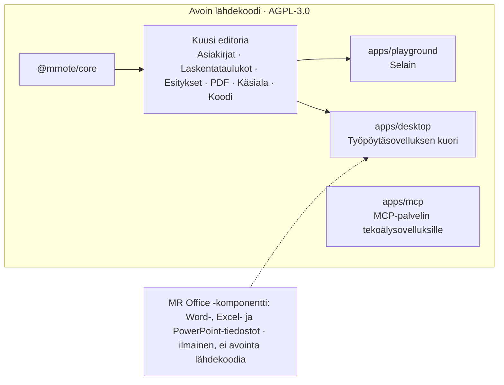

# MR Office — Suomi

<p align="center"><sub>🌐 <a href="../README.md">English</a> · <a href="../i18n/README.en-GB.md">English (UK)</a> · <a href="../i18n/README.zh.md">简体中文</a> · <a href="../i18n/README.zh-TW.md">繁體中文</a> · <a href="../i18n/README.ja.md">日本語</a> · <a href="../i18n/README.ko.md">한국어</a> · <a href="../i18n/README.de.md">Deutsch</a> · <a href="../i18n/README.fr.md">Français</a> · <a href="../i18n/README.es.md">Español</a> · <a href="../i18n/README.es-419.md">Español (Latinoamérica)</a> · <a href="../i18n/README.pt-BR.md">Português (Brasil)</a> · <a href="../i18n/README.it.md">Italiano</a> · <a href="../i18n/README.nl.md">Nederlands</a> · <a href="../i18n/README.sv.md">Svenska</a> · <a href="../i18n/README.da.md">Dansk</a> · <a href="../i18n/README.no.md">Norsk</a> · <a href="../i18n/README.fi.md">Suomi</a> · <a href="../i18n/README.id.md">Bahasa Indonesia</a> · <a href="../i18n/README.th.md">ไทย</a> · <a href="../i18n/README.vi.md">Tiếng Việt</a></sub></p>

<p align="center"><b>MR Officen avoimen lähdekoodin editorit – asiakirjat, laskentataulukot, esitykset, PDF, käsiala ja koodi – selaimessa.</b></p>

<p align="center"><a href="https://mroffice.ai/fi"><b>▶ Kokeile verkossa</b></a> · <a href="https://mroffice.ai/fi/office/download"><b>⬇ Lataa</b></a> · <a href="https://mroffice.ai">🌐 mroffice.ai</a><br><a href="https://mroffice.ai/fi/developers">🧑‍💻 Kehittäjät</a> · <a href="https://mroffice.ai/fi/developers/embed">🧩 Upota</a> · <a href="https://mroffice.ai/fi/developers/mcp">🤖 MCP tekoälysovelluksille</a> · <a href="https://www.npmjs.com/package/mroffice-embed">📦 npm-SDK</a> · <a href="https://mroffice.ai/fi/developers/oauth">🔑 Kirjaudu MR Officella</a></p>

<p align="center"><a href="../LICENSE"></a> <a href="https://github.com/XinaTian/MROffice/releases"></a> <a href="https://github.com/XinaTian/MROffice/actions/workflows/ci.yml"></a> <a href="https://github.com/XinaTian/MROffice/stargazers"></a></p>

<p align="center"><a href="https://mroffice.ai/fi"></a></p>

<p align="center"><a href="https://demo.mroffice.ai/media/mr-office-demo.mp4">🔊 Katso 50 sekunnin esittely äänen kanssa</a></p>

<table>
<tr>
<td align="center" width="50%"><a href="https://mroffice.ai/fi"></a><br><b>Asiakirjat</b></td>
<td align="center" width="50%"><a href="https://mroffice.ai/fi"></a><br><b>Laskentataulukot</b></td>
</tr>
<tr>
<td align="center" width="50%"><a href="https://mroffice.ai/fi"></a><br><b>Esitykset</b></td>
<td align="center" width="50%"><a href="https://mroffice.ai/fi"></a><br><b>PDF</b></td>
</tr>
<tr>
<td align="center" width="50%"><a href="https://mroffice.ai/fi"></a><br><b>Käsiala</b></td>
<td align="center" width="50%"><a href="https://mroffice.ai/fi"></a><br><b>Koodi</b></td>
</tr>
</table>

MR Office on työtila muistiinpanoille, tekoälylle ja oikeille tiedostoille. Tämä tietovarasto julkaisee sen editorien lähdekoodin: samat editorit, joita MR Office käyttää ja jotka voit itse koota, ajaa ja upottaa. Nämä ovat avoimen lähdekoodin editoreja, eivät täydellinen avoimen lähdekoodin toimisto-ohjelmisto: Microsoft Office -tiedostojen lukeminen ja kirjoittaminen jäävät MR Officeen (katso alla).

## Kehittäjille

Kaikki kehittäjille on osoitteessa **[MR Office Developers](https://mroffice.ai/fi/developers)** — itsepalvelu, ei hakemusta: kirjaudu millä tahansa MR Office -tilillä ja aloita.

### Upota editorit verkkosovellukseesi (suositus)

MR Office ylläpitää editoreja; palvelimesi allekirjoittaa lyhytikäisen istuntotunnuksen, ja sivusi avaa editorin sillä. Se muokkaa oikeita Word-, Excel-, PowerPoint- ja PDF-tiedostoja (.docx, .xlsx, .pptx, .pdf) yhteismuokkauksen, latausten, kaikkien vientimuotojen ja tulostuksen kera, ja tallennukset lähetetään palvelimellesi allekirjoitetulla takaisinkutsulla. Ilmainen paketti: 1 000 istuntoa kuukaudessa localhostissa, 100 omilla verkkotunnuksillasi, enintään 2 sovellusta. Se on ylläpidetty kaupallinen palvelu, joten oma sovelluksesi ei ole tämän repositorion AGPL-lisenssin sitoma.

1. Suorita projektin kansiossa `npx mroffice-embed init` (tai luo sovellus kehittäjäkonsolissa): yksi "Salli"-napsautus selaimessa, ja sovelluksen avaimet kirjoitetaan tiedostoon `.env.local` / `.env`.
2. Palvelimesi luo istuntotunnuksen `mroffice-embed/server`-moduulin `createSessionToken`-funktiolla; salainen avain ei koskaan poistu palvelimelta.
3. Sivusi avaa editorin `mroffice-embed`-paketin `open()`-funktiolla (tai skriptillä `https://mroffice.ai/embed/v1/embed.js`).

```js
// server: GET /api/mroffice/session (check who is signed in first)
import { createSessionToken } from "mroffice-embed/server";
const token = await createSessionToken({
  appId: process.env.MROFFICE_APP_ID,
  secretKey: process.env.MROFFICE_SECRET_KEY, // mro_sk_..., server only
  file: { key: "contract-42", name: "contract.docx", url: signedUrlToTheFile },
  user: { id: user.id, name: user.name },
  mode: "edit",
});

// page
import { open } from "mroffice-embed";
open({ container: "#editor", token: () => fetch("/api/mroffice/session").then((r) => r.json()).then((b) => b.token) });
```

[Upotusopas](https://mroffice.ai/fi/developers/embed) · [Opas Markdownina (tekoälyagenteille)](https://mroffice.ai/developers/embed.md) · [Hinnat ja rajat](https://mroffice.ai/fi/developers/pricing) · [Kehittäjäkonsoli](https://mroffice.ai/fi/developers/console) · [Live-demo](https://mroffice.ai/fi/developers/embed/demo)

### Tekoälysovellukset: MCP-palvelin

Tekoälysovellukset avaavat, lukevat, muokkaavat ja vievät asiakirjoja oikeassa MR Office -editorissa sen MCP-palvelimen kautta: yhdistä ylläpidettyyn päätepisteeseen `https://mcp.mroffice.ai/mcp` (kirjaudu MR Office -tililläsi, ei avainta) tai suorita `npx -y mroffice-mcp` omalla koneellasi. Lähdekoodi on hakemistossa `apps/mcp`. [MCP-opas →](https://mroffice.ai/fi/developers/mcp)

### Kirjaudu MR Officella (OAuth)

MR Office on OAuth 2.1 -valtuutuspalvelin (PKCE, asiakastunnuksen metatietoasiakirjat, dynaaminen rekisteröinti): sovelluksesi voi kirjata ihmiset sisään heidän MR Office -tilillään ja toimia heidän sallimillaan oikeuksilla. [OAuth-opas →](https://mroffice.ai/fi/developers/oauth)

### Ylläpidä avoimen lähdekoodin editoreja itse

Tämän repositorion kuusi editoria voi rakentaa omaan tuotteeseesi AGPL-3.0-lisenssillä: jos muut käyttävät muokattua versiota verkon yli, sinun on tarjottava heille sen koko lähdekoodi ja säilytettävä "MR Office" -maininta (NOTICE.md). Ne avaavat omia muotojaan, CSV-, HTML-, Markdown- ja PDF-tiedostoja; Word-, Excel- ja PowerPoint-tiedostot eivät kuulu avoimen lähdekoodin editoreihin (yllä oleva ylläpidetty upotus tukee niitä). Kaupallisen lisenssin saa osoitteesta support@mr-note.com. [Avoimen lähdekoodin opas →](https://mroffice.ai/fi/developers/open-source)

npm-paketteja valmistellaan nimillä `mroffice-core`, `mroffice-docs`, `mroffice-sheets`, `mroffice-slides`, `mroffice-pdf`, `mroffice-ink` ja `mroffice-code`; kunnes ne julkaistaan, rakenna editorit tästä repositoriosta (katso alla).

## Editorit

Mitä kukin editori tekee tässä tietovarastossa:

- **Asiakirjat** — sivupohjainen tekstinkäsittely: tyylit, fontit, luettelot, taulukot, ylä- ja alatunnisteet, osat ja palstat, muodot ja kaavat, kansilehdet ja sisällysluettelot, kommentit ja muutosten seuranta sekä käsin piirtäminen sivulle. Tallentaa omaan muotoonsa (.mrdoc); avaa HTML-, Markdown- ja tekstitiedostot.
- **Laskentataulukot** — solut ja kaavat, lukumuodot, ehdollinen muotoilu, lajittelu ja suodatus, kiinnitetyt ruudut ja useita taulukoita sekä valinnan summa ja keskiarvo. Solujen välinen laskenta (=A1*B1+10) lasketaan selaimessa kirjoitettaessa; funktioita käyttävät kaavat (SUMMA, JOS, PHAKU …) säilyvät kirjoitetussa muodossa. Tallentaa omaan muotoonsa (.mrsheet); avaa ja tallentaa CSV- ja TSV-tiedostot.
- **Esitykset** — dioja kahdeksalla omalla teemalla: asettelut, diapohja- ja asettelunäkymä, teksti, muodot, tekstiruudut, taulukot, WordArt ja kaavat, kommentit, osiot, siirtymät ja animaatiot esikatseluineen sekä diaesitys. Tallentaa omaan muotoonsa (.mrslides).
- **PDF** — PDF-tiedostojen lukeminen, haku, esittäminen ja tulostus, tekstin kopiointi ja ääneen lukeminen sekä valitun tekstin merkitseminen (korostus, alleviivaus, yliviivaus, aaltoviiva) muistilappujen ja kommenttiruudun kanssa tiedoston ollessa auki; tallennus palauttaa tiedoston sellaisena kuin se avattiin.
- **Käsiala** — käsin kirjoitetut muistiinpanot paineherkillä kynillä, korostuskynillä, pyyhekumeilla, lassolla ja viivaimella, ja käsiala muuttuu muodoiksi. Tallentaa omaan muotoonsa (.mrink).
- **Koodi** — kevyt koodieditori, jossa on syntaksikorostus monille kielille, jäsennys sekä etsi ja korvaa; JavaScript/TypeScript, Python, SQL, Lua ja komentotulkki toimivat suoraan selaimessa.

Funktioita sisältävien kaavojen laskennan, kaavioiden piirtämisen ja SmartArtin asettelun hoitaa MR Officen oma moottori MR Office -työpöytäsovelluksessa: avoimen lähdekoodin editorit säilyttävät tiedoston kaavat, kaaviot ja SmartArtin ja näyttävät SmartArtin sellaisena kuin se tallennettiin.

## Editorien ajaminen

**▶ [Kokeile live-demoa – ei asennusta](https://mroffice.ai/fi)**

Kuusi editoria ovat hakemistossa `packages/` (`@mrnote/docs`, `sheets`, `slides`, `pdf`, `ink`, `code`, yhteisenä `@mrnote/core`), ja ne toimivat yhdessä hakemistossa `apps/playground`:

```bash
npm install
npm run fonts     # the open substitutes for Office's fonts
npm run build
npm run preview   # http://localhost:5178
```

`npm run dev` käynnistää kehityspalvelimen samaan osoitteeseen, ja `npm run smoke` tarkistaa koontiversion. Jokaisen paketin README kertoo tarkemmin, mitä se tekee ja miten sen voi upottaa.

## Työpöytäsovellus

[`apps/desktop`](../apps/desktop) sisältää **MR Office Editorsin**: MR Officen työpöytäsovelluksen kuoren (Electron) lähdekoodin omalla sovellustunnisteellaan. Kun Releases-sivun ilmainen MR Office -komponentti on asennettu, se on MR Officen työpöytäsovellus: Word-, Excel-, PowerPoint- ja PDF-tiedostot, kirjautuminen ja tekoäly. Ilman komponenttia se ajaa vain avoimen lähdekoodin editoreja, jotka avaavat .mrdoc-, .mrsheet-, .mrslides- ja .mrink-tiedostot sekä CSV-, HTML-, Markdown- ja PDF-tiedostot. Kuori ja editorit ovat AGPL-lähdekoodia; komponentti on käännetty, ilmainen käyttää eikä avointa lähdekoodia. Kun olet ajanut `npm run build`, käynnistä se komennolla:

```bash
npm run desktop
```

## Kaikki ominaisuudet: asenna MR Officen työpöytäsovellus (maksuton)

MR Office -työpöytäsovellus on maksuton, sisältää nämä editorit ja koko palvelun ja toimii offline-tilassa omalla tietokoneellasi. Se tuo sen, mitä avoimen lähdekoodin editoreista puuttuu:

- Word-, Excel- ja PowerPoint-tiedostojen (.docx, .xlsx, .pptx) avaaminen ja tallentaminen
- Funktioita sisältävien kaavojen (SUMMA, JOS, PHAKU …) laskenta
- Kaaviot
- SmartArtin muokkaus
- PDF-muokkausten tallentaminen takaisin tiedostoon

**[Lataa MR Office (ilmainen) →](https://mroffice.ai/fi/office/download)**

### Word-, Excel-, PowerPoint- ja PDF-tiedostot

Word-, Excel- ja PowerPoint-tiedostojen (.docx, .xlsx, .pptx) avaamisen ja tallentamisen sekä PDF-muokkausten tallentamisen takaisin tiedostoon tarjoaa maksuton MR Office -työpöytäsovellus. Se sisältää kaikki nämä editorit ja toimii offline-tilassa omalla tietokoneellasi:

## Miten osat liittyvät toisiinsa



## Lisenssi

Avointa lähdekoodia GNU Affero General Public License v3.0 -lisenssillä (LICENSE) ja NOTICE.md-tiedoston lisäehdoin: säilytä maininta ”MR Office” ja linkki osoitteeseen https://mroffice.ai; MR Office -nimeen ja -logoon ei anneta oikeuksia. Kaupallisen lisenssin saa osoitteesta support@mr-note.com. Kolmansien osapuolten ohjelmistot ja aineistot on lueteltu tiedostossa THIRD_PARTY_NOTICES.md. Osallistuminen: katso CONTRIBUTING.md.

## Lisää

Verkkosivusto ja koko tuote: **https://mroffice.ai** · Kysymykset ja palaute: support@mr-note.com

<p align="center">Jos MR Office on sinulle hyödyllinen, ⭐ GitHubissa auttaa muita löytämään sen.</p>
