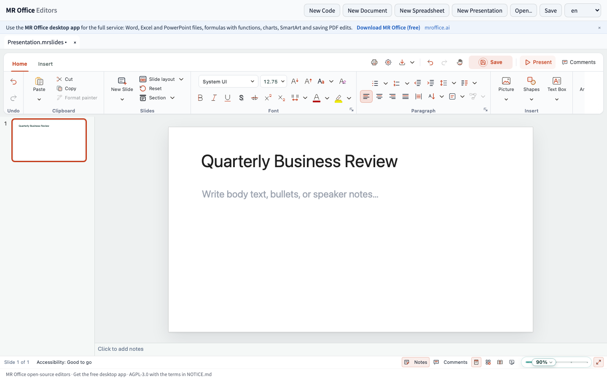
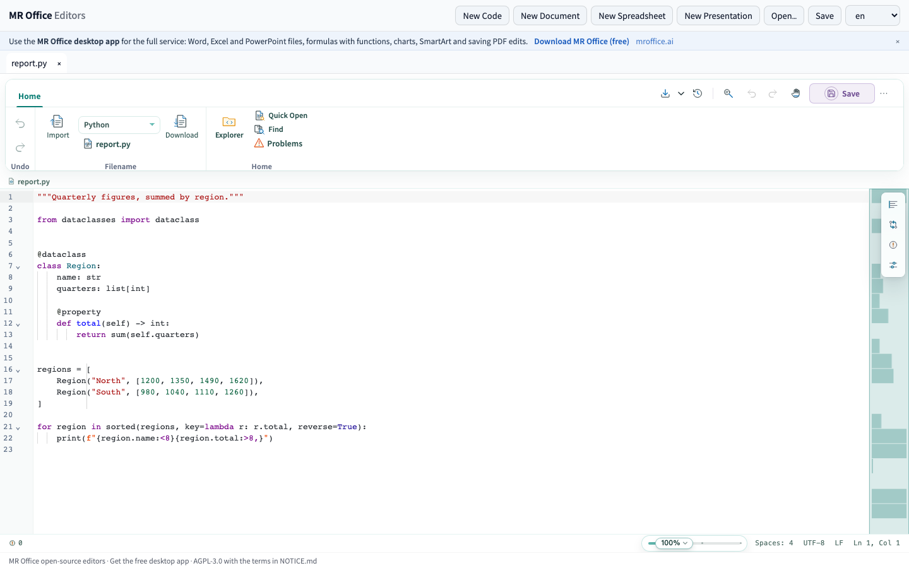

# MR Office — Français

[English](../README.md) · [English (UK)](../i18n/README.en-GB.md) · [简体中文](../i18n/README.zh.md) · [繁體中文](../i18n/README.zh-TW.md) · [日本語](../i18n/README.ja.md) · [한국어](../i18n/README.ko.md) · [Deutsch](../i18n/README.de.md) · [Français](../i18n/README.fr.md) · [Español](../i18n/README.es.md) · [Español (Latinoamérica)](../i18n/README.es-419.md) · [Português (Brasil)](../i18n/README.pt-BR.md) · [Italiano](../i18n/README.it.md) · [Nederlands](../i18n/README.nl.md) · [Svenska](../i18n/README.sv.md) · [Dansk](../i18n/README.da.md) · [Norsk](../i18n/README.no.md) · [Suomi](../i18n/README.fi.md) · [Bahasa Indonesia](../i18n/README.id.md) · [ไทย](../i18n/README.th.md) · [Tiếng Việt](../i18n/README.vi.md)

<p align="center"><b>Les éditeurs open source de MR Office — documents, feuilles de calcul, présentations, PDF, écriture manuscrite et code — dans le navigateur.</b></p>

<p align="center"><a href="https://mroffice.ai/fr"><b>▶ Essayer la démo en ligne — sans installation</b></a> · <a href="https://github.com/XinaTian/MROffice/releases">⬇ Télécharger MR Office depuis les Releases</a> · <a href="https://mroffice.ai">🌐 mroffice.ai</a></p>

<p align="center"><a href="../LICENSE"></a> <a href="https://github.com/XinaTian/MROffice/releases"></a> <a href="https://github.com/XinaTian/MROffice/actions/workflows/ci.yml"></a></p>

<table>
<tr>
<td align="center" width="33%"><a href="https://mroffice.ai/fr"></a><br><b>Documents</b></td>
<td align="center" width="33%"><a href="https://mroffice.ai/fr"></a><br><b>Feuilles de calcul</b></td>
<td align="center" width="33%"><a href="https://mroffice.ai/fr"></a><br><b>Présentations</b></td>
</tr>
<tr>
<td align="center" width="33%"><a href="https://mroffice.ai/fr"></a><br><b>PDF</b></td>
<td align="center" width="33%"><a href="https://mroffice.ai/fr"></a><br><b>Écriture manuscrite</b></td>
<td align="center" width="33%"><a href="https://mroffice.ai/fr"></a><br><b>Code</b></td>
</tr>
</table>

MR Office est un espace de travail pour les notes, l'IA et les vrais fichiers. Ce dépôt publie le code source de ses éditeurs : les mêmes éditeurs que ceux de MR Office, que vous pouvez compiler, exécuter et intégrer vous-même. Ce sont des éditeurs open source, pas une suite bureautique open source complète : la lecture et l'écriture des fichiers Microsoft Office restent dans MR Office (voir ci-dessous).

## Les éditeurs

Ce que fait chaque éditeur dans ce dépôt :

- **Documents** — un traitement de texte paginé : styles, polices, listes, tableaux, en-têtes et pieds de page, sections et colonnes, formes et équations, pages de garde et tables des matières, commentaires et suivi des modifications, et encre sur la page. Enregistre dans son propre format (.mrdoc) ; ouvre le HTML, le Markdown et le texte brut.
- **Feuilles de calcul** — cellules et formules, formats de nombre, mise en forme conditionnelle, tri et filtres, volets figés et plusieurs feuilles, avec la somme et la moyenne de la sélection. Le calcul entre cellules (=A1*B1+10) se fait dans le navigateur à la saisie ; les formules avec des fonctions (SOMME, SI, RECHERCHEV…) sont conservées telles qu'écrites. Enregistre dans son propre format (.mrsheet) ; ouvre et enregistre le CSV et le TSV.
- **Présentations** — des diapositives avec huit thèmes à lui, des dispositions, les modes masque et disposition, du texte, des formes, des zones de texte, des tableaux, du WordArt et des équations, des commentaires, des sections, des transitions et animations avec aperçu, et le diaporama. Enregistre dans son propre format (.mrslides).
- **PDF** — lire, rechercher, présenter et imprimer des PDF, copier et lire à voix haute leur texte, et, tant qu'un fichier est ouvert, annoter le texte sélectionné (surlignage, soulignement, barré, ondulé) avec des notes et un volet de commentaires ; l'enregistrement rend le fichier tel qu'il a été ouvert.
- **Écriture manuscrite** — des notes manuscrites avec stylos sensibles à la pression, surligneurs, gommes, lasso et règle, et l'encre transformée en formes. Enregistre dans son propre format (.mrink).
- **Code** — un éditeur de code léger avec coloration syntaxique pour de nombreux langages, un plan, et rechercher-remplacer ; JavaScript/TypeScript, Python, SQL, Lua et shell s'exécutent directement dans le navigateur.

Le calcul des formules avec fonctions, le dessin des graphiques et la mise en page des SmartArt sont faits par le moteur de MR Office, dans l'application de bureau MR Office : les éditeurs open source conservent les formules, graphiques et SmartArt d'un fichier, et affichent les SmartArt tels qu'ils ont été enregistrés.

## Lancer les éditeurs

**▶ [Essayer la démo en ligne — sans installation](https://mroffice.ai/fr)**

Les six éditeurs se trouvent dans `packages/` (`@mrnote/docs`, `sheets`, `slides`, `pdf`, `ink`, `code`, avec `@mrnote/core` en commun) et fonctionnent ensemble dans `apps/playground` :

```bash
npm install
npm run fonts     # the open substitutes for Office's fonts
npm run build
npm run preview   # http://localhost:5178
```

`npm run dev` lance un serveur de développement à la même adresse, et `npm run smoke` vérifie une compilation. Le README de chaque paquet détaille ce qu'il fait et comment l'intégrer.

## Pour toutes les fonctionnalités, installez l'application de bureau MR Office (gratuite)

L'application de bureau MR Office est gratuite, réunit ces éditeurs et le service complet, et fonctionne hors ligne sur votre ordinateur. Elle ajoute ce que les éditeurs open source n'ont pas :

- Ouvrir et enregistrer des fichiers Word, Excel et PowerPoint (.docx, .xlsx, .pptx)
- Calculer les formules avec fonctions (SOMME, SI, RECHERCHEV …)
- Graphiques
- Modification des SmartArt
- Réenregistrer dans le fichier les modifications d'un PDF

**[Télécharger MR Office depuis les Releases →](https://github.com/XinaTian/MROffice/releases)** · [ou sur mroffice.ai](https://mroffice.ai)

### Fichiers Word, Excel, PowerPoint et PDF

L'ouverture et l'enregistrement des fichiers Word, Excel et PowerPoint (.docx, .xlsx, .pptx), et l'enregistrement dans le fichier des modifications d'un PDF, sont assurés par l'application de bureau MR Office (gratuite), qui contient tous ces éditeurs et fonctionne hors ligne sur votre ordinateur :

## Licence

Open source sous la GNU Affero General Public License v3.0 (LICENSE), avec les conditions supplémentaires de NOTICE.md : conserver la mention « MR Office » et le lien vers https://mroffice.ai, et aucun droit sur le nom ni le logo MR Office. Une licence commerciale est disponible auprès de support@mr-note.com. Les logiciels et données tiers sont listés dans THIRD_PARTY_NOTICES.md. Contributions : voir CONTRIBUTING.md.

## En savoir plus

Site web et produit complet : **https://mroffice.ai** · Questions et retours : support@mr-note.com
