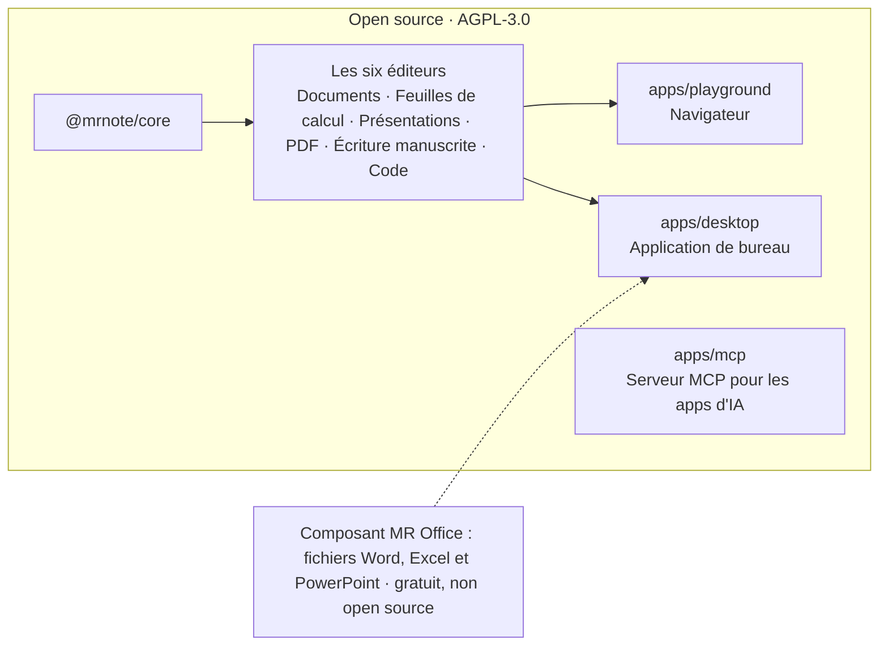

# MR Office — Français

<p align="center"><sub>🌐 <a href="../README.md">English</a> · <a href="../i18n/README.en-GB.md">English (UK)</a> · <a href="../i18n/README.zh.md">简体中文</a> · <a href="../i18n/README.zh-TW.md">繁體中文</a> · <a href="../i18n/README.ja.md">日本語</a> · <a href="../i18n/README.ko.md">한국어</a> · <a href="../i18n/README.de.md">Deutsch</a> · <a href="../i18n/README.fr.md">Français</a> · <a href="../i18n/README.es.md">Español</a> · <a href="../i18n/README.es-419.md">Español (Latinoamérica)</a> · <a href="../i18n/README.pt-BR.md">Português (Brasil)</a> · <a href="../i18n/README.it.md">Italiano</a> · <a href="../i18n/README.nl.md">Nederlands</a> · <a href="../i18n/README.sv.md">Svenska</a> · <a href="../i18n/README.da.md">Dansk</a> · <a href="../i18n/README.no.md">Norsk</a> · <a href="../i18n/README.fi.md">Suomi</a> · <a href="../i18n/README.id.md">Bahasa Indonesia</a> · <a href="../i18n/README.th.md">ไทย</a> · <a href="../i18n/README.vi.md">Tiếng Việt</a></sub></p>

<p align="center"><b>Les éditeurs open source de MR Office — documents, feuilles de calcul, présentations, PDF, écriture manuscrite et code — dans le navigateur.</b></p>

<p align="center"><a href="https://mroffice.ai/fr"><b>▶ Essayer en ligne</b></a> · <a href="https://mroffice.ai/fr/office/download"><b>⬇ Télécharger</b></a> · <a href="https://mroffice.ai">🌐 mroffice.ai</a><br><a href="https://mroffice.ai/fr/developers">🧑‍💻 Développeurs</a> · <a href="https://mroffice.ai/fr/developers/embed">🧩 Intégrer</a> · <a href="https://mroffice.ai/fr/developers/mcp">🤖 MCP pour les applis d’IA</a> · <a href="https://www.npmjs.com/package/mroffice-embed">📦 SDK npm</a> · <a href="https://mroffice.ai/fr/developers/oauth">🔑 Se connecter avec MR Office</a></p>

<p align="center"><a href="../LICENSE"></a> <a href="https://github.com/XinaTian/MROffice/releases"></a> <a href="https://github.com/XinaTian/MROffice/actions/workflows/ci.yml"></a> <a href="https://github.com/XinaTian/MROffice/stargazers"></a></p>

<p align="center"><a href="https://mroffice.ai/fr"></a></p>

<p align="center"><a href="https://demo.mroffice.ai/media/mr-office-demo.mp4">🔊 Voir la visite de 50 secondes avec le son</a></p>

<table>
<tr>
<td align="center" width="50%"><a href="https://mroffice.ai/fr"></a><br><b>Documents</b></td>
<td align="center" width="50%"><a href="https://mroffice.ai/fr"></a><br><b>Feuilles de calcul</b></td>
</tr>
<tr>
<td align="center" width="50%"><a href="https://mroffice.ai/fr"></a><br><b>Présentations</b></td>
<td align="center" width="50%"><a href="https://mroffice.ai/fr"></a><br><b>PDF</b></td>
</tr>
<tr>
<td align="center" width="50%"><a href="https://mroffice.ai/fr"></a><br><b>Écriture manuscrite</b></td>
<td align="center" width="50%"><a href="https://mroffice.ai/fr"></a><br><b>Code</b></td>
</tr>
</table>

MR Office est un espace de travail pour les notes, l'IA et les vrais fichiers. Ce dépôt publie le code source de ses éditeurs : les mêmes éditeurs que ceux de MR Office, que vous pouvez compiler, exécuter et intégrer vous-même. Ce sont des éditeurs open source, pas une suite bureautique open source complète : la lecture et l'écriture des fichiers Microsoft Office restent dans MR Office (voir ci-dessous).

## Pour les développeurs

Tout ce qu’il faut aux développeurs est sur **[MR Office Developers](https://mroffice.ai/fr/developers)** — en libre-service, sans demande : connectez-vous avec n’importe quel compte MR Office et commencez.

### Intégrer les éditeurs dans votre application web (recommandé)

MR Office héberge les éditeurs ; votre serveur signe un jeton de session de courte durée et votre page ouvre l’éditeur avec. Il modifie de vrais fichiers Word, Excel, PowerPoint et PDF (.docx, .xlsx, .pptx, .pdf), avec coédition, envois de fichiers, tous les formats d’export, l’impression, et des enregistrements renvoyés à votre serveur par un rappel signé. Offre gratuite : 1 000 sessions par mois sur localhost, 100 sur vos propres domaines, jusqu’à 2 applications. C’est un service commercial hébergé : votre application n’est pas soumise à la licence AGPL de ce dépôt.

1. Dans le dossier de votre projet, lancez `npx mroffice-embed init` (ou créez une application dans la console développeur) : un clic sur « Autoriser » dans le navigateur, et les clés de l’application sont écrites dans `.env.local` / `.env`.
2. Votre serveur crée un jeton de session avec `createSessionToken` de `mroffice-embed/server` ; la clé secrète ne quitte jamais le serveur.
3. Votre page ouvre l’éditeur avec `open()` de `mroffice-embed` (ou le script `https://mroffice.ai/embed/v1/embed.js`).

```js
// server: GET /api/mroffice/session (check who is signed in first)
import { createSessionToken } from "mroffice-embed/server";
const token = await createSessionToken({
  appId: process.env.MROFFICE_APP_ID,
  secretKey: process.env.MROFFICE_SECRET_KEY, // mro_sk_..., server only
  file: { key: "contract-42", name: "contract.docx", url: signedUrlToTheFile },
  user: { id: user.id, name: user.name },
  mode: "edit",
});

// page
import { open } from "mroffice-embed";
open({ container: "#editor", token: () => fetch("/api/mroffice/session").then((r) => r.json()).then((b) => b.token) });
```

[Guide d’intégration](https://mroffice.ai/fr/developers/embed) · [Le guide en Markdown (pour les agents IA)](https://mroffice.ai/developers/embed.md) · [Tarifs et limites](https://mroffice.ai/fr/developers/pricing) · [Console développeur](https://mroffice.ai/fr/developers/console) · [Démo en direct](https://mroffice.ai/fr/developers/embed/demo)

### Applications d’IA : le serveur MCP

Les applications d’IA ouvrent, lisent, modifient et exportent des documents dans le vrai éditeur MR Office grâce à son serveur MCP : connectez le point d’accès hébergé `https://mcp.mroffice.ai/mcp` (connexion avec votre compte MR Office, sans clé) ou lancez `npx -y mroffice-mcp` sur votre ordinateur. Son code source est dans `apps/mcp`. [Guide MCP →](https://mroffice.ai/fr/developers/mcp)

### Se connecter avec MR Office (OAuth)

MR Office est un serveur d’autorisation OAuth 2.1 (PKCE, documents de métadonnées d’ID client, enregistrement dynamique) : votre application peut connecter les personnes avec leur compte MR Office et agir dans les portées qu’elles autorisent. [Guide OAuth →](https://mroffice.ai/fr/developers/oauth)

### Héberger vous-même les éditeurs open source

Les six éditeurs de ce dépôt peuvent être intégrés à votre produit sous AGPL-3.0 : si des personnes utilisent une version modifiée via un réseau, vous devez leur proposer son code source complet et conserver la mention « MR Office » (NOTICE.md). Ils ouvrent leurs propres formats, CSV, HTML, Markdown et PDF ; les fichiers Word, Excel et PowerPoint ne font pas partie des éditeurs open source (l’intégration hébergée ci-dessus les prend en charge). Une licence commerciale est disponible auprès de support@mr-note.com. [Guide open source →](https://mroffice.ai/fr/developers/open-source)

Des paquets npm sont en préparation sous les noms `mroffice-core`, `mroffice-docs`, `mroffice-sheets`, `mroffice-slides`, `mroffice-pdf`, `mroffice-ink` et `mroffice-code` ; d’ici leur publication, compilez les éditeurs depuis ce dépôt (voir plus bas).

## Les éditeurs

Ce que fait chaque éditeur dans ce dépôt :

- **Documents** — un traitement de texte paginé : styles, polices, listes, tableaux, en-têtes et pieds de page, sections et colonnes, formes et équations, pages de garde et tables des matières, commentaires et suivi des modifications, et encre sur la page. Enregistre dans son propre format (.mrdoc) ; ouvre le HTML, le Markdown et le texte brut.
- **Feuilles de calcul** — cellules et formules, formats de nombre, mise en forme conditionnelle, tri et filtres, volets figés et plusieurs feuilles, avec la somme et la moyenne de la sélection. Le calcul entre cellules (=A1*B1+10) se fait dans le navigateur à la saisie ; les formules avec des fonctions (SOMME, SI, RECHERCHEV…) sont conservées telles qu'écrites. Enregistre dans son propre format (.mrsheet) ; ouvre et enregistre le CSV et le TSV.
- **Présentations** — des diapositives avec huit thèmes à lui, des dispositions, les modes masque et disposition, du texte, des formes, des zones de texte, des tableaux, du WordArt et des équations, des commentaires, des sections, des transitions et animations avec aperçu, et le diaporama. Enregistre dans son propre format (.mrslides).
- **PDF** — lire, rechercher, présenter et imprimer des PDF, copier et lire à voix haute leur texte, et, tant qu'un fichier est ouvert, annoter le texte sélectionné (surlignage, soulignement, barré, ondulé) avec des notes et un volet de commentaires ; l'enregistrement rend le fichier tel qu'il a été ouvert.
- **Écriture manuscrite** — des notes manuscrites avec stylos sensibles à la pression, surligneurs, gommes, lasso et règle, et l'encre transformée en formes. Enregistre dans son propre format (.mrink).
- **Code** — un éditeur de code léger avec coloration syntaxique pour de nombreux langages, un plan, et rechercher-remplacer ; JavaScript/TypeScript, Python, SQL, Lua et shell s'exécutent directement dans le navigateur.

Le calcul des formules avec fonctions, le dessin des graphiques et la mise en page des SmartArt sont faits par le moteur de MR Office, dans l'application de bureau MR Office : les éditeurs open source conservent les formules, graphiques et SmartArt d'un fichier, et affichent les SmartArt tels qu'ils ont été enregistrés.

## Lancer les éditeurs

**▶ [Essayer la démo en ligne — sans installation](https://mroffice.ai/fr)**

Les six éditeurs se trouvent dans `packages/` (`@mrnote/docs`, `sheets`, `slides`, `pdf`, `ink`, `code`, avec `@mrnote/core` en commun) et fonctionnent ensemble dans `apps/playground` :

```bash
npm install
npm run fonts     # the open substitutes for Office's fonts
npm run build
npm run preview   # http://localhost:5178
```

`npm run dev` lance un serveur de développement à la même adresse, et `npm run smoke` vérifie une compilation. Le README de chaque paquet détaille ce qu'il fait et comment l'intégrer.

## Application de bureau

[`apps/desktop`](../apps/desktop) contient **MR Office Editors** : le code source de l’enveloppe de l’application de bureau MR Office (Electron), avec sa propre identité d’application. Avec le composant MR Office gratuit des Releases, c’est l’application de bureau MR Office, avec les fichiers Word, Excel, PowerPoint et PDF, la connexion et l’IA. Sans le composant, seuls les éditeurs open source fonctionnent ; ils ouvrent les fichiers .mrdoc, .mrsheet, .mrslides et .mrink, ainsi que CSV, HTML, Markdown et PDF. L’enveloppe et les éditeurs sont du code source AGPL ; le composant est compilé, gratuit et n’est pas open source. Après `npm run build`, lancez-la avec :

```bash
npm run desktop
```

## Pour toutes les fonctionnalités, installez l'application de bureau MR Office (gratuite)

L'application de bureau MR Office est gratuite, réunit ces éditeurs et le service complet, et fonctionne hors ligne sur votre ordinateur. Elle ajoute ce que les éditeurs open source n'ont pas :

- Ouvrir et enregistrer des fichiers Word, Excel et PowerPoint (.docx, .xlsx, .pptx)
- Calculer les formules avec fonctions (SOMME, SI, RECHERCHEV …)
- Graphiques
- Modification des SmartArt
- Réenregistrer dans le fichier les modifications d'un PDF

**[Télécharger MR Office (gratuit) →](https://mroffice.ai/fr/office/download)**

### Fichiers Word, Excel, PowerPoint et PDF

L'ouverture et l'enregistrement des fichiers Word, Excel et PowerPoint (.docx, .xlsx, .pptx), et l'enregistrement dans le fichier des modifications d'un PDF, sont assurés par l'application de bureau MR Office (gratuite), qui contient tous ces éditeurs et fonctionne hors ligne sur votre ordinateur :

## Comment les éléments s'articulent



## Licence

Open source sous la GNU Affero General Public License v3.0 (LICENSE), avec les conditions supplémentaires de NOTICE.md : conserver la mention « MR Office » et le lien vers https://mroffice.ai, et aucun droit sur le nom ni le logo MR Office. Une licence commerciale est disponible auprès de support@mr-note.com. Les logiciels et données tiers sont listés dans THIRD_PARTY_NOTICES.md. Contributions : voir CONTRIBUTING.md.

## En savoir plus

Site web et produit complet : **https://mroffice.ai** · Questions et retours : support@mr-note.com

<p align="center">Si MR Office vous est utile, une ⭐ sur GitHub aide d'autres personnes à le découvrir.</p>
