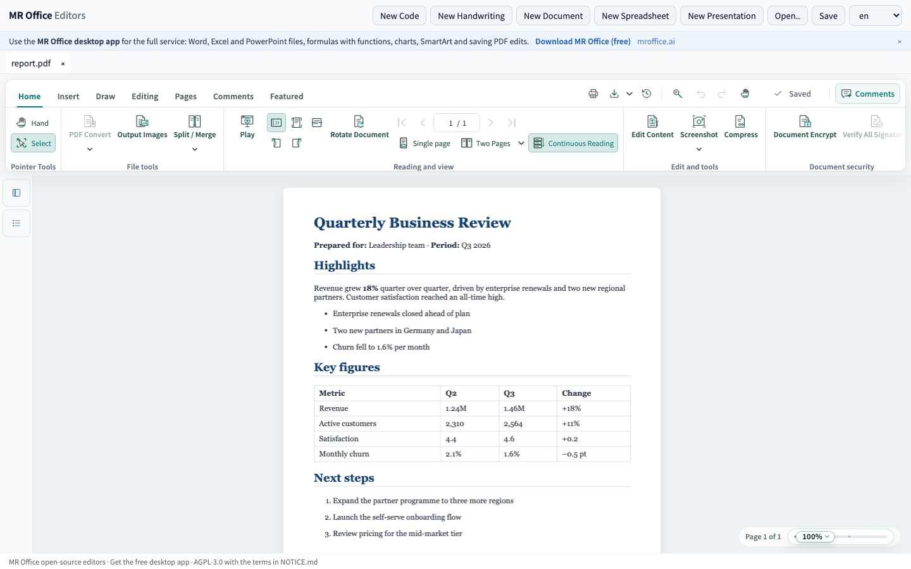
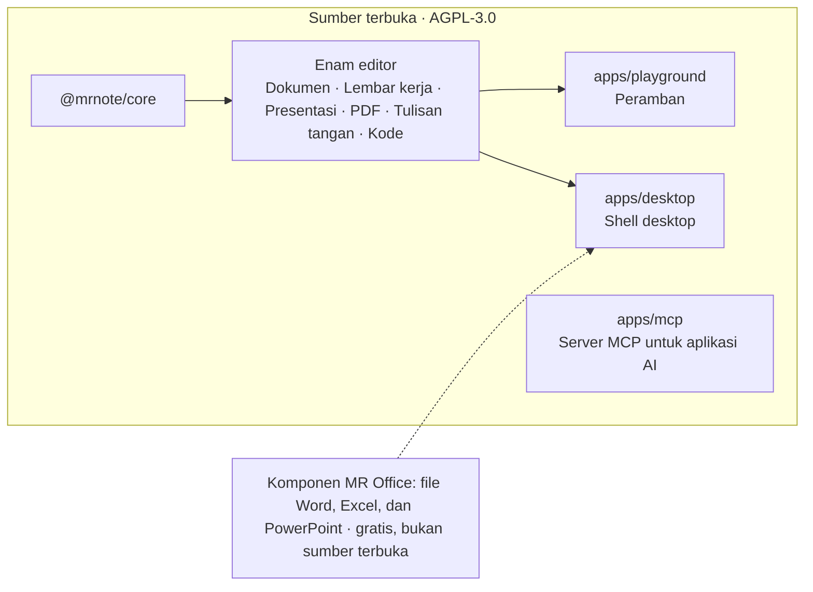

# MR Office — Bahasa Indonesia

<p align="center"><sub>🌐 <a href="../README.md">English</a> · <a href="../i18n/README.en-GB.md">English (UK)</a> · <a href="../i18n/README.zh.md">简体中文</a> · <a href="../i18n/README.zh-TW.md">繁體中文</a> · <a href="../i18n/README.ja.md">日本語</a> · <a href="../i18n/README.ko.md">한국어</a> · <a href="../i18n/README.de.md">Deutsch</a> · <a href="../i18n/README.fr.md">Français</a> · <a href="../i18n/README.es.md">Español</a> · <a href="../i18n/README.es-419.md">Español (Latinoamérica)</a> · <a href="../i18n/README.pt-BR.md">Português (Brasil)</a> · <a href="../i18n/README.it.md">Italiano</a> · <a href="../i18n/README.nl.md">Nederlands</a> · <a href="../i18n/README.sv.md">Svenska</a> · <a href="../i18n/README.da.md">Dansk</a> · <a href="../i18n/README.no.md">Norsk</a> · <a href="../i18n/README.fi.md">Suomi</a> · <a href="../i18n/README.id.md">Bahasa Indonesia</a> · <a href="../i18n/README.th.md">ไทย</a> · <a href="../i18n/README.vi.md">Tiếng Việt</a></sub></p>

<p align="center"><b>Editor sumber terbuka MR Office — dokumen, lembar kerja, presentasi, PDF, tulisan tangan, dan kode — yang berjalan di peramban.</b></p>

<p align="center"><a href="https://mroffice.ai/id"><b>▶ Coba demo langsung — tanpa instalasi</b></a> · <a href="https://github.com/XinaTian/MROffice/releases">⬇ Unduh MR Office dari Releases</a> · <a href="https://mroffice.ai">🌐 mroffice.ai</a></p>

<p align="center"><a href="../LICENSE"></a> <a href="https://github.com/XinaTian/MROffice/releases"></a> <a href="https://github.com/XinaTian/MROffice/actions/workflows/ci.yml"></a> <a href="https://github.com/XinaTian/MROffice/stargazers"></a></p>

<p align="center"><a href="https://mroffice.ai/id"></a></p>

<p align="center"><a href="../docs/media/mr-office-demo.mp4">🔊 Tonton tur 50 detik dengan suara</a></p>

<table>
<tr>
<td align="center" width="50%"><a href="https://mroffice.ai/id"></a><br><b>Dokumen</b></td>
<td align="center" width="50%"><a href="https://mroffice.ai/id"></a><br><b>Lembar kerja</b></td>
</tr>
<tr>
<td align="center" width="50%"><a href="https://mroffice.ai/id"></a><br><b>Presentasi</b></td>
<td align="center" width="50%"><a href="https://mroffice.ai/id"></a><br><b>PDF</b></td>
</tr>
<tr>
<td align="center" width="50%"><a href="https://mroffice.ai/id"></a><br><b>Tulisan tangan</b></td>
<td align="center" width="50%"><a href="https://mroffice.ai/id"></a><br><b>Kode</b></td>
</tr>
</table>

MR Office adalah ruang kerja untuk catatan, AI, dan file sungguhan. Repositori ini menerbitkan kode sumber editornya: editor yang sama dengan yang dijalankan MR Office, yang bisa Anda bangun, jalankan, dan sematkan sendiri. Ini adalah editor sumber terbuka, bukan paket perkantoran sumber terbuka yang lengkap: membaca dan menulis file Microsoft Office tetap ada di MR Office (lihat di bawah).

## Editor

Yang dilakukan setiap editor di repositori ini:

- **Dokumen** — pengolah kata berhalaman: gaya, font, daftar, tabel, header dan footer, bagian dan kolom, bentuk dan persamaan, halaman sampul dan daftar isi, komentar dan lacak perubahan, serta tinta di halaman. Menyimpan dalam formatnya sendiri (.mrdoc); membuka HTML, Markdown, dan teks biasa.
- **Lembar kerja** — sel dan rumus, format angka, pemformatan bersyarat, pengurutan dan filter, panel beku, dan banyak lembar, dengan jumlah dan rata-rata pilihan. Aritmetika antarsel (=A1*B1+10) dihitung di peramban saat diketik; rumus dengan fungsi (SUM, IF, VLOOKUP …) disimpan seperti yang ditulis. Menyimpan dalam formatnya sendiri (.mrsheet); membuka dan menyimpan CSV serta TSV.
- **Presentasi** — slide dengan delapan tema miliknya sendiri, tata letak, tampilan master slide dan tata letak, teks, bentuk, kotak teks, tabel, WordArt dan persamaan, komentar, bagian, transisi dan animasi dengan pratinjau, serta tayangan slide. Menyimpan dalam formatnya sendiri (.mrslides).
- **PDF** — membaca, mencari, menyajikan, dan mencetak file PDF, menyalin dan membacakan teksnya, serta menandai teks terpilih (sorot, garis bawah, coret, bergelombang) dengan catatan dan panel komentar selama file terbuka; menyimpan mengembalikan file seperti saat dibuka.
- **Tulisan tangan** — catatan tulisan tangan dengan pena peka tekanan, stabilo, penghapus, laso, dan penggaris, serta tinta yang diubah menjadi bentuk. Menyimpan dalam formatnya sendiri (.mrink).
- **Kode** — editor kode ringan dengan penyorotan sintaks untuk banyak bahasa, kerangka, serta cari dan ganti; JavaScript/TypeScript, Python, SQL, Lua, dan shell berjalan langsung di peramban.

Penghitungan rumus dengan fungsi, penggambaran bagan, dan tata letak SmartArt dijalankan oleh mesin MR Office sendiri, di aplikasi desktop MR Office: editor sumber terbuka menyimpan rumus, bagan, dan SmartArt dalam file, dan menampilkan SmartArt sebagaimana disimpan.

## Menjalankan editor

**▶ [Coba demo langsung — tanpa instalasi](https://mroffice.ai/id)**

Keenam editor ada di `packages/` (`@mrnote/docs`, `sheets`, `slides`, `pdf`, `ink`, `code`, yang berbagi `@mrnote/core`) dan berjalan bersama di `apps/playground`:

```bash
npm install
npm run fonts     # the open substitutes for Office's fonts
npm run build
npm run preview   # http://localhost:5178
```

`npm run dev` memulai server pengembangan di alamat yang sama, dan `npm run smoke` memeriksa hasil build. README setiap paket menjelaskan secara rinci apa yang dilakukannya dan cara menyematkannya.

## Aplikasi desktop

[`apps/desktop`](../apps/desktop) berisi **MR Office Editors**: kode sumber cangkang aplikasi desktop MR Office (Electron), dengan identitas aplikasinya sendiri. Dengan komponen MR Office gratis dari Releases, ini adalah aplikasi desktop MR Office, dengan file Word, Excel, PowerPoint, dan PDF, masuk akun, dan AI. Tanpa komponen itu, hanya editor sumber terbuka yang berjalan; editor ini membuka file .mrdoc, .mrsheet, .mrslides, dan .mrink, serta CSV, HTML, Markdown, dan PDF. Cangkang dan editor adalah kode sumber AGPL; komponennya sudah dikompilasi, gratis dipakai, dan bukan sumber terbuka. Setelah `npm run build`, jalankan dengan:

```bash
npm run desktop
```

## Untuk semua fitur, pasang aplikasi desktop MR Office (gratis)

Aplikasi desktop MR Office gratis, berisi editor-editor ini dan layanan lengkap, serta berjalan offline di komputer Anda sendiri. Aplikasi ini menambahkan yang tidak ada di editor sumber terbuka:

- Membuka dan menyimpan file Word, Excel, dan PowerPoint (.docx, .xlsx, .pptx)
- Menghitung rumus dengan fungsi (SUM, IF, VLOOKUP …)
- Bagan
- Pengeditan SmartArt
- Menyimpan hasil edit PDF kembali ke file

**[Unduh MR Office dari Releases →](https://github.com/XinaTian/MROffice/releases)** · [atau dari mroffice.ai](https://mroffice.ai)

### File Word, Excel, PowerPoint, dan PDF

Membuka dan menyimpan file Word, Excel, dan PowerPoint (.docx, .xlsx, .pptx), serta menyimpan hasil edit PDF kembali ke file, disediakan oleh aplikasi desktop MR Office (gratis), yang berisi semua editor ini dan berjalan offline di komputer Anda sendiri:

## Bagaimana bagian-bagiannya terhubung



## Lisensi

Sumber terbuka di bawah GNU Affero General Public License v3.0 (LICENSE), dengan ketentuan tambahan di NOTICE.md: pertahankan atribusi "MR Office" dan tautan ke https://mroffice.ai, dan tidak ada hak atas nama atau logo MR Office. Lisensi komersial tersedia melalui support@mr-note.com. Perangkat lunak dan data pihak ketiga tercantum di THIRD_PARTY_NOTICES.md. Kontribusi: lihat CONTRIBUTING.md.

## Selengkapnya

Situs web dan produk lengkap: **https://mroffice.ai** · Pertanyaan dan masukan: support@mr-note.com

<p align="center">Jika MR Office bermanfaat bagi Anda, ⭐ di GitHub membantu orang lain menemukannya.</p>
