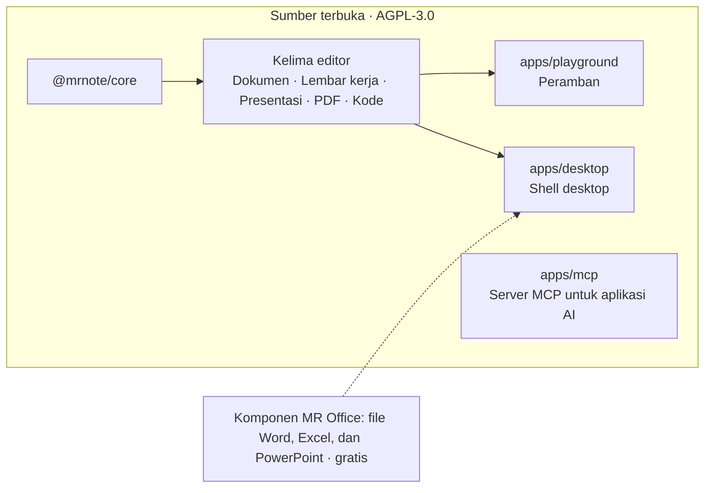

# MR Office — Bahasa Indonesia

<p align="center"><sub>🌐 <a href="../README.md">English</a> · <a href="../i18n/README.en-GB.md">English (UK)</a> · <a href="../i18n/README.zh.md">简体中文</a> · <a href="../i18n/README.zh-TW.md">繁體中文</a> · <a href="../i18n/README.ja.md">日本語</a> · <a href="../i18n/README.ko.md">한국어</a> · <a href="../i18n/README.de.md">Deutsch</a> · <a href="../i18n/README.fr.md">Français</a> · <a href="../i18n/README.es.md">Español</a> · <a href="../i18n/README.es-419.md">Español (Latinoamérica)</a> · <a href="../i18n/README.pt-BR.md">Português (Brasil)</a> · <a href="../i18n/README.it.md">Italiano</a> · <a href="../i18n/README.nl.md">Nederlands</a> · <a href="../i18n/README.sv.md">Svenska</a> · <a href="../i18n/README.da.md">Dansk</a> · <a href="../i18n/README.no.md">Norsk</a> · <a href="../i18n/README.fi.md">Suomi</a> · <a href="../i18n/README.id.md">Bahasa Indonesia</a> · <a href="../i18n/README.th.md">ไทย</a> · <a href="../i18n/README.vi.md">Tiếng Việt</a></sub></p>

<p align="center"><b>Editor open-source MR Office, editor yang paling dekat dengan Microsoft Office — dokumen, spreadsheet, presentasi, PDF, dan kode — berjalan di browser.</b></p>

<p align="center"><a href="https://mroffice.ai/id"><b>▶ Coba online</b></a> · <a href="https://mroffice.ai/id/office/download"><b>⬇ Unduh</b></a> · <a href="https://mroffice.ai">🌐 mroffice.ai</a><br><a href="https://mroffice.ai/id/developers">🧑‍💻 Pengembang</a> · <a href="https://mroffice.ai/id/developers/embed">🧩 Sematkan</a> · <a href="https://mroffice.ai/id/developers/mcp">🤖 MCP untuk aplikasi AI</a> · <a href="https://www.npmjs.com/package/mroffice-embed">📦 SDK npm</a> · <a href="https://mroffice.ai/id/developers/oauth">🔑 Masuk dengan MR Office</a></p>

<p align="center"><a href="../LICENSE"></a> <a href="https://github.com/XinaTian/MROffice/releases"></a> <a href="https://github.com/XinaTian/MROffice/actions/workflows/ci.yml"></a> <a href="https://github.com/XinaTian/MROffice/stargazers"></a></p>

<p align="center"><a href="https://mroffice.ai/id"></a></p>

<p align="center"><a href="https://demo.mroffice.ai/media/mr-office-demo.mp4">🔊 Tonton tur 50 detik dengan suara</a></p>

<table>
<tr>
<td align="center" width="50%"><a href="https://mroffice.ai/id"></a><br><b>Dokumen</b></td>
<td align="center" width="50%"><a href="https://mroffice.ai/id"></a><br><b>Lembar kerja</b></td>
</tr>
<tr>
<td align="center" width="50%"><a href="https://mroffice.ai/id"></a><br><b>Presentasi</b></td>
<td align="center" width="50%"><a href="https://mroffice.ai/id"></a><br><b>PDF</b></td>
</tr>
<tr>
<td align="center" width="50%"><a href="https://mroffice.ai/id"></a><br><b>Kode</b></td>
</tr>
</table>

MR Office adalah ruang kerja untuk catatan, AI, dan file sungguhan. Repositori ini menerbitkan kode sumber editornya: editor yang sama yang dijalankan MR Office, yang dapat Anda bangun, jalankan, dan sematkan sendiri. Bersama aplikasi desktop MR Office gratis atau embed terkelola, editor ini membuka dan menyimpan file Word, Excel, dan PowerPoint sungguhan.

## Untuk pengembang

Semua untuk pengembang ada di **[MR Office Developers](https://mroffice.ai/id/developers)** — layanan mandiri, tanpa pengajuan: masuk dengan akun MR Office mana pun dan mulai.

### Sematkan editor di aplikasi web Anda (disarankan)

MR Office menghosting editor; server Anda menandatangani token sesi berumur pendek dan halaman Anda membuka editor. Editor ini mengedit file Word, Excel, PowerPoint, dan PDF sungguhan (.docx, .xlsx, .pptx, .pdf), dengan pengeditan bersama, unggahan, semua format ekspor, pencetakan, dan penyimpanan yang dikirim kembali ke server Anda dalam callback bertanda tangan. Paket gratis: 1.000 sesi per bulan di localhost, 100 di domain Anda sendiri, hingga 2 aplikasi. Sebagai layanan terkelola, ini tidak menimbulkan kewajiban AGPL pada aplikasi Anda sendiri.

1. Di folder proyek Anda, jalankan `npx mroffice-embed init` (atau buat aplikasi di konsol pengembang): satu klik "Izinkan" di browser, dan kunci aplikasi ditulis ke `.env.local` / `.env`.
2. Server Anda membuat token sesi dengan `createSessionToken` dari `mroffice-embed/server`; kunci rahasia tidak pernah meninggalkan server.
3. Halaman Anda membuka editor dengan `open()` dari `mroffice-embed` (atau skrip `https://mroffice.ai/embed/v1/embed.js`).

```js
// server: GET /api/mroffice/session (check who is signed in first)
import { createSessionToken } from "mroffice-embed/server";
const token = await createSessionToken({
  appId: process.env.MROFFICE_APP_ID,
  secretKey: process.env.MROFFICE_SECRET_KEY, // mro_sk_..., server only
  file: { key: "contract-42", name: "contract.docx", url: signedUrlToTheFile },
  user: { id: user.id, name: user.name },
  mode: "edit",
});

// page
import { open } from "mroffice-embed";
open({ container: "#editor", token: () => fetch("/api/mroffice/session").then((r) => r.json()).then((b) => b.token) });
```

[Panduan penyematan](https://mroffice.ai/id/developers/embed) · [Panduan dalam Markdown (untuk agen AI)](https://mroffice.ai/developers/embed.md) · [Harga dan batas](https://mroffice.ai/id/developers/pricing) · [Konsol pengembang](https://mroffice.ai/id/developers/console) · [Demo langsung](https://mroffice.ai/id/developers/embed/demo)

### Aplikasi AI: server MCP

Aplikasi AI membuka, membaca, mengedit, dan mengekspor dokumen di editor MR Office yang sesungguhnya melalui server MCP-nya: hubungkan endpoint yang dihosting `https://mcp.mroffice.ai/mcp` (masuk dengan akun MR Office Anda, tanpa kunci), atau jalankan `npx -y mroffice-mcp` di komputer Anda. Kode sumbernya ada di `apps/mcp`. [Panduan MCP →](https://mroffice.ai/id/developers/mcp)

### Masuk dengan MR Office (OAuth)

MR Office adalah server otorisasi OAuth 2.1 (PKCE, dokumen metadata ID klien, pendaftaran dinamis): aplikasi Anda dapat memasukkan orang dengan akun MR Office mereka dan bertindak dalam cakupan yang mereka izinkan. [Panduan OAuth →](https://mroffice.ai/id/developers/oauth)

### Host sendiri editor sumber terbuka

Kelima editor di repositori ini dapat dibangun menjadi produk Anda sendiri di bawah AGPL-3.0: jika orang menggunakan versi yang dimodifikasi melalui jaringan, Anda harus menawarkan kode sumber lengkapnya kepada mereka, dan mempertahankan atribusi "MR Office" (NOTICE.md). Mereka membuka formatnya sendiri, CSV, HTML, Markdown, dan PDF; untuk file Word, Excel, dan PowerPoint, gunakan embed terkelola di atas. Lisensi komersial tersedia dari support@mr-note.com. [Panduan sumber terbuka →](https://mroffice.ai/id/developers/open-source)

Editor tersedia di npm sebagai komponen React: `npm i mroffice-docs mroffice-core` (dan `mroffice-sheets`, `mroffice-slides`, `mroffice-pdf`, `mroffice-code`); README setiap paket menunjukkan cara menyematkannya.

## Editor

Yang dilakukan setiap editor di repositori ini:

- **Dokumen** — pengolah kata berhalaman: font, pemformatan paragraf, daftar dan gaya di Home; halaman sampul dan kosong, pemisah halaman, tabel, gambar, bentuk, SmartArt, bagan, tautan, penanda, komentar, header, footer dan nomor halaman, persamaan, simbol, kotak teks dan WordArt di Insert. Menyimpan formatnya sendiri (.mrdoc); membuka HTML, Markdown dan teks biasa.
- **Lembar kerja** — sel dan formula dengan font, perataan, format angka, pemformatan bersyarat, gaya sel dan menyisipkan atau menghapus sel di Home; tabel, gambar, bentuk, ikon, kotak centang, bagan dan sparkline di Insert; beberapa sheet, dengan jumlah dan rata-rata dari pilihan. Aritmetika antar sel (=A1*B1+10) dihitung di browser saat Anda mengetik; formula dengan fungsi (SUM, IF, VLOOKUP …) disimpan sebagaimana ditulis. Menyimpan formatnya sendiri (.mrsheet); membuka dan menyimpan CSV dan TSV.
- **Presentasi** — slide dengan tata letak dan bagian, teks, font dan paragraf, serta bentuk dengan penataannya di Home; tabel, gambar, ikon, SmartArt, bagan, kotak teks, WordArt, header dan footer, persamaan, simbol dan video di Insert; catatan pembicara, komentar dan presentasi. Menyimpan formatnya sendiri (.mrslides).
- **PDF** — membaca, mempresentasikan dan mencetak file PDF: tampilan satu dan dua halaman, gulir berkelanjutan, rotasi, thumbnail dan mode baca, pencarian dan penyalinan teksnya, serta komentar saat file terbuka; menyimpan mengembalikan file seperti saat dibuka.
- **Kode** — editor kode ringan dengan penyorotan sintaks untuk banyak bahasa, outline, pencarian, buka cepat, penjelajah file dan daftar masalah.

Rumus dengan fungsi, grafik, dan SmartArt dihitung dan digambar oleh mesin MR Office, di aplikasi desktop gratis dan layanan terkelola; editor di sini mempertahankan setiap rumus, grafik, dan SmartArt yang dimiliki file, dan menampilkan SmartArt seperti saat disimpan.

## Menjalankan editor

**▶ [Coba demo langsung — tanpa instalasi](https://mroffice.ai/id)**

Kelima editor berada di `packages/` (`@mrnote/docs`, `sheets`, `slides`, `pdf`, `code`, berbagi `@mrnote/core`) dan berjalan bersama di `apps/playground`:

```bash
npm install
npm run fonts     # the open substitutes for Office's fonts
npm run build
npm run preview   # http://localhost:5178
```

`npm run dev` memulai server pengembangan di alamat yang sama, dan `npm run smoke` memeriksa hasil build. README setiap paket menjelaskan secara rinci apa yang dilakukannya dan cara menyematkannya.

## Aplikasi desktop

[`apps/desktop`](../apps/desktop) berisi **MR Office Editors**: sumber shell aplikasi desktop MR Office (Electron), dengan identitasnya sendiri. Dengan komponen MR Office gratis dari Releases, ia menjadi aplikasi desktop MR Office, dengan file Word, Excel, PowerPoint, dan PDF, masuk akun, dan AI. Tanpa komponen tersebut, ia menjalankan editor open-source secara mandiri, yang membuka file .mrdoc, .mrsheet, dan .mrslides, CSV, HTML, Markdown, dan PDF. Shell dan editor adalah kode sumber AGPL; komponennya adalah unduhan gratis dari Releases. Setelah `npm run build`, jalankan dengan:

```bash
npm run desktop
```

## Untuk semua fitur, pasang aplikasi desktop MR Office (gratis)

Aplikasi desktop MR Office gratis, memiliki editor ini dan layanan lengkap, serta bekerja offline di komputer Anda sendiri. Di atas editor, aplikasi ini menambahkan:

- Membuka dan menyimpan file Word, Excel, dan PowerPoint (.docx, .xlsx, .pptx)
- Menghitung rumus dengan fungsi (SUM, IF, VLOOKUP …)
- Bagan
- Pengeditan SmartArt
- Menyimpan hasil edit PDF kembali ke file

**[Unduh MR Office (gratis) →](https://mroffice.ai/id/office/download)**

### File Word, Excel, PowerPoint, dan PDF

Kerjakan file Word, Excel, dan PowerPoint sungguhan (.docx, .xlsx, .pptx) dan simpan perubahan PDF langsung ke dalam file dengan aplikasi desktop MR Office gratis, yang memiliki semua editor ini dan bekerja offline di komputer Anda sendiri:

## Bagaimana bagian-bagiannya terhubung



## Lisensi

Sumber terbuka di bawah GNU Affero General Public License v3.0 (LICENSE), dengan ketentuan tambahan di NOTICE.md: pertahankan atribusi "MR Office" dan tautan ke https://mroffice.ai, dan tidak ada hak atas nama atau logo MR Office. Lisensi komersial tersedia melalui support@mr-note.com. Perangkat lunak dan data pihak ketiga tercantum di THIRD_PARTY_NOTICES.md. Kontribusi: lihat CONTRIBUTING.md.

## Selengkapnya

Situs web dan produk lengkap: **https://mroffice.ai** · Pertanyaan dan masukan: support@mr-note.com

<p align="center">Jika MR Office bermanfaat bagi Anda, ⭐ di GitHub membantu orang lain menemukannya.</p>
