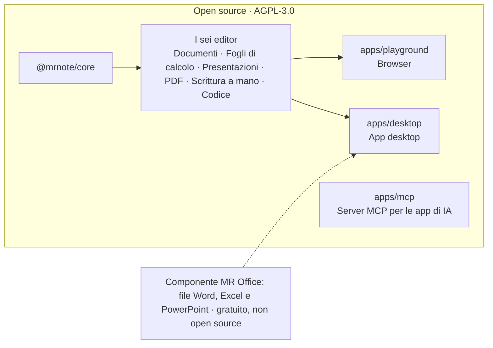

# MR Office — Italiano

<p align="center"><sub>🌐 <a href="../README.md">English</a> · <a href="../i18n/README.en-GB.md">English (UK)</a> · <a href="../i18n/README.zh.md">简体中文</a> · <a href="../i18n/README.zh-TW.md">繁體中文</a> · <a href="../i18n/README.ja.md">日本語</a> · <a href="../i18n/README.ko.md">한국어</a> · <a href="../i18n/README.de.md">Deutsch</a> · <a href="../i18n/README.fr.md">Français</a> · <a href="../i18n/README.es.md">Español</a> · <a href="../i18n/README.es-419.md">Español (Latinoamérica)</a> · <a href="../i18n/README.pt-BR.md">Português (Brasil)</a> · <a href="../i18n/README.it.md">Italiano</a> · <a href="../i18n/README.nl.md">Nederlands</a> · <a href="../i18n/README.sv.md">Svenska</a> · <a href="../i18n/README.da.md">Dansk</a> · <a href="../i18n/README.no.md">Norsk</a> · <a href="../i18n/README.fi.md">Suomi</a> · <a href="../i18n/README.id.md">Bahasa Indonesia</a> · <a href="../i18n/README.th.md">ไทย</a> · <a href="../i18n/README.vi.md">Tiếng Việt</a></sub></p>

<p align="center"><b>Gli editor open source di MR Office — documenti, fogli di calcolo, presentazioni, PDF, scrittura a mano e codice — nel browser.</b></p>

<p align="center"><a href="https://mroffice.ai/it"><b>▶ Prova la demo online, senza installare nulla</b></a> · <a href="https://github.com/XinaTian/MROffice/releases">⬇ Scarica MR Office dalle Releases</a> · <a href="https://mroffice.ai">🌐 mroffice.ai</a></p>

<p align="center"><a href="../LICENSE"></a> <a href="https://github.com/XinaTian/MROffice/releases"></a> <a href="https://github.com/XinaTian/MROffice/actions/workflows/ci.yml"></a> <a href="https://github.com/XinaTian/MROffice/stargazers"></a></p>

<p align="center"><a href="https://mroffice.ai/it"></a></p>

<p align="center"><a href="../docs/media/mr-office-demo.mp4">🔊 Guarda il tour di 50 secondi con l'audio</a></p>

<table>
<tr>
<td align="center" width="50%"><a href="https://mroffice.ai/it"></a><br><b>Documenti</b></td>
<td align="center" width="50%"><a href="https://mroffice.ai/it"></a><br><b>Fogli di calcolo</b></td>
</tr>
<tr>
<td align="center" width="50%"><a href="https://mroffice.ai/it"></a><br><b>Presentazioni</b></td>
<td align="center" width="50%"><a href="https://mroffice.ai/it"></a><br><b>PDF</b></td>
</tr>
<tr>
<td align="center" width="50%"><a href="https://mroffice.ai/it"></a><br><b>Scrittura a mano</b></td>
<td align="center" width="50%"><a href="https://mroffice.ai/it"></a><br><b>Codice</b></td>
</tr>
</table>

MR Office è uno spazio di lavoro per note, IA e file reali. Questo repository pubblica il codice sorgente dei suoi editor: gli stessi editor che usa MR Office, che puoi compilare, eseguire e incorporare in autonomia. Sono editor open source, non una suite per ufficio open source completa: la lettura e la scrittura dei file di Microsoft Office restano in MR Office (vedi sotto).

## Gli editor

Cosa fa ogni editor in questo repository:

- **Documenti** — un elaboratore di testi a pagine: stili, caratteri, elenchi, tabelle, intestazioni e piè di pagina, sezioni e colonne, forme ed equazioni, frontespizi e sommari, commenti e revisioni, e inchiostro sulla pagina. Salva nel proprio formato (.mrdoc); apre HTML, Markdown e testo semplice.
- **Fogli di calcolo** — celle e formule, formati numerici, formattazione condizionale, ordinamento e filtri, riquadri bloccati e più fogli, con somma e media della selezione. L'aritmetica tra celle (=A1*B1+10) è calcolata nel browser mentre scrivi; le formule con funzioni (SOMMA, SE, CERCA.VERT…) restano come sono scritte. Salva nel proprio formato (.mrsheet); apre e salva CSV e TSV.
- **Presentazioni** — diapositive con otto temi propri, layout, visualizzazioni schema e layout, testo, forme, caselle di testo, tabelle, WordArt ed equazioni, commenti, sezioni, transizioni e animazioni con anteprima, e presentazione. Salva nel proprio formato (.mrslides).
- **PDF** — leggere, cercare, presentare e stampare file PDF, copiarne e leggerne ad alta voce il testo, e annotare il testo selezionato (evidenziato, sottolineato, barrato, ondulato) con note e un riquadro dei commenti finché il file è aperto; il salvataggio restituisce il file così come è stato aperto.
- **Scrittura a mano** — note scritte a mano con penne sensibili alla pressione, evidenziatori, gomme, lazo e righello, e inchiostro trasformato in forme. Salva nel proprio formato (.mrink).
- **Codice** — un editor di codice leggero con evidenziazione della sintassi per molti linguaggi, una struttura e trova e sostituisci; JavaScript/TypeScript, Python, SQL, Lua e shell girano direttamente nel browser.

Il calcolo delle formule con funzioni, il disegno dei grafici e l'impaginazione degli SmartArt sono svolti dal motore di MR Office, nell'app desktop MR Office: gli editor open source conservano le formule, i grafici e gli SmartArt di un file e mostrano gli SmartArt come sono stati salvati.

## Eseguire gli editor

**▶ [Prova la demo online, senza installare nulla](https://mroffice.ai/it)**

I sei editor sono in `packages/` (`@mrnote/docs`, `sheets`, `slides`, `pdf`, `ink`, `code`, che condividono `@mrnote/core`) e girano insieme in `apps/playground`:

```bash
npm install
npm run fonts     # the open substitutes for Office's fonts
npm run build
npm run preview   # http://localhost:5178
```

`npm run dev` avvia un server di sviluppo allo stesso indirizzo e `npm run smoke` verifica una build. Il README di ogni pacchetto descrive nel dettaglio cosa fa e come incorporarlo.

## App desktop

[`apps/desktop`](../apps/desktop) contiene **MR Office Editors**: il codice sorgente della shell dell’app desktop di MR Office (Electron), con una propria identità di app. Con il componente MR Office gratuito delle Releases è l’app desktop di MR Office, con file Word, Excel, PowerPoint e PDF, accesso e IA. Senza il componente esegue solo gli editor open source, che aprono file .mrdoc, .mrsheet, .mrslides e .mrink, oltre a CSV, HTML, Markdown e PDF. Shell ed editor sono codice sorgente AGPL; il componente è compilato, gratuito e non open source. Dopo `npm run build`, avviala con:

```bash
npm run desktop
```

## Per tutte le funzioni, installa l'app desktop di MR Office (gratuita)

L'app desktop MR Office è gratuita, contiene questi editor e il servizio completo e funziona offline sul tuo computer. Aggiunge ciò che gli editor open source non hanno:

- Aprire e salvare file Word, Excel e PowerPoint (.docx, .xlsx, .pptx)
- Calcolare formule con funzioni (SOMMA, SE, CERCA.VERT …)
- Grafici
- Modifica degli SmartArt
- Salvare nel file le modifiche a un PDF

**[Scarica MR Office dalle Releases →](https://github.com/XinaTian/MROffice/releases)** · [oppure da mroffice.ai](https://mroffice.ai)

### File Word, Excel, PowerPoint e PDF

L'apertura e il salvataggio di file Word, Excel e PowerPoint (.docx, .xlsx, .pptx), e il salvataggio nel file delle modifiche a un PDF, sono offerti dall'app desktop MR Office (gratuita), che contiene tutti questi editor e funziona offline sul tuo computer:

## Come si combinano le parti



## Licenza

Open source con la GNU Affero General Public License v3.0 (LICENSE), con i termini aggiuntivi di NOTICE.md: mantenere l'attribuzione "MR Office" e il link a https://mroffice.ai, nessun diritto sul nome o sul logo MR Office. Una licenza commerciale è disponibile scrivendo a support@mr-note.com. Software e dati di terze parti sono elencati in THIRD_PARTY_NOTICES.md. Contributi: vedi CONTRIBUTING.md.

## Altro

Sito web e prodotto completo: **https://mroffice.ai** · Domande e feedback: support@mr-note.com

<p align="center">Se MR Office ti è utile, una ⭐ su GitHub aiuta altre persone a trovarlo.</p>
