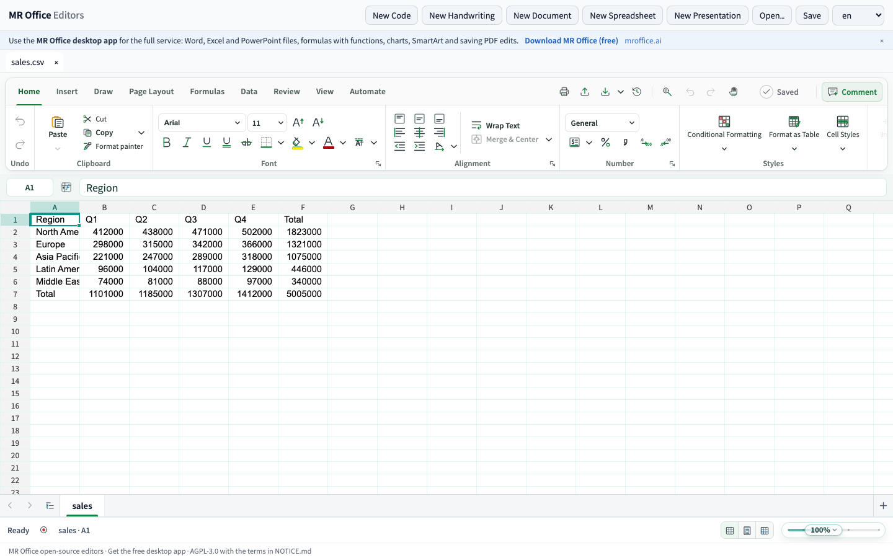
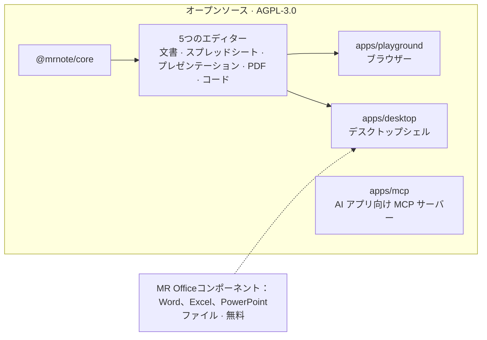

# MR Office — 日本語

<p align="center"><sub>🌐 <a href="../README.md">English</a> · <a href="../i18n/README.en-GB.md">English (UK)</a> · <a href="../i18n/README.zh.md">简体中文</a> · <a href="../i18n/README.zh-TW.md">繁體中文</a> · <a href="../i18n/README.ja.md">日本語</a> · <a href="../i18n/README.ko.md">한국어</a> · <a href="../i18n/README.de.md">Deutsch</a> · <a href="../i18n/README.fr.md">Français</a> · <a href="../i18n/README.es.md">Español</a> · <a href="../i18n/README.es-419.md">Español (Latinoamérica)</a> · <a href="../i18n/README.pt-BR.md">Português (Brasil)</a> · <a href="../i18n/README.it.md">Italiano</a> · <a href="../i18n/README.nl.md">Nederlands</a> · <a href="../i18n/README.sv.md">Svenska</a> · <a href="../i18n/README.da.md">Dansk</a> · <a href="../i18n/README.no.md">Norsk</a> · <a href="../i18n/README.fi.md">Suomi</a> · <a href="../i18n/README.id.md">Bahasa Indonesia</a> · <a href="../i18n/README.th.md">ไทย</a> · <a href="../i18n/README.vi.md">Tiếng Việt</a></sub></p>

<p align="center"><b>Microsoft Officeに最も近いエディター、MR Officeのオープンソースエディター — 文書、スプレッドシート、プレゼンテーション、PDF、コード — がブラウザーで動作します。</b></p>

<p align="center"><a href="https://mroffice.ai/ja"><b>▶ オンラインで試す</b></a> · <a href="https://mroffice.ai/ja/office/download"><b>⬇ ダウンロード</b></a> · <a href="https://mroffice.ai">🌐 mroffice.ai</a><br><a href="https://mroffice.ai/ja/developers">🧑‍💻 開発者</a> · <a href="https://mroffice.ai/ja/developers/embed">🧩 埋め込み</a> · <a href="https://mroffice.ai/ja/developers/mcp">🤖 AI アプリ向け MCP</a> · <a href="https://www.npmjs.com/package/mroffice-embed">📦 npm SDK</a> · <a href="https://mroffice.ai/ja/developers/oauth">🔑 MR Office でサインイン</a></p>

<p align="center"><a href="../LICENSE"></a> <a href="https://github.com/XinaTian/MROffice/releases"></a> <a href="https://github.com/XinaTian/MROffice/actions/workflows/ci.yml"></a> <a href="https://github.com/XinaTian/MROffice/stargazers"></a></p>

<p align="center"><a href="https://mroffice.ai/ja"></a></p>

<p align="center"><a href="https://demo.mroffice.ai/media/mr-office-demo.mp4">🔊 50 秒の紹介動画を見る（音声あり）</a></p>

<table>
<tr>
<td align="center" width="50%"><a href="https://mroffice.ai/ja"></a><br><b>文書</b></td>
<td align="center" width="50%"><a href="https://mroffice.ai/ja"></a><br><b>スプレッドシート</b></td>
</tr>
<tr>
<td align="center" width="50%"><a href="https://mroffice.ai/ja"></a><br><b>プレゼンテーション</b></td>
<td align="center" width="50%"><a href="https://mroffice.ai/ja"></a><br><b>PDF</b></td>
</tr>
<tr>
<td align="center" width="50%"><a href="https://mroffice.ai/ja"></a><br><b>コード</b></td>
</tr>
</table>

MR Officeは、ノート、AI、実際のファイルのためのワークスペースです。このリポジトリは、そのエディタのソースコードを公開しています。MR Officeが動かしているのと同じエディタで、自分でビルドし、実行し、組み込むことができます。無料のMR Officeデスクトップアプリやホスト型の埋め込みと合わせて、本物のWord、Excel、PowerPointファイルを開いて保存できます。

## 開発者向け

開発者向けのすべては **[MR Office Developers](https://mroffice.ai/ja/developers)** にあります。セルフサービスで申請は不要です。MR Office アカウントでサインインすればすぐ始められます。

### Web アプリにエディターを埋め込む（推奨）

MR Officeがエディタをホストし、あなたのサーバーが短命のセッショントークンに署名し、あなたのページがエディタを開きます。本物のWord、Excel、PowerPoint、PDFファイル（.docx、.xlsx、.pptx、.pdf）を編集でき、共同編集、アップロード、すべてのエクスポート形式、印刷、署名付きコールバックであなたのサーバーに返される保存に対応します。無料プラン：localhostで月1,000セッション、独自ドメインで100、最大2アプリ。ホスト型サービスとして、あなたのアプリにAGPLの義務を課しません。

1. プロジェクトのフォルダーで `npx mroffice-embed init` を実行します（または開発者コンソールでアプリを作成）。ブラウザーで「許可」を 1 回押すと、アプリのキーが `.env.local` / `.env` に書き込まれます。
2. サーバーは `mroffice-embed/server` の `createSessionToken` でセッショントークンを発行します。シークレットキーはサーバーの外に出ません。
3. ページは `mroffice-embed` の `open()`（またはスクリプト `https://mroffice.ai/embed/v1/embed.js`）でエディターを開きます。

```js
// server: GET /api/mroffice/session (check who is signed in first)
import { createSessionToken } from "mroffice-embed/server";
const token = await createSessionToken({
  appId: process.env.MROFFICE_APP_ID,
  secretKey: process.env.MROFFICE_SECRET_KEY, // mro_sk_..., server only
  file: { key: "contract-42", name: "contract.docx", url: signedUrlToTheFile },
  user: { id: user.id, name: user.name },
  mode: "edit",
});

// page
import { open } from "mroffice-embed";
open({ container: "#editor", token: () => fetch("/api/mroffice/session").then((r) => r.json()).then((b) => b.token) });
```

[埋め込みガイド](https://mroffice.ai/ja/developers/embed) · [Markdown 版ガイド（AI エージェント向け）](https://mroffice.ai/developers/embed.md) · [料金と上限](https://mroffice.ai/ja/developers/pricing) · [開発者コンソール](https://mroffice.ai/ja/developers/console) · [ライブデモ](https://mroffice.ai/ja/developers/embed/demo)

### AI アプリ: MCP サーバー

AI アプリは MCP サーバーを通じて、本物の MR Office エディターでドキュメントを開き、読み、編集し、エクスポートできます。ホスト型エンドポイント `https://mcp.mroffice.ai/mcp`（MR Office アカウントでサインイン、キー不要）に接続するか、自分のコンピューターで `npx -y mroffice-mcp` を実行します。ソースは `apps/mcp` にあります。 [MCP ガイド →](https://mroffice.ai/ja/developers/mcp)

### MR Office でサインイン（OAuth）

MR Office は OAuth 2.1 認可サーバーです（PKCE、クライアント ID メタデータドキュメント、動的登録）。あなたのアプリは MR Office アカウントでユーザーをサインインさせ、許可されたスコープで操作できます。 [OAuth ガイド →](https://mroffice.ai/ja/developers/oauth)

### オープンソースのエディターをセルフホストする

このリポジトリの5つのエディターは、AGPL-3.0の下で独自の製品に組み込めます。改変版をネットワーク経由で使用させる場合は、完全なソースコードを提供し、「MR Office」の表示（NOTICE.md）を保持する必要があります。独自形式、CSV、HTML、Markdown、PDFを開きます。Word、Excel、PowerPointファイルには、上記のホスト型埋め込みをご利用ください。商用ライセンスはsupport@mr-note.comから入手できます。 [オープンソースガイド →](https://mroffice.ai/ja/developers/open-source)

エディターはReactコンポーネントとしてnpmで公開されています: `npm i mroffice-docs mroffice-core`（および`mroffice-sheets`、`mroffice-slides`、`mroffice-pdf`、`mroffice-code`）。各パッケージのREADMEに埋め込み方法が記載されています。

## エディター

このリポジトリで各エディターができること：

- **文書** — ページ単位のワープロ:ホームタブにはフォント、段落書式、リスト、スタイル。挿入タブには表紙と空白ページ、改ページ、表、画像、図形、SmartArt、グラフ、リンク、ブックマーク、コメント、ヘッダー、フッター、ページ番号、数式、記号、テキストボックス、WordArt。独自形式（.mrdoc）で保存し、HTML、Markdown、プレーンテキストを開きます。
- **スプレッドシート** — セルと数式:ホームタブにはフォント、配置、表示形式、条件付き書式、セルのスタイル、セルの挿入と削除。挿入タブには表、画像、図形、アイコン、チェックボックス、グラフ、スパークライン。複数のシートに対応し、選択範囲の合計と平均を表示。セル間の四則演算（=A1*B1+10）は入力に合わせてブラウザーで計算され、関数を使う数式（SUM、IF、VLOOKUP …）は書いたとおりに保持されます。独自形式（.mrsheet）で保存し、CSVとTSVを開いて保存できます。
- **プレゼンテーション** — スライド:ホームタブにはレイアウトとセクション、テキスト、フォントと段落、図形とその配置。挿入タブには表、画像、アイコン、SmartArt、グラフ、テキストボックス、WordArt、ヘッダーとフッター、数式、記号、動画。発表者メモ、コメント、プレゼンテーションに対応。独自形式（.mrslides）で保存します。
- **PDF** — PDFファイルの閲覧、プレゼンテーション、印刷:単一ページ表示と見開き表示、連続スクロール、回転、サムネイル、閲覧モード、テキストの検索とコピー、ファイルを開いている間のコメント。保存すると、開いたときのままのファイルが返されます。
- **コード** — 多くの言語のシンタックスハイライト、アウトライン、検索、クイックオープン、ファイルエクスプローラー、問題リストを備えた軽量コードエディター。

関数を使った数式、グラフ、SmartArtは、無料のデスクトップアプリでもホスト型サービスでも、MR Officeのエンジンによって計算・描画されます。ここにあるエディタは、ファイルに含まれるすべての数式、グラフ、SmartArtを保持し、SmartArtは保存されたとおりに表示します。

## エディターを動かす

**▶ [ライブデモを試す（インストール不要）](https://mroffice.ai/ja)**

5つのエディターは`packages/`（`@mrnote/docs`、`sheets`、`slides`、`pdf`、`code`、共通の`@mrnote/core`）にあり、`apps/playground`で一緒に動作します:

```bash
npm install
npm run fonts     # the open substitutes for Office's fonts
npm run build
npm run preview   # http://localhost:5178
```

`npm run dev` は同じアドレスで開発サーバーを起動し、`npm run smoke` はビルドを確認します。各パッケージの README に、できることの詳細と組み込み方を載せています。

## デスクトップアプリ

[`apps/desktop`](../apps/desktop)には**MR Office Editors**があります。これはMR Officeデスクトップアプリのシェル（Electron）のソースであり、独自のアイデンティティを持ちます。Releasesの無料MR Officeコンポーネントと組み合わせると、Word、Excel、PowerPoint、PDFファイル、サインイン、AIを備えたMR Officeデスクトップアプリになります。コンポーネントなしでは、オープンソースエディターを単独で実行し、.mrdoc、.mrsheet、.mrslidesファイル、CSV、HTML、Markdown、PDFを開きます。シェルとエディターはAGPLソースコードです。コンポーネントはReleasesから無料でダウンロードできます。`npm run build`の後、次のコマンドで起動します:

```bash
npm run desktop
```

## すべての機能を使うには MR Office デスクトップ版（無料）をインストールしてください

MR Officeデスクトップアプリは無料で、これらのエディタとフルサービスを備え、お使いのコンピュータでオフラインでも動作します。エディタに加えて、次の機能があります：

- Word・Excel・PowerPoint ファイル（.docx、.xlsx、.pptx）を開いて保存
- 関数を使う数式（SUM、IF、VLOOKUP など）の計算
- グラフ
- SmartArt の編集
- PDF の編集内容をファイルに書き戻す

**[MR Office をダウンロード（無料） →](https://mroffice.ai/ja/office/download)**

### Word、Excel、PowerPoint、PDF ファイル

本物のWord、Excel、PowerPointファイル（.docx、.xlsx、.pptx）で作業し、PDFの編集内容をファイルにそのまま保存できます。無料のMR Officeデスクトップアプリにはこれらのエディタがすべて揃い、お使いのコンピュータでオフラインでも動作します：

## 構成



## ライセンス

GNU Affero General Public License v3.0（LICENSE）のもとで、NOTICE.md の追加条項とともに公開しています。「MR Office」の表示と https://mroffice.ai へのリンクを残すこと、MR Office の名称とロゴの権利は付与されないことが条件です。商用ライセンスは support@mr-note.com までお問い合わせください。サードパーティのソフトウェアとデータは THIRD_PARTY_NOTICES.md に記載しています。コントリビューションについては CONTRIBUTING.md をご覧ください。

## 詳しく

Web サイトと製品版：**https://mroffice.ai** · ご質問・ご意見：support@mr-note.com

<p align="center">MR Office が役に立ったら、GitHub で ⭐ を付けてください。ほかの人が見つけやすくなります。</p>
