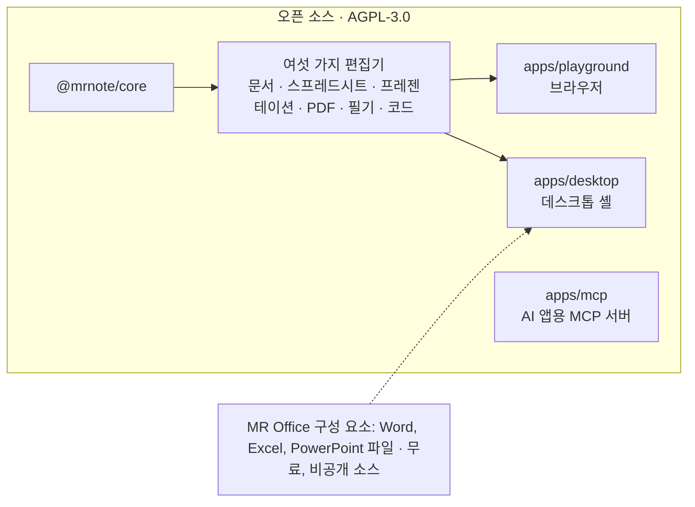

# MR Office — 한국어

<p align="center"><sub>🌐 <a href="../README.md">English</a> · <a href="../i18n/README.en-GB.md">English (UK)</a> · <a href="../i18n/README.zh.md">简体中文</a> · <a href="../i18n/README.zh-TW.md">繁體中文</a> · <a href="../i18n/README.ja.md">日本語</a> · <a href="../i18n/README.ko.md">한국어</a> · <a href="../i18n/README.de.md">Deutsch</a> · <a href="../i18n/README.fr.md">Français</a> · <a href="../i18n/README.es.md">Español</a> · <a href="../i18n/README.es-419.md">Español (Latinoamérica)</a> · <a href="../i18n/README.pt-BR.md">Português (Brasil)</a> · <a href="../i18n/README.it.md">Italiano</a> · <a href="../i18n/README.nl.md">Nederlands</a> · <a href="../i18n/README.sv.md">Svenska</a> · <a href="../i18n/README.da.md">Dansk</a> · <a href="../i18n/README.no.md">Norsk</a> · <a href="../i18n/README.fi.md">Suomi</a> · <a href="../i18n/README.id.md">Bahasa Indonesia</a> · <a href="../i18n/README.th.md">ไทย</a> · <a href="../i18n/README.vi.md">Tiếng Việt</a></sub></p>

<p align="center"><b>MR Office의 오픈 소스 편집기: 문서, 스프레드시트, 프레젠테이션, PDF, 필기, 코드가 브라우저에서 실행됩니다.</b></p>

<p align="center"><a href="https://mroffice.ai/ko"><b>▶ 온라인 체험</b></a> · <a href="https://mroffice.ai/ko/office/download"><b>⬇ 다운로드</b></a> · <a href="https://mroffice.ai">🌐 mroffice.ai</a><br><a href="https://mroffice.ai/ko/developers">🧑‍💻 개발자</a> · <a href="https://mroffice.ai/ko/developers/embed">🧩 임베드</a> · <a href="https://mroffice.ai/ko/developers/mcp">🤖 AI 앱용 MCP</a> · <a href="https://www.npmjs.com/package/mroffice-embed">📦 npm SDK</a> · <a href="https://mroffice.ai/ko/developers/oauth">🔑 MR Office로 로그인</a></p>

<p align="center"><a href="../LICENSE"></a> <a href="https://github.com/XinaTian/MROffice/releases"></a> <a href="https://github.com/XinaTian/MROffice/actions/workflows/ci.yml"></a> <a href="https://github.com/XinaTian/MROffice/stargazers"></a></p>

<p align="center"><a href="https://mroffice.ai/ko"></a></p>

<p align="center"><a href="https://demo.mroffice.ai/media/mr-office-demo.mp4">🔊 50초 소개 영상 보기 (소리 포함)</a></p>

<table>
<tr>
<td align="center" width="50%"><a href="https://mroffice.ai/ko"></a><br><b>문서</b></td>
<td align="center" width="50%"><a href="https://mroffice.ai/ko"></a><br><b>스프레드시트</b></td>
</tr>
<tr>
<td align="center" width="50%"><a href="https://mroffice.ai/ko"></a><br><b>프레젠테이션</b></td>
<td align="center" width="50%"><a href="https://mroffice.ai/ko"></a><br><b>PDF</b></td>
</tr>
<tr>
<td align="center" width="50%"><a href="https://mroffice.ai/ko"></a><br><b>필기</b></td>
<td align="center" width="50%"><a href="https://mroffice.ai/ko"></a><br><b>코드</b></td>
</tr>
</table>

MR Office는 노트, AI, 실제 파일을 한곳에 모은 작업 공간입니다. 이 저장소는 그 편집기의 소스 코드를 공개합니다. MR Office에서 실행되는 것과 같은 편집기이며, 직접 빌드하고 실행하고 포함할 수 있습니다. 이것은 오픈 소스 편집기이지 완전한 오픈 소스 Office 제품군이 아닙니다. Microsoft Office 파일의 읽기와 쓰기는 MR Office가 제공합니다(아래 참고).

## 개발자용

개발자에게 필요한 모든 것은 **[MR Office Developers](https://mroffice.ai/ko/developers)**에 있습니다. 셀프 서비스이며 신청이 필요 없습니다. MR Office 계정으로 로그인하고 바로 시작하세요.

### 웹 앱에 편집기 임베드하기(권장)

편집기는 MR Office가 호스팅합니다. 서버가 짧게 유효한 세션 토큰에 서명하면 페이지가 그것으로 편집기를 엽니다. 실제 Word, Excel, PowerPoint, PDF 파일(.docx, .xlsx, .pptx, .pdf)을 편집하며 공동 편집, 업로드, 모든 내보내기 형식, 인쇄를 지원하고, 저장된 파일은 서명된 콜백으로 서버에 전달됩니다. 무료 플랜: localhost 개발 월 1,000회, 운영 도메인 월 100회, 앱 최대 2개. 호스팅되는 상용 서비스이므로 여러분의 앱은 이 저장소의 AGPL 라이선스에 구속되지 않습니다.

1. 프로젝트 폴더에서 `npx mroffice-embed init`를 실행하세요(또는 개발자 콘솔에서 앱을 만드세요). 브라우저에서 "허용"을 한 번 누르면 앱의 키가 `.env.local` / `.env`에 기록됩니다.
2. 서버는 `mroffice-embed/server`의 `createSessionToken`으로 세션 토큰을 발급합니다. 시크릿 키는 서버를 떠나지 않습니다.
3. 페이지는 `mroffice-embed`의 `open()`(또는 스크립트 `https://mroffice.ai/embed/v1/embed.js`)으로 편집기를 엽니다.

```js
// server: GET /api/mroffice/session (check who is signed in first)
import { createSessionToken } from "mroffice-embed/server";
const token = await createSessionToken({
  appId: process.env.MROFFICE_APP_ID,
  secretKey: process.env.MROFFICE_SECRET_KEY, // mro_sk_..., server only
  file: { key: "contract-42", name: "contract.docx", url: signedUrlToTheFile },
  user: { id: user.id, name: user.name },
  mode: "edit",
});

// page
import { open } from "mroffice-embed";
open({ container: "#editor", token: () => fetch("/api/mroffice/session").then((r) => r.json()).then((b) => b.token) });
```

[임베드 가이드](https://mroffice.ai/ko/developers/embed) · [Markdown 가이드(AI 에이전트용)](https://mroffice.ai/developers/embed.md) · [가격 및 한도](https://mroffice.ai/ko/developers/pricing) · [개발자 콘솔](https://mroffice.ai/ko/developers/console) · [라이브 데모](https://mroffice.ai/ko/developers/embed/demo)

### AI 앱: MCP 서버

AI 앱은 MCP 서버를 통해 실제 MR Office 편집기에서 문서를 열고, 읽고, 편집하고, 내보낼 수 있습니다. 호스팅 엔드포인트 `https://mcp.mroffice.ai/mcp`(MR Office 계정으로 로그인, 키 불필요)에 연결하거나 내 컴퓨터에서 `npx -y mroffice-mcp`를 실행하세요. 소스는 `apps/mcp`에 있습니다. [MCP 가이드 →](https://mroffice.ai/ko/developers/mcp)

### MR Office로 로그인(OAuth)

MR Office는 OAuth 2.1 인가 서버입니다(PKCE, 클라이언트 ID 메타데이터 문서, 동적 등록). 여러분의 앱은 사용자를 MR Office 계정으로 로그인시키고 허용된 범위 안에서 동작할 수 있습니다. [OAuth 가이드 →](https://mroffice.ai/ko/developers/oauth)

### 오픈 소스 편집기 직접 호스팅하기

이 저장소의 편집기 6개는 AGPL-3.0에 따라 여러분의 제품에 넣을 수 있습니다. 수정한 버전을 네트워크로 제공한다면 전체 소스 코드를 제공하고 "MR Office" 표기(NOTICE.md)를 유지해야 합니다. 자체 형식, CSV, HTML, Markdown, PDF를 엽니다. Word, Excel, PowerPoint 파일은 오픈 소스 편집기에 포함되지 않습니다(위의 호스팅 임베드에서 지원). 상용 라이선스는 support@mr-note.com으로 문의하세요. [오픈 소스 가이드 →](https://mroffice.ai/ko/developers/open-source)

npm 패키지를 `mroffice-core`, `mroffice-docs`, `mroffice-sheets`, `mroffice-slides`, `mroffice-pdf`, `mroffice-ink`, `mroffice-code`라는 이름으로 준비 중입니다. 게시되기 전까지는 이 저장소에서 편집기를 빌드하세요(아래 참고).

## 편집기

이 저장소에서 각 편집기가 하는 일:

- **문서** — 페이지 단위 워드 프로세서: 스타일, 글꼴, 목록, 표, 머리글과 바닥글, 구역과 단, 도형과 수식, 표지와 목차, 메모와 변경 내용 추적, 페이지 위 필기. 고유 형식(.mrdoc)으로 저장하며 HTML, Markdown, 일반 텍스트를 엽니다.
- **스프레드시트** — 셀과 수식, 숫자 서식, 조건부 서식, 정렬과 필터, 틀 고정, 여러 시트, 선택 영역의 합계와 평균. 셀 사이의 사칙연산(=A1*B1+10 등)은 입력하면 브라우저에서 계산되고, 함수를 쓰는 수식(SUM, IF, VLOOKUP 등)은 쓴 그대로 보존됩니다. 고유 형식(.mrsheet)으로 저장하며 CSV와 TSV를 열고 저장합니다.
- **프레젠테이션** — 고유 테마 8개가 있는 슬라이드: 레이아웃, 슬라이드 마스터와 레이아웃 보기, 텍스트, 도형, 텍스트 상자, 표, WordArt와 수식, 메모, 구역, 화면 전환과 애니메이션(미리 보기), 슬라이드 쇼. 고유 형식(.mrslides)으로 저장합니다.
- **PDF** — PDF 읽기, 검색, 프레젠테이션, 인쇄, 텍스트 복사와 소리 내어 읽기. 파일이 열려 있는 동안 선택한 텍스트에 강조 표시, 밑줄, 취소선, 물결선을 달고 메모와 메모 창을 쓸 수 있습니다. 저장하면 연 그대로의 파일을 돌려줍니다.
- **필기** — 압력 감지 펜, 형광펜, 지우개, 올가미, 눈금자. 잉크를 도형으로 바꿉니다. 고유 형식(.mrink)으로 저장합니다.
- **코드** — 여러 언어의 구문 강조, 개요, 찾기 및 바꾸기를 갖춘 가벼운 코드 편집기. JavaScript/TypeScript, Python, SQL, Lua, 셸을 브라우저에서 바로 실행합니다.

함수가 들어간 수식 계산, 차트 그리기, SmartArt 레이아웃은 MR Office 자체 엔진이 처리하며 MR Office 데스크톱 앱에서 제공됩니다. 오픈 소스 편집기는 파일에 있는 수식, 차트, SmartArt를 그대로 보존하고 SmartArt는 저장된 모습대로 표시합니다.

## 편집기 실행

**▶ [라이브 데모 체험 (설치 불필요)](https://mroffice.ai/ko)**

여섯 편집기는 `packages/`(`@mrnote/docs`, `sheets`, `slides`, `pdf`, `ink`, `code`, 공통 `@mrnote/core`)에 있으며 `apps/playground`에서 함께 실행됩니다:

```bash
npm install
npm run fonts     # the open substitutes for Office's fonts
npm run build
npm run preview   # http://localhost:5178
```

`npm run dev`는 같은 주소에서 개발 서버를 시작하고, `npm run smoke`는 빌드를 점검합니다. 각 패키지의 README에 하는 일과 포함 방법을 자세히 적었습니다.

## 데스크톱 앱

[`apps/desktop`](../apps/desktop)에는 **MR Office Editors**가 있습니다. MR Office 데스크톱 앱 셸(Electron)의 소스 코드이며 고유한 앱 ID를 사용합니다. Releases의 무료 MR Office 구성 요소를 설치하면 MR Office 데스크톱 앱이 되어 Word, Excel, PowerPoint, PDF 파일과 로그인, AI를 쓸 수 있습니다. 구성 요소가 없으면 오픈 소스 편집기만 실행되며 .mrdoc, .mrsheet, .mrslides, .mrink 파일과 CSV, HTML, Markdown, PDF를 엽니다. 셸과 편집기는 AGPL 소스 코드이고, 구성 요소는 컴파일된 것으로 무료로 쓸 수 있지만 오픈 소스가 아닙니다. `npm run build` 후 다음으로 실행합니다:

```bash
npm run desktop
```

## 모든 기능을 사용하려면 MR Office 데스크톱 앱(무료)을 설치하세요

MR Office 데스크톱 앱은 무료이며 이 편집기들과 전체 서비스를 갖추고 있고, 내 컴퓨터에서 오프라인으로도 작동합니다. 오픈 소스 편집기에 없는 다음 기능을 제공합니다:

- Word, Excel, PowerPoint 파일(.docx, .xlsx, .pptx) 열기와 저장
- 함수가 들어간 수식(SUM, IF, VLOOKUP 등) 계산
- 차트
- SmartArt 편집
- PDF 편집 내용을 파일에 다시 저장

**[MR Office 다운로드(무료) →](https://mroffice.ai/ko/office/download)**

### Word, Excel, PowerPoint, PDF 파일

Word, Excel, PowerPoint 파일(.docx, .xlsx, .pptx) 열기와 저장, PDF 편집 내용을 파일에 다시 저장하는 기능은 무료 MR Office 데스크톱 앱이 제공합니다. 데스크톱 앱에는 이 편집기들이 모두 들어 있으며 내 컴퓨터에서 오프라인으로도 작동합니다:

## 구성



## 라이선스

GNU Affero General Public License v3.0(LICENSE)과 NOTICE.md의 추가 조건으로 공개합니다. "MR Office" 표시와 https://mroffice.ai 링크를 유지해야 하며, MR Office 이름과 로고에 대한 권리는 부여되지 않습니다. 상업용 라이선스는 support@mr-note.com으로 문의하세요. 서드파티 소프트웨어와 데이터는 THIRD_PARTY_NOTICES.md에 있습니다. 기여 방법은 CONTRIBUTING.md를 보세요.

## 더 보기

웹사이트와 전체 제품: **https://mroffice.ai** · 질문과 의견: support@mr-note.com

<p align="center">MR Office가 유용했다면 GitHub에서 ⭐를 눌러 주세요. 다른 사람들이 찾는 데 도움이 됩니다.</p>
