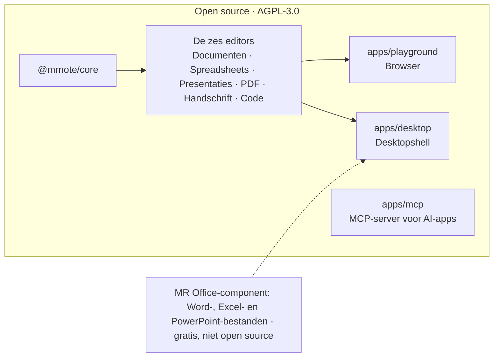

# MR Office — Nederlands

<p align="center"><sub>🌐 <a href="../README.md">English</a> · <a href="../i18n/README.en-GB.md">English (UK)</a> · <a href="../i18n/README.zh.md">简体中文</a> · <a href="../i18n/README.zh-TW.md">繁體中文</a> · <a href="../i18n/README.ja.md">日本語</a> · <a href="../i18n/README.ko.md">한국어</a> · <a href="../i18n/README.de.md">Deutsch</a> · <a href="../i18n/README.fr.md">Français</a> · <a href="../i18n/README.es.md">Español</a> · <a href="../i18n/README.es-419.md">Español (Latinoamérica)</a> · <a href="../i18n/README.pt-BR.md">Português (Brasil)</a> · <a href="../i18n/README.it.md">Italiano</a> · <a href="../i18n/README.nl.md">Nederlands</a> · <a href="../i18n/README.sv.md">Svenska</a> · <a href="../i18n/README.da.md">Dansk</a> · <a href="../i18n/README.no.md">Norsk</a> · <a href="../i18n/README.fi.md">Suomi</a> · <a href="../i18n/README.id.md">Bahasa Indonesia</a> · <a href="../i18n/README.th.md">ไทย</a> · <a href="../i18n/README.vi.md">Tiếng Việt</a></sub></p>

<p align="center"><b>De opensource-editors van MR Office — documenten, spreadsheets, presentaties, pdf, handschrift en code — in de browser.</b></p>

<p align="center"><a href="https://mroffice.ai/nl"><b>▶ Online proberen</b></a> · <a href="https://mroffice.ai/nl/office/download"><b>⬇ Downloaden</b></a> · <a href="https://mroffice.ai">🌐 mroffice.ai</a><br><a href="https://mroffice.ai/nl/developers">🧑‍💻 Ontwikkelaars</a> · <a href="https://mroffice.ai/nl/developers/embed">🧩 Insluiten</a> · <a href="https://mroffice.ai/nl/developers/mcp">🤖 MCP voor AI-apps</a> · <a href="https://www.npmjs.com/package/mroffice-embed">📦 npm-SDK</a> · <a href="https://mroffice.ai/nl/developers/oauth">🔑 Inloggen met MR Office</a></p>

<p align="center"><a href="../LICENSE"></a> <a href="https://github.com/XinaTian/MROffice/releases"></a> <a href="https://github.com/XinaTian/MROffice/actions/workflows/ci.yml"></a> <a href="https://github.com/XinaTian/MROffice/stargazers"></a></p>

<p align="center"><a href="https://mroffice.ai/nl"></a></p>

<p align="center"><a href="https://demo.mroffice.ai/media/mr-office-demo.mp4">🔊 Bekijk de rondleiding van 50 seconden met geluid</a></p>

<table>
<tr>
<td align="center" width="50%"><a href="https://mroffice.ai/nl"></a><br><b>Documenten</b></td>
<td align="center" width="50%"><a href="https://mroffice.ai/nl"></a><br><b>Spreadsheets</b></td>
</tr>
<tr>
<td align="center" width="50%"><a href="https://mroffice.ai/nl"></a><br><b>Presentaties</b></td>
<td align="center" width="50%"><a href="https://mroffice.ai/nl"></a><br><b>PDF</b></td>
</tr>
<tr>
<td align="center" width="50%"><a href="https://mroffice.ai/nl"></a><br><b>Handschrift</b></td>
<td align="center" width="50%"><a href="https://mroffice.ai/nl"></a><br><b>Code</b></td>
</tr>
</table>

MR Office is een werkruimte voor notities, AI en echte bestanden. Deze repository publiceert de broncode van de editors: dezelfde editors die MR Office gebruikt, die je zelf kunt bouwen, draaien en insluiten. Het zijn opensource-editors, geen volledige opensource-kantoorsuite: het lezen en schrijven van Microsoft Office-bestanden blijft in MR Office (zie hieronder).

## Voor ontwikkelaars

Alles voor ontwikkelaars staat op **[MR Office Developers](https://mroffice.ai/nl/developers)** — selfservice, geen aanvraag: log in met een willekeurig MR Office-account en begin.

### De editors in je webapp insluiten (aanbevolen)

MR Office host de editors; je server ondertekent een kortlevend sessietoken en je pagina opent daarmee de editor. Hij bewerkt echte Word-, Excel-, PowerPoint- en PDF-bestanden (.docx, .xlsx, .pptx, .pdf), met samen bewerken, uploads, alle exportformaten, afdrukken en opgeslagen versies die via een ondertekende callback naar je server gaan. Gratis abonnement: 1.000 sessies per maand op localhost, 100 op je eigen domeinen, tot 2 apps. Het is een gehoste commerciële dienst, dus je eigen app valt niet onder de AGPL-licentie van deze repository.

1. Voer in de map van je project `npx mroffice-embed init` uit (of maak een app in de ontwikkelaarsconsole): één klik op "Toestaan" in de browser en de sleutels van de app staan in `.env.local` / `.env`.
2. Je server maakt een sessietoken met `createSessionToken` uit `mroffice-embed/server`; de geheime sleutel verlaat de server nooit.
3. Je pagina opent de editor met `open()` uit `mroffice-embed` (of het script `https://mroffice.ai/embed/v1/embed.js`).

```js
// server: GET /api/mroffice/session (check who is signed in first)
import { createSessionToken } from "mroffice-embed/server";
const token = await createSessionToken({
  appId: process.env.MROFFICE_APP_ID,
  secretKey: process.env.MROFFICE_SECRET_KEY, // mro_sk_..., server only
  file: { key: "contract-42", name: "contract.docx", url: signedUrlToTheFile },
  user: { id: user.id, name: user.name },
  mode: "edit",
});

// page
import { open } from "mroffice-embed";
open({ container: "#editor", token: () => fetch("/api/mroffice/session").then((r) => r.json()).then((b) => b.token) });
```

[Insluitgids](https://mroffice.ai/nl/developers/embed) · [De gids als Markdown (voor AI-agents)](https://mroffice.ai/developers/embed.md) · [Prijzen en limieten](https://mroffice.ai/nl/developers/pricing) · [Ontwikkelaarsconsole](https://mroffice.ai/nl/developers/console) · [Live demo](https://mroffice.ai/nl/developers/embed/demo)

### AI-apps: de MCP-server

AI-apps openen, lezen, bewerken en exporteren documenten in de echte MR Office-editor via de MCP-server: verbind het gehoste eindpunt `https://mcp.mroffice.ai/mcp` (inloggen met je MR Office-account, geen sleutel) of voer `npx -y mroffice-mcp` uit op je eigen computer. De broncode staat in `apps/mcp`. [MCP-gids →](https://mroffice.ai/nl/developers/mcp)

### Inloggen met MR Office (OAuth)

MR Office is een OAuth 2.1-autorisatieserver (PKCE, client-ID-metadatadocumenten, dynamische registratie): je app kan mensen laten inloggen met hun MR Office-account en handelen met de scopes die zij toestaan. [OAuth-gids →](https://mroffice.ai/nl/developers/oauth)

### De open-source editors zelf hosten

De zes editors in deze repository kun je onder de AGPL-3.0 in je eigen product opnemen: gebruiken mensen een gewijzigde versie via een netwerk, dan moet je hun de volledige broncode aanbieden en de vermelding "MR Office" (NOTICE.md) behouden. Ze openen hun eigen formaten, CSV, HTML, Markdown en PDF; Word-, Excel- en PowerPoint-bestanden horen niet bij de open-source editors (de gehoste insluiting hierboven wel). Een commerciële licentie is verkrijgbaar via support@mr-note.com. [Open-sourcegids →](https://mroffice.ai/nl/developers/open-source)

Er worden npm-pakketten voorbereid onder de namen `mroffice-core`, `mroffice-docs`, `mroffice-sheets`, `mroffice-slides`, `mroffice-pdf`, `mroffice-ink` en `mroffice-code`; tot ze gepubliceerd zijn, bouw je de editors uit deze repository (zie hieronder).

## De editors

Wat elke editor in deze repository doet:

- **Documenten** — een tekstverwerker met pagina's: stijlen, lettertypen, lijsten, tabellen, kop- en voetteksten, secties en kolommen, vormen en vergelijkingen, voorbladen en inhoudsopgaven, opmerkingen en wijzigingen bijhouden, en inkt op de pagina. Slaat op in een eigen formaat (.mrdoc); opent HTML, Markdown en platte tekst.
- **Spreadsheets** — cellen en formules, getalnotaties, voorwaardelijke opmaak, sorteren en filteren, vastgezette deelvensters en meerdere bladen, met som en gemiddelde van de selectie. Rekenen tussen cellen (=A1*B1+10) gebeurt tijdens het typen in de browser; formules met functies (SOM, ALS, VERT.ZOEKEN …) blijven staan zoals ze zijn geschreven. Slaat op in een eigen formaat (.mrsheet); opent en bewaart CSV en TSV.
- **Presentaties** — dia's met acht eigen thema's, indelingen, diamodel- en indelingsweergave, tekst, vormen, tekstvakken, tabellen, WordArt en vergelijkingen, opmerkingen, secties, overgangen en animaties met voorbeeld, en een diavoorstelling. Slaat op in een eigen formaat (.mrslides).
- **PDF** — pdf-bestanden lezen, doorzoeken, presenteren en afdrukken, tekst kopiëren en laten voorlezen, en geselecteerde tekst markeren (markeren, onderstrepen, doorhalen, golflijn) met notities en een opmerkingenvenster zolang het bestand open is; opslaan geeft het bestand terug zoals het werd geopend.
- **Handschrift** — handgeschreven notities met drukgevoelige pennen, markeerstiften, gummen, lasso en liniaal, en inkt die vormen wordt. Slaat op in een eigen formaat (.mrink).
- **Code** — een lichte code-editor met syntaxiskleuring voor veel talen, een overzicht, en zoeken en vervangen; JavaScript/TypeScript, Python, SQL, Lua en shell draaien direct in de browser.

Formules met functies berekenen, grafieken tekenen en SmartArt opmaken doet de eigen engine van MR Office, in de desktop-app van MR Office: de opensource-editors bewaren de formules, grafieken en SmartArt van een bestand en tonen SmartArt zoals het is opgeslagen.

## De editors draaien

**▶ [Probeer de live demo – zonder installatie](https://mroffice.ai/nl)**

De zes editors staan in `packages/` (`@mrnote/docs`, `sheets`, `slides`, `pdf`, `ink`, `code`, die `@mrnote/core` delen) en draaien samen in `apps/playground`:

```bash
npm install
npm run fonts     # the open substitutes for Office's fonts
npm run build
npm run preview   # http://localhost:5178
```

`npm run dev` start een ontwikkelserver op hetzelfde adres en `npm run smoke` controleert een build. De README van elk pakket beschrijft in detail wat het doet en hoe je het insluit.

## Desktop-app

[`apps/desktop`](../apps/desktop) bevat **MR Office Editors**: de broncode van de schil van de MR Office-desktop-app (Electron), met een eigen app-identiteit. Met het gratis MR Office-onderdeel uit Releases is het de MR Office-desktop-app, met Word-, Excel-, PowerPoint- en PDF-bestanden, inloggen en AI. Zonder het onderdeel draaien alleen de opensource-editors; die openen .mrdoc-, .mrsheet-, .mrslides- en .mrink-bestanden en CSV, HTML, Markdown en PDF. De schil en de editors zijn AGPL-broncode; het onderdeel is gecompileerd, gratis te gebruiken en niet open source. Start de app na `npm run build` met:

```bash
npm run desktop
```

## Voor alle functies: installeer de desktop-app van MR Office (gratis)

De desktop-app van MR Office is gratis, bevat deze editors en de volledige dienst, en werkt offline op je eigen computer. Hij voegt toe wat de opensource-editors niet hebben:

- Word-, Excel- en PowerPoint-bestanden (.docx, .xlsx, .pptx) openen en opslaan
- Formules met functies (SOM, ALS, VERT.ZOEKEN …) berekenen
- Grafieken
- SmartArt bewerken
- Bewerkingen van een pdf terugschrijven in het bestand

**[MR Office downloaden (gratis) →](https://mroffice.ai/nl/office/download)**

### Word-, Excel-, PowerPoint- en pdf-bestanden

Word-, Excel- en PowerPoint-bestanden (.docx, .xlsx, .pptx) openen en opslaan, en bewerkingen van een pdf terugschrijven in het bestand, doet de gratis desktop-app van MR Office. Die bevat al deze editors en werkt offline op je eigen computer:

## Hoe de onderdelen samenhangen



## Licentie

Open source onder de GNU Affero General Public License v3.0 (LICENSE), met de aanvullende voorwaarden in NOTICE.md: behoud de vermelding "MR Office" en de link naar https://mroffice.ai, en geen rechten op de naam of het logo van MR Office. Een commerciële licentie is verkrijgbaar via support@mr-note.com. Software en gegevens van derden staan in THIRD_PARTY_NOTICES.md. Bijdragen: zie CONTRIBUTING.md.

## Meer

Website en het volledige product: **https://mroffice.ai** · Vragen en feedback: support@mr-note.com

<p align="center">Heb je iets aan MR Office? Een ⭐ op GitHub helpt anderen het te vinden.</p>
