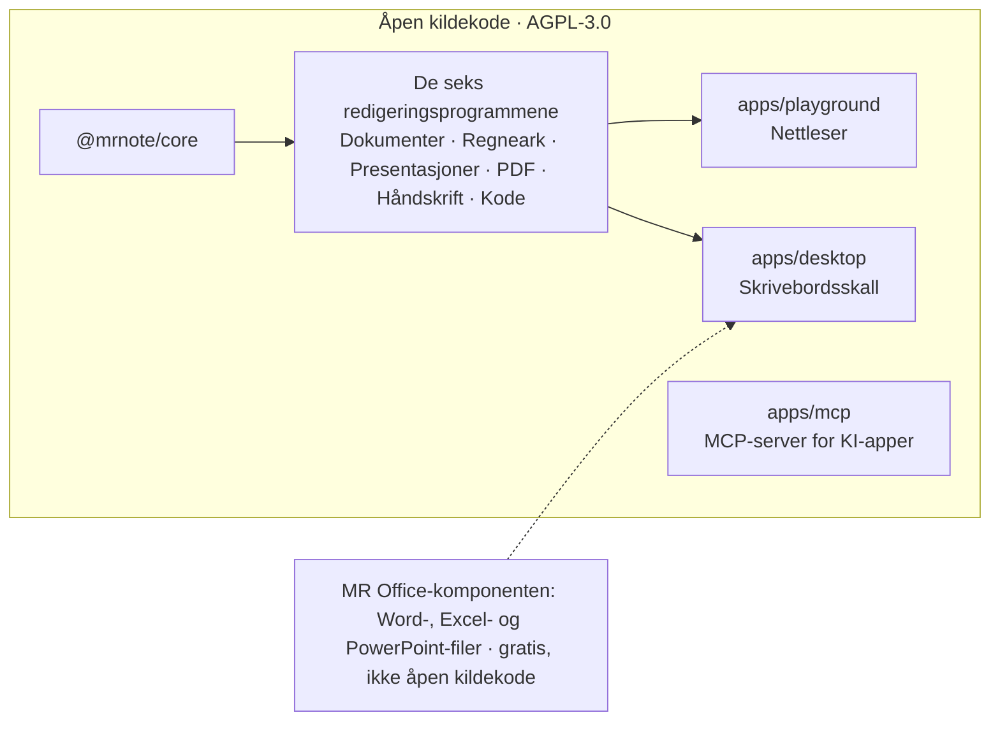

# MR Office — Norsk

<p align="center"><sub>🌐 <a href="../README.md">English</a> · <a href="../i18n/README.en-GB.md">English (UK)</a> · <a href="../i18n/README.zh.md">简体中文</a> · <a href="../i18n/README.zh-TW.md">繁體中文</a> · <a href="../i18n/README.ja.md">日本語</a> · <a href="../i18n/README.ko.md">한국어</a> · <a href="../i18n/README.de.md">Deutsch</a> · <a href="../i18n/README.fr.md">Français</a> · <a href="../i18n/README.es.md">Español</a> · <a href="../i18n/README.es-419.md">Español (Latinoamérica)</a> · <a href="../i18n/README.pt-BR.md">Português (Brasil)</a> · <a href="../i18n/README.it.md">Italiano</a> · <a href="../i18n/README.nl.md">Nederlands</a> · <a href="../i18n/README.sv.md">Svenska</a> · <a href="../i18n/README.da.md">Dansk</a> · <a href="../i18n/README.no.md">Norsk</a> · <a href="../i18n/README.fi.md">Suomi</a> · <a href="../i18n/README.id.md">Bahasa Indonesia</a> · <a href="../i18n/README.th.md">ไทย</a> · <a href="../i18n/README.vi.md">Tiếng Việt</a></sub></p>

<p align="center"><b>MR Offices redigeringsverktøy med åpen kildekode – dokumenter, regneark, presentasjoner, PDF, håndskrift og kode – i nettleseren.</b></p>

<p align="center"><a href="https://mroffice.ai/no"><b>▶ Prøv live-demoen – ingen installasjon</b></a> · <a href="https://github.com/XinaTian/MROffice/releases">⬇ Last ned MR Office fra Releases</a> · <a href="https://mroffice.ai">🌐 mroffice.ai</a></p>

<p align="center"><a href="../LICENSE"></a> <a href="https://github.com/XinaTian/MROffice/releases"></a> <a href="https://github.com/XinaTian/MROffice/actions/workflows/ci.yml"></a> <a href="https://github.com/XinaTian/MROffice/stargazers"></a></p>

<p align="center"><a href="https://mroffice.ai/no"></a></p>

<p align="center"><a href="../docs/media/mr-office-demo.mp4">🔊 Se den 50 sekunder lange omvisningen med lyd</a></p>

<table>
<tr>
<td align="center" width="50%"><a href="https://mroffice.ai/no"></a><br><b>Dokumenter</b></td>
<td align="center" width="50%"><a href="https://mroffice.ai/no"></a><br><b>Regneark</b></td>
</tr>
<tr>
<td align="center" width="50%"><a href="https://mroffice.ai/no"></a><br><b>Presentasjoner</b></td>
<td align="center" width="50%"><a href="https://mroffice.ai/no"></a><br><b>PDF</b></td>
</tr>
<tr>
<td align="center" width="50%"><a href="https://mroffice.ai/no"></a><br><b>Håndskrift</b></td>
<td align="center" width="50%"><a href="https://mroffice.ai/no"></a><br><b>Kode</b></td>
</tr>
</table>

MR Office er et arbeidsområde for notater, KI og ekte filer. Dette repositoriet publiserer kildekoden til redigeringsverktøyene: de samme som MR Office bruker, og som du selv kan bygge, kjøre og bygge inn. Dette er redigeringsverktøy med åpen kildekode, ikke en komplett kontorpakke med åpen kildekode: lesing og skriving av Microsoft Office-filer blir værende i MR Office (se nedenfor).

## Redigeringsverktøyene

Hva hvert verktøy gjør i dette repositoriet:

- **Dokumenter** — et sidebasert tekstbehandlingsprogram: stiler, skrifter, lister, tabeller, topp- og bunntekster, inndelinger og spalter, figurer og formler, forsider og innholdsfortegnelser, kommentarer og sporede endringer, samt håndskrift på siden. Lagrer i eget format (.mrdoc); åpner HTML, Markdown og ren tekst.
- **Regneark** — celler og formler, tallformater, betinget formatering, sortering og filtrering, frosne ruter og flere ark, med sum og gjennomsnitt for markeringen. Regning mellom celler (=A1*B1+10) beregnes i nettleseren mens du skriver; formler med funksjoner (SUMMER, HVIS, FINN.RAD …) beholdes slik de er skrevet. Lagrer i eget format (.mrsheet); åpner og lagrer CSV og TSV.
- **Presentasjoner** — lysbilder med åtte egne temaer, oppsett, lysbildemal- og oppsettvisning, tekst, figurer, tekstbokser, tabeller, WordArt og formler, kommentarer, inndelinger, overganger og animasjoner med forhåndsvisning, og lysbildefremvisning. Lagrer i eget format (.mrslides).
- **PDF** — lese, søke i, presentere og skrive ut PDF-filer, kopiere og lese opp teksten, og markere valgt tekst (utheving, understreking, gjennomstreking, bølgelinje) med notater og et kommentarpanel mens filen er åpen; lagring gir tilbake filen slik den ble åpnet.
- **Håndskrift** — håndskrevne notater med trykkfølsomme penner, markeringspenner, viskelær, lasso og linjal, og håndskrift som blir figurer. Lagrer i eget format (.mrink).
- **Kode** — et lett koderedigeringsverktøy med syntaksutheving for mange språk, en disposisjon og søk og erstatt; JavaScript/TypeScript, Python, SQL, Lua og skall kjører rett i nettleseren.

Beregning av formler med funksjoner, tegning av diagrammer og oppsett av SmartArt gjøres av MR Offices egen motor i MR Offices skrivebordsapp: redigeringsprogrammene med åpen kildekode beholder formlene, diagrammene og SmartArt i en fil og viser SmartArt slik det ble lagret.

## Kjør redigeringsverktøyene

**▶ [Prøv live-demoen – ingen installasjon](https://mroffice.ai/no)**

De seks verktøyene ligger i `packages/` (`@mrnote/docs`, `sheets`, `slides`, `pdf`, `ink`, `code`, som deler `@mrnote/core`) og kjører sammen i `apps/playground`:

```bash
npm install
npm run fonts     # the open substitutes for Office's fonts
npm run build
npm run preview   # http://localhost:5178
```

`npm run dev` starter en utviklingsserver på samme adresse, og `npm run smoke` kontrollerer et bygg. README-filen for hver pakke beskriver i detalj hva den gjør og hvordan den bygges inn.

## Skrivebordsapp

[`apps/desktop`](../apps/desktop) inneholder **MR Office Editors**: kildekoden til skallet i MR Offices skrivebordsapp (Electron), med sin egen app-identitet. Med den gratis MR Office-komponenten fra Releases er det MR Offices skrivebordsapp, med Word-, Excel-, PowerPoint- og PDF-filer, innlogging og AI. Uten komponenten kjører bare redigeringsprogrammene med åpen kildekode; de åpner .mrdoc-, .mrsheet-, .mrslides- og .mrink-filer samt CSV, HTML, Markdown og PDF. Skallet og redigeringsprogrammene er AGPL-kildekode; komponenten er kompilert, gratis å bruke og ikke åpen kildekode. Etter `npm run build` starter du den med:

```bash
npm run desktop
```

## For alle funksjoner: installer MR Offices skrivebordsapp (gratis)

MR Offices skrivebordsapp er gratis, har disse redigeringsprogrammene og hele tjenesten, og fungerer frakoblet på din egen datamaskin. Den legger til det redigeringsprogrammene med åpen kildekode mangler:

- Åpne og lagre Word-, Excel- og PowerPoint-filer (.docx, .xlsx, .pptx)
- Beregne formler med funksjoner (SUMMER, HVIS, FINN.RAD …)
- Diagrammer
- Redigering av SmartArt
- Lagre endringer i en PDF tilbake i filen

**[Last ned MR Office fra Releases →](https://github.com/XinaTian/MROffice/releases)** · [eller fra mroffice.ai](https://mroffice.ai)

### Word-, Excel-, PowerPoint- og PDF-filer

Å åpne og lagre Word-, Excel- og PowerPoint-filer (.docx, .xlsx, .pptx) og lagre endringer i en PDF tilbake i filen gjøres av MR Offices gratis skrivebordsapp. Den har alle disse redigeringsprogrammene og fungerer frakoblet på din egen datamaskin:

## Slik henger delene sammen



## Lisens

Åpen kildekode under GNU Affero General Public License v3.0 (LICENSE), med tilleggsvilkårene i NOTICE.md: behold navngivelsen «MR Office» og lenken til https://mroffice.ai, og ingen rettigheter til navnet eller logoen MR Office. En kommersiell lisens fås via support@mr-note.com. Programvare og data fra tredjeparter står i THIRD_PARTY_NOTICES.md. Bidrag: se CONTRIBUTING.md.

## Mer

Nettsted og hele produktet: **https://mroffice.ai** · Spørsmål og tilbakemeldinger: support@mr-note.com

<p align="center">Hvis MR Office er nyttig for deg, hjelper en ⭐ på GitHub andre å finne det.</p>
