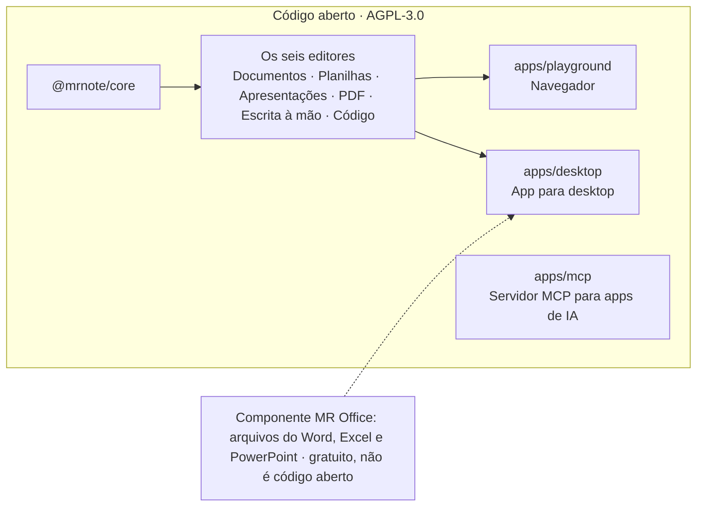

# MR Office — Português (Brasil)

<p align="center"><sub>🌐 <a href="../README.md">English</a> · <a href="../i18n/README.en-GB.md">English (UK)</a> · <a href="../i18n/README.zh.md">简体中文</a> · <a href="../i18n/README.zh-TW.md">繁體中文</a> · <a href="../i18n/README.ja.md">日本語</a> · <a href="../i18n/README.ko.md">한국어</a> · <a href="../i18n/README.de.md">Deutsch</a> · <a href="../i18n/README.fr.md">Français</a> · <a href="../i18n/README.es.md">Español</a> · <a href="../i18n/README.es-419.md">Español (Latinoamérica)</a> · <a href="../i18n/README.pt-BR.md">Português (Brasil)</a> · <a href="../i18n/README.it.md">Italiano</a> · <a href="../i18n/README.nl.md">Nederlands</a> · <a href="../i18n/README.sv.md">Svenska</a> · <a href="../i18n/README.da.md">Dansk</a> · <a href="../i18n/README.no.md">Norsk</a> · <a href="../i18n/README.fi.md">Suomi</a> · <a href="../i18n/README.id.md">Bahasa Indonesia</a> · <a href="../i18n/README.th.md">ไทย</a> · <a href="../i18n/README.vi.md">Tiếng Việt</a></sub></p>

<p align="center"><b>Os editores de código aberto do MR Office — documentos, planilhas, apresentações, PDF, escrita à mão e código — no navegador.</b></p>

<p align="center"><a href="https://mroffice.ai/pt-BR"><b>▶ Experimente a demonstração online — sem instalar</b></a> · <a href="https://github.com/XinaTian/MROffice/releases">⬇ Baixar o MR Office em Releases</a> · <a href="https://mroffice.ai">🌐 mroffice.ai</a></p>

<p align="center"><a href="../LICENSE"></a> <a href="https://github.com/XinaTian/MROffice/releases"></a> <a href="https://github.com/XinaTian/MROffice/actions/workflows/ci.yml"></a> <a href="https://github.com/XinaTian/MROffice/stargazers"></a></p>

<p align="center"><a href="https://mroffice.ai/pt-BR"></a></p>

<p align="center"><a href="../docs/media/mr-office-demo.mp4">🔊 Assista ao tour de 50 segundos com som</a></p>

<table>
<tr>
<td align="center" width="50%"><a href="https://mroffice.ai/pt-BR"></a><br><b>Documentos</b></td>
<td align="center" width="50%"><a href="https://mroffice.ai/pt-BR"></a><br><b>Planilhas</b></td>
</tr>
<tr>
<td align="center" width="50%"><a href="https://mroffice.ai/pt-BR"></a><br><b>Apresentações</b></td>
<td align="center" width="50%"><a href="https://mroffice.ai/pt-BR"></a><br><b>PDF</b></td>
</tr>
<tr>
<td align="center" width="50%"><a href="https://mroffice.ai/pt-BR"></a><br><b>Escrita à mão</b></td>
<td align="center" width="50%"><a href="https://mroffice.ai/pt-BR"></a><br><b>Código</b></td>
</tr>
</table>

O MR Office é um espaço de trabalho para notas, IA e arquivos reais. Este repositório publica o código-fonte dos seus editores: os mesmos editores que rodam no MR Office, que você pode compilar, executar e incorporar por conta própria. São editores de código aberto, não um pacote Office de código aberto completo: a leitura e a gravação de arquivos do Microsoft Office ficam no MR Office (veja abaixo).

## Os editores

O que cada editor faz neste repositório:

- **Documentos** — um processador de texto paginado: estilos, fontes, listas, tabelas, cabeçalhos e rodapés, seções e colunas, formas e equações, folhas de rosto e sumários, comentários e controle de alterações, e tinta na página. Salva no próprio formato (.mrdoc); abre HTML, Markdown e texto simples.
- **Planilhas** — células e fórmulas, formatos de número, formatação condicional, classificação e filtros, painéis congelados e várias planilhas, com a soma e a média da seleção. A aritmética entre células (=A1*B1+10) é calculada no navegador ao digitar; fórmulas com funções (SOMA, SE, PROCV…) ficam como foram escritas. Salva no próprio formato (.mrsheet); abre e salva CSV e TSV.
- **Apresentações** — slides com oito temas próprios, layouts, modos de slide mestre e de layout, texto, formas, caixas de texto, tabelas, WordArt e equações, comentários, seções, transições e animações com visualização, e apresentação de slides. Salva no próprio formato (.mrslides).
- **PDF** — ler, pesquisar, apresentar e imprimir arquivos PDF, copiar e ler em voz alta o texto, e marcar o texto selecionado (realce, sublinhado, tachado, ondulado) com notas e um painel de comentários enquanto o arquivo está aberto; salvar devolve o arquivo como foi aberto.
- **Escrita à mão** — notas manuscritas com canetas sensíveis à pressão, marca-textos, borrachas, laço e régua, e tinta convertida em formas. Salva no próprio formato (.mrink).
- **Código** — um editor de código leve com realce de sintaxe para muitas linguagens, estrutura de tópicos e localizar e substituir; JavaScript/TypeScript, Python, SQL, Lua e shell rodam direto no navegador.

O cálculo de fórmulas com funções, o desenho de gráficos e o layout de SmartArt são feitos pelo motor do próprio MR Office, no aplicativo para desktop MR Office: os editores de código aberto preservam as fórmulas, os gráficos e os SmartArt de um arquivo, e mostram os SmartArt como foram salvos.

## Executar os editores

**▶ [Experimente a demonstração online — sem instalar](https://mroffice.ai/pt-BR)**

Os seis editores estão em `packages/` (`@mrnote/docs`, `sheets`, `slides`, `pdf`, `ink`, `code`, que compartilham `@mrnote/core`) e rodam juntos em `apps/playground`:

```bash
npm install
npm run fonts     # the open substitutes for Office's fonts
npm run build
npm run preview   # http://localhost:5178
```

`npm run dev` inicia um servidor de desenvolvimento no mesmo endereço e `npm run smoke` verifica uma compilação. O README de cada pacote detalha o que ele faz e como incorporá-lo.

## Aplicativo de desktop

[`apps/desktop`](../apps/desktop) contém o **MR Office Editors**: o código-fonte da camada do aplicativo de desktop do MR Office (Electron), com identidade de aplicativo própria. Com o componente gratuito do MR Office disponível em Releases, ele é o aplicativo de desktop do MR Office, com arquivos Word, Excel, PowerPoint e PDF, login e IA. Sem o componente, executa só os editores de código aberto, que abrem arquivos .mrdoc, .mrsheet, .mrslides e .mrink, além de CSV, HTML, Markdown e PDF. A camada e os editores são código-fonte AGPL; o componente é compilado, gratuito e não é de código aberto. Depois de `npm run build`, inicie com:

```bash
npm run desktop
```

## Para todos os recursos, instale o aplicativo para desktop do MR Office (grátis)

O aplicativo para desktop MR Office é gratuito, traz estes editores e o serviço completo, e funciona offline no seu próprio computador. Ele acrescenta o que os editores de código aberto não têm:

- Abrir e salvar arquivos do Word, Excel e PowerPoint (.docx, .xlsx, .pptx)
- Calcular fórmulas com funções (SOMA, SE, PROCV …)
- Gráficos
- Edição de SmartArt
- Gravar no arquivo as edições feitas em um PDF

**[Baixar o MR Office em Releases →](https://github.com/XinaTian/MROffice/releases)** · [ou em mroffice.ai](https://mroffice.ai)

### Arquivos do Word, Excel, PowerPoint e PDF

Abrir e salvar arquivos do Word, Excel e PowerPoint (.docx, .xlsx, .pptx), e gravar no arquivo as edições feitas em um PDF, são recursos do aplicativo para desktop MR Office (grátis), que traz todos estes editores e funciona offline no seu próprio computador:

## Como as partes se encaixam



## Licença

Código aberto sob a GNU Affero General Public License v3.0 (LICENSE), com os termos adicionais de NOTICE.md: manter a atribuição "MR Office" e o link para https://mroffice.ai, sem direitos sobre o nome ou o logotipo do MR Office. Uma licença comercial está disponível em support@mr-note.com. Softwares e dados de terceiros estão listados em THIRD_PARTY_NOTICES.md. Contribuições: veja CONTRIBUTING.md.

## Mais

Site e o produto completo: **https://mroffice.ai** · Dúvidas e sugestões: support@mr-note.com

<p align="center">Se o MR Office for útil para você, uma ⭐ no GitHub ajuda outras pessoas a encontrá-lo.</p>
