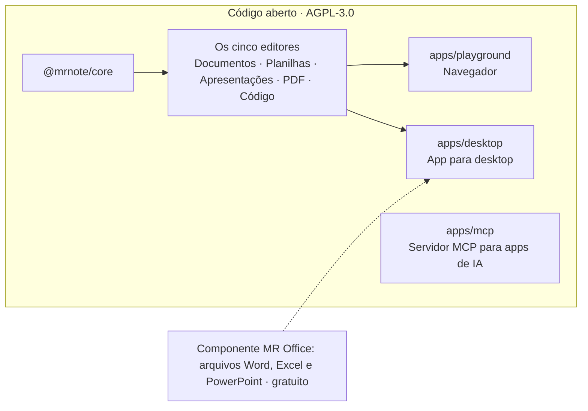

# MR Office — Português (Brasil)

<p align="center"><sub>🌐 <a href="../README.md">English</a> · <a href="../i18n/README.en-GB.md">English (UK)</a> · <a href="../i18n/README.zh.md">简体中文</a> · <a href="../i18n/README.zh-TW.md">繁體中文</a> · <a href="../i18n/README.ja.md">日本語</a> · <a href="../i18n/README.ko.md">한국어</a> · <a href="../i18n/README.de.md">Deutsch</a> · <a href="../i18n/README.fr.md">Français</a> · <a href="../i18n/README.es.md">Español</a> · <a href="../i18n/README.es-419.md">Español (Latinoamérica)</a> · <a href="../i18n/README.pt-BR.md">Português (Brasil)</a> · <a href="../i18n/README.it.md">Italiano</a> · <a href="../i18n/README.nl.md">Nederlands</a> · <a href="../i18n/README.sv.md">Svenska</a> · <a href="../i18n/README.da.md">Dansk</a> · <a href="../i18n/README.no.md">Norsk</a> · <a href="../i18n/README.fi.md">Suomi</a> · <a href="../i18n/README.id.md">Bahasa Indonesia</a> · <a href="../i18n/README.th.md">ไทย</a> · <a href="../i18n/README.vi.md">Tiếng Việt</a></sub></p>

<p align="center"><b>Os editores de código aberto do MR Office, a suíte de escritório com IA mais próxima do Microsoft Office: documentos, planilhas, apresentações, PDF e código no navegador, e uma IA que edita arquivos reais do Word, Excel e PowerPoint junto com você.</b></p>

<p align="center"><a href="https://mroffice.ai/pt-BR"><b>▶ Experimentar online</b></a> · <a href="https://mroffice.ai/pt-BR/office/download"><b>⬇ Baixar</b></a> · <a href="https://mroffice.ai">🌐 mroffice.ai</a><br><a href="https://mroffice.ai/pt-BR/developers">🧑‍💻 Desenvolvedores</a> · <a href="https://mroffice.ai/pt-BR/developers/embed">🧩 Incorporar</a> · <a href="https://mroffice.ai/pt-BR/developers/mcp">🤖 MCP para apps de IA</a> · <a href="https://www.npmjs.com/package/mroffice-embed">📦 SDK npm</a> · <a href="https://mroffice.ai/pt-BR/developers/oauth">🔑 Entrar com o MR Office</a></p>

<p align="center"><a href="../LICENSE"></a> <a href="https://github.com/XinaTian/MROffice/releases"></a> <a href="https://github.com/XinaTian/MROffice/actions/workflows/ci.yml"></a> <a href="https://github.com/XinaTian/MROffice/stargazers"></a></p>

<p align="center"><a href="https://mroffice.ai/pt-BR"></a></p>

<p align="center"><a href="https://demo.mroffice.ai/media/mr-office-demo.mp4">🔊 Assista ao tour de 50 segundos com som</a></p>

<table>
<tr>
<td align="center" width="50%"><a href="https://mroffice.ai/pt-BR"></a><br><b>Documentos</b></td>
<td align="center" width="50%"><a href="https://mroffice.ai/pt-BR"></a><br><b>Planilhas</b></td>
</tr>
<tr>
<td align="center" width="50%"><a href="https://mroffice.ai/pt-BR"></a><br><b>Apresentações</b></td>
<td align="center" width="50%"><a href="https://mroffice.ai/pt-BR"></a><br><b>PDF</b></td>
</tr>
<tr>
<td align="center" width="50%"><a href="https://mroffice.ai/pt-BR"></a><br><b>Código</b></td>
</tr>
</table>

O MR Office é uma suíte de escritório com IA para arquivos reais: Word, Excel, PowerPoint e PDF, na web e em um aplicativo desktop gratuito, com uma IA ao lado de cada documento e coedição ao vivo. Este repositório publica o código-fonte dos seus editores: os mesmos editores que o MR Office executa, que você pode compilar, executar e incorporar por conta própria.

## IA que trabalha dentro dos seus arquivos

No MR Office, a IA trabalha no próprio documento, não em texto colado em um chat. Ela lê o arquivo, faz a alteração nos objetos do próprio arquivo e mostra o que tocou antes de você manter.

- **Copilot em cada editor** — documentos, planilhas, apresentações, PDF e código. Selecione ou circule o que você quer dizer e diga o que deseja: ela edita parágrafos, tabelas, células e fórmulas, formas e slides no lugar, pergunta quando o pedido não está claro, pré-visualiza a alteração antes de aplicá-la, e toda alteração pode ser desfeita.
- **Alterações que você revisa** — o que a IA propõe só é aplicado quando você confirma; se o arquivo mudou nesse meio-tempo, a proposta é anulada e nada do que você escreveu é sobrescrito.
- **Uma janela de IA que conhece seu workspace** — pergunte sobre seus arquivos, notas e canvas e receba respostas que citam suas fontes; ela redige novos documentos, planilhas e apresentações, e cria uma pequena ferramenta no canvas quando você precisar.
- **Memória** — um grafo de memória mantém as pessoas, projetos e decisões que importam, para que a IA não comece do zero em cada conversa.
- **Modelos líderes** — escolha o modelo para cada conversa entre os principais modelos de IA atuais; seus arquivos ficam no seu workspace, ou no seu próprio computador com o aplicativo desktop.

**[Experimente a IA no MR Office, grátis →](https://mroffice.ai/pt-BR)**

### Deixe seu agente de IA editar arquivos do Office (MCP)

Claude, ChatGPT, Cursor, Codex, VS Code e qualquer outro cliente MCP podem criar, abrir, editar, reler, visualizar e exportar documentos e planilhas através do servidor MCP do MR Office (`create_document`, `open_document`, `update_document`, `get_document`, `render_page`, `export_document` para docx, xlsx, pptx, pdf, md, html ou csv). Em apps que exibem MCP Apps, o editor aparece direto na conversa; em outros, as ferramentas respondem com um link para o mesmo editor e uma imagem da página. Você e a IA editam o mesmo documento: o assistente relê suas edições antes de continuar, e uma atualização feita sobre edições que ele não viu é recusada em vez de perdida.

```bash
# Claude Code
claude mcp add mroffice -- npx -y mroffice-mcp
# Codex
codex mcp add mroffice -- npx -y mroffice-mcp
```

Claude Desktop, Cursor e outros apps que aceitam uma configuração JSON:

```json
{ "mcpServers": { "mroffice": { "command": "npx", "args": ["-y", "mroffice-mcp"] } } }
```

Sem instalação: conecte o endpoint hospedado `https://mcp.mroffice.ai/mcp` e entre com sua conta MR Office. Arquivos do Word, Excel e PowerPoint passam pelo motor Office do MR Office como sua própria conta; o código-fonte do servidor MCP está em `apps/mcp`. [Guia do MCP →](https://mroffice.ai/pt-BR/developers/mcp)

## Para desenvolvedores

Tudo para desenvolvedores está em **[MR Office Developers](https://mroffice.ai/pt-BR/developers)** — autoatendimento, sem solicitação: entre com qualquer conta MR Office e comece.

### Incorpore os editores no seu app web (recomendado)

O MR Office hospeda os editores; seu servidor assina um token de sessão de curta duração e sua página abre o editor. Ele edita arquivos reais do Word, Excel, PowerPoint e PDF (.docx, .xlsx, .pptx, .pdf), com coedição, uploads, todos os formatos de exportação, impressão, e salvamentos enviados de volta ao seu servidor em um callback assinado. Plano gratuito: 1.000 sessões por mês em localhost, 100 nos seus próprios domínios, até 2 apps. Como serviço hospedado, ele não impõe obrigações da AGPL ao seu próprio app.

1. Na pasta do seu projeto, execute `npx mroffice-embed init` (ou crie um app no console do desenvolvedor): um clique em "Permitir" no navegador e as chaves do app são gravadas em `.env.local` / `.env`.
2. Seu servidor gera um token de sessão com `createSessionToken` de `mroffice-embed/server`; a chave secreta nunca sai do servidor.
3. Sua página abre o editor com `open()` de `mroffice-embed` (ou o script `https://mroffice.ai/embed/v1/embed.js`).

```js
// server: GET /api/mroffice/session (check who is signed in first)
import { createSessionToken } from "mroffice-embed/server";
const token = await createSessionToken({
  appId: process.env.MROFFICE_APP_ID,
  secretKey: process.env.MROFFICE_SECRET_KEY, // mro_sk_..., server only
  file: { key: "contract-42", name: "contract.docx", url: signedUrlToTheFile },
  user: { id: user.id, name: user.name },
  mode: "edit",
});

// page
import { open } from "mroffice-embed";
open({ container: "#editor", token: () => fetch("/api/mroffice/session").then((r) => r.json()).then((b) => b.token) });
```

[Guia de incorporação](https://mroffice.ai/pt-BR/developers/embed) · [O guia em Markdown (para agentes de IA)](https://mroffice.ai/developers/embed.md) · [Preços e limites](https://mroffice.ai/pt-BR/developers/pricing) · [Console do desenvolvedor](https://mroffice.ai/pt-BR/developers/console) · [Demonstração ao vivo](https://mroffice.ai/pt-BR/developers/embed/demo)

### Apps de IA: o servidor MCP

O servidor MCP acima também é como seus próprios recursos de IA podem abrir, ler, editar e exportar documentos no editor real do MR Office: o endpoint hospedado `https://mcp.mroffice.ai/mcp` (login OAuth, sem chave) ou `npx -y mroffice-mcp` no seu próprio computador. [Guia do MCP →](https://mroffice.ai/pt-BR/developers/mcp)

### Entrar com o MR Office (OAuth)

O MR Office é um servidor de autorização OAuth 2.1 (PKCE, documentos de metadados de ID de cliente, registro dinâmico): seu app pode conectar pessoas com a conta MR Office delas e agir com os escopos que elas permitirem. [Guia de OAuth →](https://mroffice.ai/pt-BR/developers/oauth)

### Hospede você mesmo os editores de código aberto

Os cinco editores deste repositório podem ser integrados ao seu próprio produto sob a AGPL-3.0: se as pessoas usarem uma versão modificada pela rede, você deve oferecer a elas o código-fonte completo e manter a atribuição "MR Office" (NOTICE.md). Eles abrem seus próprios formatos, CSV, HTML, Markdown e PDF; para arquivos Word, Excel e PowerPoint, use o embed hospedado acima. Uma licença comercial está disponível em support@mr-note.com. [Guia de código aberto →](https://mroffice.ai/pt-BR/developers/open-source)

Os editores estão no npm como componentes React: `npm i mroffice-docs mroffice-core` (e `mroffice-sheets`, `mroffice-slides`, `mroffice-pdf`, `mroffice-code`); o README de cada pacote mostra como incorporá-lo.

## Os editores

O que cada editor faz neste repositório:

- **Documentos** — um processador de texto paginado: fontes, formatação de parágrafo, listas e estilos na guia Página Inicial; capa e páginas em branco, quebras de página, tabelas, imagens, formas, SmartArt, gráficos, links, indicadores, comentários, cabeçalhos, rodapés e números de página, equações, símbolos, caixas de texto e WordArt na guia Inserir. Salva seu próprio formato (.mrdoc); abre HTML, Markdown e texto sem formatação.
- **Planilhas** — células e fórmulas com fontes, alinhamento, formatos de número, formatação condicional, estilos de célula e inserção ou exclusão de células na guia Página Inicial; tabelas, imagens, formas, ícones, caixas de seleção, gráficos e minigráficos na guia Inserir; várias planilhas, com somas e médias da seleção. A aritmética entre células (=A1*B1+10) é calculada no navegador enquanto você digita; fórmulas com funções (SUM, IF, VLOOKUP …) são mantidas como escritas. Salva seu próprio formato (.mrsheet); abre e salva CSV e TSV.
- **Apresentações** — slides com layouts e seções, texto, fontes e parágrafos, e formas com seu arranjo na guia Página Inicial; tabelas, imagens, ícones, SmartArt, gráficos, caixas de texto, WordArt, cabeçalhos e rodapés, equações, símbolos e vídeo na guia Inserir; notas do apresentador, comentários e apresentação. Salva seu próprio formato (.mrslides).
- **PDF** — ler, apresentar e imprimir arquivos PDF: visualizações de uma e duas páginas, rolagem contínua, rotação, miniaturas e modo de leitura, pesquisa e cópia do texto, e comentários enquanto um arquivo está aberto; salvar devolve o arquivo como foi aberto.
- **Código** — um editor de código leve com realce de sintaxe para muitas linguagens, estrutura de tópicos, localizar, abertura rápida, explorador de arquivos e lista de problemas.

Fórmulas com funções, gráficos e SmartArt são calculados e desenhados pelo engine do MR Office, no app de desktop gratuito e no serviço hospedado; os editores aqui preservam cada fórmula, gráfico e SmartArt que um arquivo contém, e exibem o SmartArt como foi salvo.

## Executar os editores

**▶ [Experimente a demonstração online — sem instalar](https://mroffice.ai/pt-BR)**

Os cinco editores estão em `packages/` (`@mrnote/docs`, `sheets`, `slides`, `pdf`, `code`, compartilhando `@mrnote/core`) e rodam juntos em `apps/playground`:

```bash
npm install
npm run fonts     # the open substitutes for Office's fonts
npm run build
npm run preview   # http://localhost:5178
```

`npm run dev` inicia um servidor de desenvolvimento no mesmo endereço e `npm run smoke` verifica uma compilação. O README de cada pacote detalha o que ele faz e como incorporá-lo.

## Aplicativo de desktop

[`apps/desktop`](../apps/desktop) contém o **MR Office Editors**: o código-fonte do shell do aplicativo desktop do MR Office (Electron), sob uma identidade própria. Com o componente gratuito do MR Office disponível em Releases, ele é o aplicativo desktop do MR Office, com arquivos Word, Excel, PowerPoint e PDF, login e IA. Sem o componente, ele executa os editores de código aberto por conta própria, que abrem arquivos .mrdoc, .mrsheet e .mrslides, CSV, HTML, Markdown e PDF. O shell e os editores são código-fonte AGPL; o componente é um download gratuito em Releases. Após `npm run build`, inicie-o com:

```bash
npm run desktop
```

## Para todos os recursos, instale o aplicativo para desktop do MR Office (grátis)

O app de desktop MR Office é gratuito, tem esses editores e o serviço completo, e funciona offline no seu próprio computador. Além dos editores, ele adiciona:

- Abrir e salvar arquivos do Word, Excel e PowerPoint (.docx, .xlsx, .pptx)
- Calcular fórmulas com funções (SOMA, SE, PROCV …)
- Gráficos
- Edição de SmartArt
- Gravar no arquivo as edições feitas em um PDF

**[Baixar o MR Office (grátis) →](https://mroffice.ai/pt-BR/office/download)**

## Como as partes se encaixam



## Licença

Código aberto sob a GNU Affero General Public License v3.0 (LICENSE), com os termos adicionais de NOTICE.md: manter a atribuição "MR Office" e o link para https://mroffice.ai, sem direitos sobre o nome ou o logotipo do MR Office. Uma licença comercial está disponível em support@mr-note.com. Softwares e dados de terceiros estão listados em THIRD_PARTY_NOTICES.md. Contribuições: veja CONTRIBUTING.md.

## Mais

Site e o produto completo: **https://mroffice.ai** · Dúvidas e sugestões: support@mr-note.com

<p align="center">Se o MR Office for útil para você, uma ⭐ no GitHub ajuda outras pessoas a encontrá-lo.</p>
