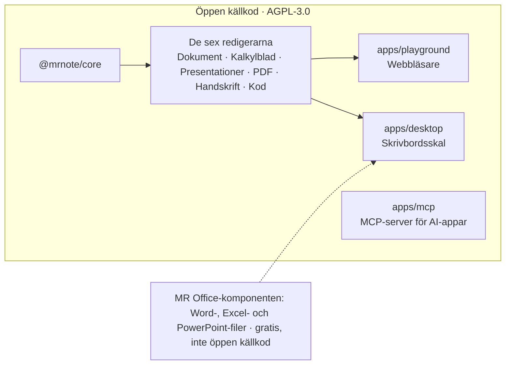

# MR Office — Svenska

<p align="center"><sub>🌐 <a href="../README.md">English</a> · <a href="../i18n/README.en-GB.md">English (UK)</a> · <a href="../i18n/README.zh.md">简体中文</a> · <a href="../i18n/README.zh-TW.md">繁體中文</a> · <a href="../i18n/README.ja.md">日本語</a> · <a href="../i18n/README.ko.md">한국어</a> · <a href="../i18n/README.de.md">Deutsch</a> · <a href="../i18n/README.fr.md">Français</a> · <a href="../i18n/README.es.md">Español</a> · <a href="../i18n/README.es-419.md">Español (Latinoamérica)</a> · <a href="../i18n/README.pt-BR.md">Português (Brasil)</a> · <a href="../i18n/README.it.md">Italiano</a> · <a href="../i18n/README.nl.md">Nederlands</a> · <a href="../i18n/README.sv.md">Svenska</a> · <a href="../i18n/README.da.md">Dansk</a> · <a href="../i18n/README.no.md">Norsk</a> · <a href="../i18n/README.fi.md">Suomi</a> · <a href="../i18n/README.id.md">Bahasa Indonesia</a> · <a href="../i18n/README.th.md">ไทย</a> · <a href="../i18n/README.vi.md">Tiếng Việt</a></sub></p>

<p align="center"><b>MR Offices redigerare med öppen källkod – dokument, kalkylblad, presentationer, PDF, handskrift och kod – i webbläsaren.</b></p>

<p align="center"><a href="https://mroffice.ai/sv"><b>▶ Prova online</b></a> · <a href="https://mroffice.ai/sv/office/download"><b>⬇ Ladda ned</b></a> · <a href="https://mroffice.ai">🌐 mroffice.ai</a><br><a href="https://mroffice.ai/sv/developers">🧑‍💻 Utvecklare</a> · <a href="https://mroffice.ai/sv/developers/embed">🧩 Bädda in</a> · <a href="https://mroffice.ai/sv/developers/mcp">🤖 MCP för AI-appar</a> · <a href="https://www.npmjs.com/package/mroffice-embed">📦 npm-SDK</a> · <a href="https://mroffice.ai/sv/developers/oauth">🔑 Logga in med MR Office</a></p>

<p align="center"><a href="../LICENSE"></a> <a href="https://github.com/XinaTian/MROffice/releases"></a> <a href="https://github.com/XinaTian/MROffice/actions/workflows/ci.yml"></a> <a href="https://github.com/XinaTian/MROffice/stargazers"></a></p>

<p align="center"><a href="https://mroffice.ai/sv"></a></p>

<p align="center"><a href="https://demo.mroffice.ai/media/mr-office-demo.mp4">🔊 Se den 50 sekunder långa rundturen med ljud</a></p>

<table>
<tr>
<td align="center" width="50%"><a href="https://mroffice.ai/sv"></a><br><b>Dokument</b></td>
<td align="center" width="50%"><a href="https://mroffice.ai/sv"></a><br><b>Kalkylblad</b></td>
</tr>
<tr>
<td align="center" width="50%"><a href="https://mroffice.ai/sv"></a><br><b>Presentationer</b></td>
<td align="center" width="50%"><a href="https://mroffice.ai/sv"></a><br><b>PDF</b></td>
</tr>
<tr>
<td align="center" width="50%"><a href="https://mroffice.ai/sv"></a><br><b>Handskrift</b></td>
<td align="center" width="50%"><a href="https://mroffice.ai/sv"></a><br><b>Kod</b></td>
</tr>
</table>

MR Office är en arbetsyta för anteckningar, AI och riktiga filer. Det här arkivet publicerar källkoden till dess redigerare: samma redigerare som MR Office använder, som du själv kan bygga, köra och bädda in. Det är redigerare med öppen källkod, inte ett komplett kontorspaket med öppen källkod: läsning och skrivning av Microsoft Office-filer finns kvar i MR Office (se nedan).

## För utvecklare

Allt för utvecklare finns på **[MR Office Developers](https://mroffice.ai/sv/developers)** — självbetjäning, ingen ansökan: logga in med valfritt MR Office-konto och börja.

### Bädda in redigerarna i din webbapp (rekommenderas)

MR Office är värd för redigerarna; din server signerar en kortlivad sessionstoken och din sida öppnar redigeraren med den. Den redigerar riktiga Word-, Excel-, PowerPoint- och PDF-filer (.docx, .xlsx, .pptx, .pdf), med samredigering, uppladdningar, alla exportformat, utskrift och sparningar som skickas till din server i ett signerat callback. Gratisplan: 1 000 sessioner i månaden på localhost, 100 på dina egna domäner, upp till 2 appar. Det är en hostad kommersiell tjänst, så din egen app är inte bunden av detta förråds AGPL-licens.

1. Kör `npx mroffice-embed init` i projektets mapp (eller skapa en app i utvecklarkonsolen): ett klick på "Tillåt" i webbläsaren, så skrivs appens nycklar till `.env.local` / `.env`.
2. Din server skapar en sessionstoken med `createSessionToken` från `mroffice-embed/server`; den hemliga nyckeln lämnar aldrig servern.
3. Din sida öppnar redigeraren med `open()` från `mroffice-embed` (eller skriptet `https://mroffice.ai/embed/v1/embed.js`).

```js
// server: GET /api/mroffice/session (check who is signed in first)
import { createSessionToken } from "mroffice-embed/server";
const token = await createSessionToken({
  appId: process.env.MROFFICE_APP_ID,
  secretKey: process.env.MROFFICE_SECRET_KEY, // mro_sk_..., server only
  file: { key: "contract-42", name: "contract.docx", url: signedUrlToTheFile },
  user: { id: user.id, name: user.name },
  mode: "edit",
});

// page
import { open } from "mroffice-embed";
open({ container: "#editor", token: () => fetch("/api/mroffice/session").then((r) => r.json()).then((b) => b.token) });
```

[Guide för inbäddning](https://mroffice.ai/sv/developers/embed) · [Guiden som Markdown (för AI-agenter)](https://mroffice.ai/developers/embed.md) · [Priser och gränser](https://mroffice.ai/sv/developers/pricing) · [Utvecklarkonsol](https://mroffice.ai/sv/developers/console) · [Livedemo](https://mroffice.ai/sv/developers/embed/demo)

### AI-appar: MCP-servern

AI-appar öppnar, läser, redigerar och exporterar dokument i den riktiga MR Office-redigeraren via dess MCP-server: anslut den hostade slutpunkten `https://mcp.mroffice.ai/mcp` (logga in med ditt MR Office-konto, ingen nyckel) eller kör `npx -y mroffice-mcp` på din egen dator. Källkoden finns i `apps/mcp`. [MCP-guide →](https://mroffice.ai/sv/developers/mcp)

### Logga in med MR Office (OAuth)

MR Office är en OAuth 2.1-auktoriseringsserver (PKCE, metadatadokument för klient-ID, dynamisk registrering): din app kan logga in personer med deras MR Office-konto och agera med de behörigheter de tillåter. [OAuth-guide →](https://mroffice.ai/sv/developers/oauth)

### Kör redigerarna med öppen källkod själv

De sex redigerarna i detta förråd kan byggas in i din egen produkt under AGPL-3.0: om andra använder en ändrad version över ett nätverk måste du erbjuda dem dess fullständiga källkod och behålla angivelsen "MR Office" (NOTICE.md). De öppnar sina egna format, CSV, HTML, Markdown och PDF; Word-, Excel- och PowerPoint-filer ingår inte i redigerarna med öppen källkod (den hostade inbäddningen ovan har dem). En kommersiell licens finns via support@mr-note.com. [Guide för öppen källkod →](https://mroffice.ai/sv/developers/open-source)

Redigerarna finns på npm som React-komponenter: `npm i mroffice-docs mroffice-core` (och `mroffice-sheets`, `mroffice-slides`, `mroffice-pdf`, `mroffice-ink`, `mroffice-code`); varje pakets README visar hur man bäddar in det.

## Redigerarna

Vad varje redigerare gör i det här arkivet:

- **Dokument** — en sidbaserad ordbehandlare: format, typsnitt, listor, tabeller, sidhuvuden och sidfötter, avsnitt och spalter, former och ekvationer, försättssidor och innehållsförteckningar, kommentarer och spårade ändringar, samt pennanteckningar på sidan. Sparar i eget format (.mrdoc); öppnar HTML, Markdown och oformaterad text.
- **Kalkylblad** — celler och formler, talformat, villkorsstyrd formatering, sortering och filtrering, låsta rutor och flera blad, med summa och medelvärde för markeringen. Räkning mellan celler (=A1*B1+10) sker i webbläsaren medan du skriver; formler med funktioner (SUMMA, OM, LETARAD …) behålls som de är skrivna. Sparar i eget format (.mrsheet); öppnar och sparar CSV och TSV.
- **Presentationer** — bilder med åtta egna teman, layouter, bildbakgrunds- och layoutvyer, text, former, textrutor, tabeller, WordArt och ekvationer, kommentarer, avsnitt, övergångar och animeringar med förhandsvisning samt bildspel. Sparar i eget format (.mrslides).
- **PDF** — läsa, söka i, presentera och skriva ut PDF-filer, kopiera och läsa upp texten, och markera vald text (överstrykning, understrykning, genomstrykning, vågig linje) med anteckningar och en kommentarspanel medan filen är öppen; när du sparar lämnas filen tillbaka som den öppnades.
- **Handskrift** — handskrivna anteckningar med tryckkänsliga pennor, överstrykningspennor, suddgummin, lasso och linjal, och penndrag som blir former. Sparar i eget format (.mrink).
- **Kod** — en lätt kodredigerare med syntaxmarkering för många språk, en disposition samt sök och ersätt; JavaScript/TypeScript, Python, SQL, Lua och skal körs direkt i webbläsaren.

Att beräkna formler med funktioner, rita diagram och ställa upp SmartArt görs av MR Offices egen motor, i MR Offices skrivbordsapp: redigerarna med öppen källkod behåller en fils formler, diagram och SmartArt och visar SmartArt som det sparades.

## Kör redigerarna

**▶ [Prova livedemon – ingen installation](https://mroffice.ai/sv)**

De sex redigerarna finns i `packages/` (`@mrnote/docs`, `sheets`, `slides`, `pdf`, `ink`, `code`, som delar `@mrnote/core`) och körs tillsammans i `apps/playground`:

```bash
npm install
npm run fonts     # the open substitutes for Office's fonts
npm run build
npm run preview   # http://localhost:5178
```

`npm run dev` startar en utvecklingsserver på samma adress och `npm run smoke` kontrollerar ett bygge. Varje pakets README beskriver i detalj vad det gör och hur det bäddas in.

## Skrivbordsapp

[`apps/desktop`](../apps/desktop) innehåller **MR Office Editors**: källkoden till MR Offices skrivbordsappskal (Electron), med en egen appidentitet. Med den kostnadsfria MR Office-komponenten från Releases är det MR Offices skrivbordsapp, med Word-, Excel-, PowerPoint- och PDF-filer, inloggning och AI. Utan komponenten körs bara redigerarna med öppen källkod; de öppnar .mrdoc-, .mrsheet-, .mrslides- och .mrink-filer samt CSV, HTML, Markdown och PDF. Skalet och redigerarna är AGPL-källkod; komponenten är kompilerad, gratis att använda och inte öppen källkod. Efter `npm run build` startar du den med:

```bash
npm run desktop
```

## För alla funktioner: installera MR Offices skrivbordsapp (gratis)

MR Offices skrivbordsapp är kostnadsfri, innehåller de här redigerarna och hela tjänsten och fungerar offline på din egen dator. Den lägger till det som redigerarna med öppen källkod saknar:

- Öppna och spara Word-, Excel- och PowerPoint-filer (.docx, .xlsx, .pptx)
- Beräkna formler med funktioner (SUMMA, OM, LETARAD …)
- Diagram
- Redigering av SmartArt
- Spara ändringar i en PDF tillbaka i filen

**[Ladda ned MR Office (gratis) →](https://mroffice.ai/sv/office/download)**

### Word-, Excel-, PowerPoint- och PDF-filer

Att öppna och spara Word-, Excel- och PowerPoint-filer (.docx, .xlsx, .pptx), och att spara ändringar i en PDF tillbaka i filen, sköts av MR Offices kostnadsfria skrivbordsapp. Den innehåller alla de här redigerarna och fungerar offline på din egen dator:

## Hur delarna hänger ihop



## Licens

Öppen källkod under GNU Affero General Public License v3.0 (LICENSE), med de ytterligare villkoren i NOTICE.md: behåll angivelsen ”MR Office” och länken till https://mroffice.ai, och inga rättigheter till namnet eller logotypen MR Office. En kommersiell licens finns via support@mr-note.com. Programvara och data från tredje part listas i THIRD_PARTY_NOTICES.md. Bidrag: se CONTRIBUTING.md.

## Mer

Webbplats och hela produkten: **https://mroffice.ai** · Frågor och synpunkter: support@mr-note.com

<p align="center">Om MR Office är användbart för dig hjälper en ⭐ på GitHub andra att hitta det.</p>
