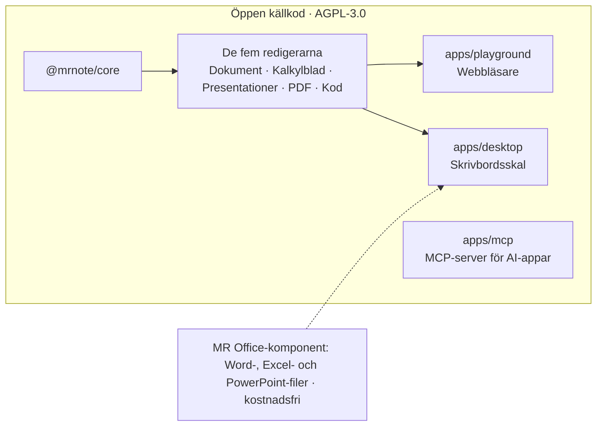

# MR Office — Svenska

<p align="center"><sub>🌐 <a href="../README.md">English</a> · <a href="../i18n/README.en-GB.md">English (UK)</a> · <a href="../i18n/README.zh.md">简体中文</a> · <a href="../i18n/README.zh-TW.md">繁體中文</a> · <a href="../i18n/README.ja.md">日本語</a> · <a href="../i18n/README.ko.md">한국어</a> · <a href="../i18n/README.de.md">Deutsch</a> · <a href="../i18n/README.fr.md">Français</a> · <a href="../i18n/README.es.md">Español</a> · <a href="../i18n/README.es-419.md">Español (Latinoamérica)</a> · <a href="../i18n/README.pt-BR.md">Português (Brasil)</a> · <a href="../i18n/README.it.md">Italiano</a> · <a href="../i18n/README.nl.md">Nederlands</a> · <a href="../i18n/README.sv.md">Svenska</a> · <a href="../i18n/README.da.md">Dansk</a> · <a href="../i18n/README.no.md">Norsk</a> · <a href="../i18n/README.fi.md">Suomi</a> · <a href="../i18n/README.id.md">Bahasa Indonesia</a> · <a href="../i18n/README.th.md">ไทย</a> · <a href="../i18n/README.vi.md">Tiếng Việt</a></sub></p>

<p align="center"><b>MR Office öppna källkodsredigerare, redigeraren som ligger närmast Microsoft Office — dokument, kalkylblad, presentationer, PDF och kod — som körs i webbläsaren.</b></p>

<p align="center"><a href="https://mroffice.ai/sv"><b>▶ Prova online</b></a> · <a href="https://mroffice.ai/sv/office/download"><b>⬇ Ladda ned</b></a> · <a href="https://mroffice.ai">🌐 mroffice.ai</a><br><a href="https://mroffice.ai/sv/developers">🧑‍💻 Utvecklare</a> · <a href="https://mroffice.ai/sv/developers/embed">🧩 Bädda in</a> · <a href="https://mroffice.ai/sv/developers/mcp">🤖 MCP för AI-appar</a> · <a href="https://www.npmjs.com/package/mroffice-embed">📦 npm-SDK</a> · <a href="https://mroffice.ai/sv/developers/oauth">🔑 Logga in med MR Office</a></p>

<p align="center"><a href="../LICENSE"></a> <a href="https://github.com/XinaTian/MROffice/releases"></a> <a href="https://github.com/XinaTian/MROffice/actions/workflows/ci.yml"></a> <a href="https://github.com/XinaTian/MROffice/stargazers"></a></p>

<p align="center"><a href="https://mroffice.ai/sv"></a></p>

<p align="center"><a href="https://demo.mroffice.ai/media/mr-office-demo.mp4">🔊 Se den 50 sekunder långa rundturen med ljud</a></p>

<table>
<tr>
<td align="center" width="50%"><a href="https://mroffice.ai/sv"></a><br><b>Dokument</b></td>
<td align="center" width="50%"><a href="https://mroffice.ai/sv"></a><br><b>Kalkylblad</b></td>
</tr>
<tr>
<td align="center" width="50%"><a href="https://mroffice.ai/sv"></a><br><b>Presentationer</b></td>
<td align="center" width="50%"><a href="https://mroffice.ai/sv"></a><br><b>PDF</b></td>
</tr>
<tr>
<td align="center" width="50%"><a href="https://mroffice.ai/sv"></a><br><b>Kod</b></td>
</tr>
</table>

MR Office är en arbetsyta för anteckningar, AI och riktiga filer. Det här repot publicerar källkoden till dess editorer: samma editorer som MR Office kör, och som du kan bygga, köra och bädda in själv. Tillsammans med den kostnadsfria skrivbordsappen MR Office eller den hostade inbäddningen öppnar och sparar de riktiga Word-, Excel- och PowerPoint-filer.

## För utvecklare

Allt för utvecklare finns på **[MR Office Developers](https://mroffice.ai/sv/developers)** — självbetjäning, ingen ansökan: logga in med valfritt MR Office-konto och börja.

### Bädda in redigerarna i din webbapp (rekommenderas)

MR Office hostar editorerna; din server signerar en kortlivad sessionstoken och din sida öppnar editorn. Den redigerar riktiga Word-, Excel-, PowerPoint- och PDF-filer (.docx, .xlsx, .pptx, .pdf), med samredigering, uppladdningar, alla exportformat, utskrift, och sparanden som skickas tillbaka till din server i en signerad callback. Gratisplan: 1 000 sessioner i månaden på localhost, 100 på dina egna domäner, upp till 2 appar. Som hostad tjänst lägger den inga AGPL-skyldigheter på din egen app.

1. Kör `npx mroffice-embed init` i projektets mapp (eller skapa en app i utvecklarkonsolen): ett klick på "Tillåt" i webbläsaren, så skrivs appens nycklar till `.env.local` / `.env`.
2. Din server skapar en sessionstoken med `createSessionToken` från `mroffice-embed/server`; den hemliga nyckeln lämnar aldrig servern.
3. Din sida öppnar redigeraren med `open()` från `mroffice-embed` (eller skriptet `https://mroffice.ai/embed/v1/embed.js`).

```js
// server: GET /api/mroffice/session (check who is signed in first)
import { createSessionToken } from "mroffice-embed/server";
const token = await createSessionToken({
  appId: process.env.MROFFICE_APP_ID,
  secretKey: process.env.MROFFICE_SECRET_KEY, // mro_sk_..., server only
  file: { key: "contract-42", name: "contract.docx", url: signedUrlToTheFile },
  user: { id: user.id, name: user.name },
  mode: "edit",
});

// page
import { open } from "mroffice-embed";
open({ container: "#editor", token: () => fetch("/api/mroffice/session").then((r) => r.json()).then((b) => b.token) });
```

[Guide för inbäddning](https://mroffice.ai/sv/developers/embed) · [Guiden som Markdown (för AI-agenter)](https://mroffice.ai/developers/embed.md) · [Priser och gränser](https://mroffice.ai/sv/developers/pricing) · [Utvecklarkonsol](https://mroffice.ai/sv/developers/console) · [Livedemo](https://mroffice.ai/sv/developers/embed/demo)

### AI-appar: MCP-servern

AI-appar öppnar, läser, redigerar och exporterar dokument i den riktiga MR Office-redigeraren via dess MCP-server: anslut den hostade slutpunkten `https://mcp.mroffice.ai/mcp` (logga in med ditt MR Office-konto, ingen nyckel) eller kör `npx -y mroffice-mcp` på din egen dator. Källkoden finns i `apps/mcp`. [MCP-guide →](https://mroffice.ai/sv/developers/mcp)

### Logga in med MR Office (OAuth)

MR Office är en OAuth 2.1-auktoriseringsserver (PKCE, metadatadokument för klient-ID, dynamisk registrering): din app kan logga in personer med deras MR Office-konto och agera med de behörigheter de tillåter. [OAuth-guide →](https://mroffice.ai/sv/developers/oauth)

### Kör redigerarna med öppen källkod själv

De fem redigerarna i det här arkivet kan byggas in i din egen produkt under AGPL-3.0: om människor använder en modifierad version över ett nätverk måste du erbjuda dem dess fullständiga källkod och behålla attributionen "MR Office" (NOTICE.md). De öppnar sina egna format, CSV, HTML, Markdown och PDF; för Word-, Excel- och PowerPoint-filer, använd den hostade inbäddningen ovan. En kommersiell licens finns tillgänglig från support@mr-note.com. [Guide för öppen källkod →](https://mroffice.ai/sv/developers/open-source)

Redigerarna finns på npm som React-komponenter: `npm i mroffice-docs mroffice-core` (och `mroffice-sheets`, `mroffice-slides`, `mroffice-pdf`, `mroffice-code`); varje pakets README visar hur man bäddar in det.

## Redigerarna

Vad varje redigerare gör i det här arkivet:

- **Dokument** — en sidindelad ordbehandlare: teckensnitt, styckeformatering, listor och stilar på Start; omslags- och tomma sidor, sidbrytningar, tabeller, bilder, former, SmartArt, diagram, länkar, bokmärken, kommentarer, sidhuvuden, sidfötter och sidnummer, ekvationer, symboler, textrutor och WordArt på Infoga. Sparar sitt eget format (.mrdoc); öppnar HTML, Markdown och oformaterad text.
- **Kalkylblad** — celler och formler med teckensnitt, justering, talformat, villkorsstyrd formatering, cellstilar och infoga eller ta bort celler på Start; tabeller, bilder, former, ikoner, kryssrutor, diagram och miniatyrdiagram på Infoga; flera blad, med summor och medelvärden för markeringen. Aritmetik mellan celler (=A1*B1+10) beräknas i webbläsaren medan du skriver; formler med funktioner (SUM, IF, VLOOKUP …) behålls som skrivna. Sparar sitt eget format (.mrsheet); öppnar och sparar CSV och TSV.
- **Presentationer** — bilder med layouter och avsnitt, text, teckensnitt och stycken, och former med deras arrangemang på Start; tabeller, bilder, ikoner, SmartArt, diagram, textrutor, WordArt, sidhuvuden och sidfötter, ekvationer, symboler och video på Infoga; talarnoter, kommentarer och presentation. Sparar sitt eget format (.mrslides).
- **PDF** — läs, presentera och skriv ut PDF-filer: enkel- och tvåsidiga vyer, kontinuerlig rullning, rotation, miniatyrbilder och läsläge, sökning och kopiering av deras text, och kommentarer medan en fil är öppen; spara lämnar tillbaka filen som den öppnades.
- **Kod** — en lättviktskodredigerare med syntaxmarkering för många språk, en disposition, sök, snabböppning, en filutforskare och en problemlista.

Formler med funktioner, diagram och SmartArt beräknas och ritas av MR Offices motor, i den kostnadsfria skrivbordsappen och i den hostade tjänsten; editorerna här bevarar varje formel, diagram och SmartArt som en fil innehåller, och visar SmartArt så som det sparades.

## Kör redigerarna

**▶ [Prova livedemon – ingen installation](https://mroffice.ai/sv)**

De fem redigerarna finns i `packages/` (`@mrnote/docs`, `sheets`, `slides`, `pdf`, `code`, som delar `@mrnote/core`) och körs tillsammans i `apps/playground`:

```bash
npm install
npm run fonts     # the open substitutes for Office's fonts
npm run build
npm run preview   # http://localhost:5178
```

`npm run dev` startar en utvecklingsserver på samma adress och `npm run smoke` kontrollerar ett bygge. Varje pakets README beskriver i detalj vad det gör och hur det bäddas in.

## Skrivbordsapp

[`apps/desktop`](../apps/desktop) innehåller **MR Office Editors**: källkoden för skalet i MR Office skrivbordsapp (Electron), under en egen identitet. Med den kostnadsfria MR Office-komponenten från Releases är det MR Office skrivbordsapp, med Word-, Excel-, PowerPoint- och PDF-filer, inloggning och AI. Utan komponenten kör den de öppna källkodsredigerarna på egen hand, som öppnar .mrdoc-, .mrsheet- och .mrslides-filer, CSV, HTML, Markdown och PDF. Skalet och redigerarna är AGPL-källkod; komponenten är en kostnadsfri nedladdning från Releases. Efter `npm run build`, starta den med:

```bash
npm run desktop
```

## För alla funktioner: installera MR Offices skrivbordsapp (gratis)

Skrivbordsappen MR Office är kostnadsfri, har dessa editorer och hela tjänsten, och fungerar offline på din egen dator. Utöver editorerna lägger den till:

- Öppna och spara Word-, Excel- och PowerPoint-filer (.docx, .xlsx, .pptx)
- Beräkna formler med funktioner (SUMMA, OM, LETARAD …)
- Diagram
- Redigering av SmartArt
- Spara ändringar i en PDF tillbaka i filen

**[Ladda ned MR Office (gratis) →](https://mroffice.ai/sv/office/download)**

### Word-, Excel-, PowerPoint- och PDF-filer

Arbeta med riktiga Word-, Excel- och PowerPoint-filer (.docx, .xlsx, .pptx) och spara PDF-ändringar direkt i filen med den kostnadsfria skrivbordsappen MR Office, som har alla dessa editorer och fungerar offline på din egen dator:

## Hur delarna hänger ihop



## Licens

Öppen källkod under GNU Affero General Public License v3.0 (LICENSE), med de ytterligare villkoren i NOTICE.md: behåll angivelsen ”MR Office” och länken till https://mroffice.ai, och inga rättigheter till namnet eller logotypen MR Office. En kommersiell licens finns via support@mr-note.com. Programvara och data från tredje part listas i THIRD_PARTY_NOTICES.md. Bidrag: se CONTRIBUTING.md.

## Mer

Webbplats och hela produkten: **https://mroffice.ai** · Frågor och synpunkter: support@mr-note.com

<p align="center">Om MR Office är användbart för dig hjälper en ⭐ på GitHub andra att hitta det.</p>
