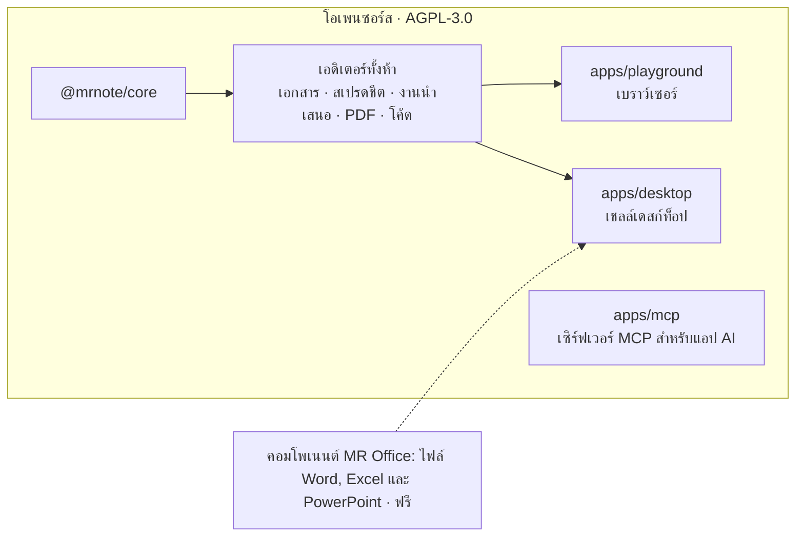

# MR Office — ไทย

<p align="center"><sub>🌐 <a href="../README.md">English</a> · <a href="../i18n/README.en-GB.md">English (UK)</a> · <a href="../i18n/README.zh.md">简体中文</a> · <a href="../i18n/README.zh-TW.md">繁體中文</a> · <a href="../i18n/README.ja.md">日本語</a> · <a href="../i18n/README.ko.md">한국어</a> · <a href="../i18n/README.de.md">Deutsch</a> · <a href="../i18n/README.fr.md">Français</a> · <a href="../i18n/README.es.md">Español</a> · <a href="../i18n/README.es-419.md">Español (Latinoamérica)</a> · <a href="../i18n/README.pt-BR.md">Português (Brasil)</a> · <a href="../i18n/README.it.md">Italiano</a> · <a href="../i18n/README.nl.md">Nederlands</a> · <a href="../i18n/README.sv.md">Svenska</a> · <a href="../i18n/README.da.md">Dansk</a> · <a href="../i18n/README.no.md">Norsk</a> · <a href="../i18n/README.fi.md">Suomi</a> · <a href="../i18n/README.id.md">Bahasa Indonesia</a> · <a href="../i18n/README.th.md">ไทย</a> · <a href="../i18n/README.vi.md">Tiếng Việt</a></sub></p>

<p align="center"><b>เอดิเตอร์โอเพนซอร์สของ MR Office เอดิเตอร์ที่ใกล้เคียง Microsoft Office ที่สุด — เอกสาร สเปรดชีต งานนำเสนอ PDF และโค้ด — ทำงานในเบราว์เซอร์</b></p>

<p align="center"><a href="https://mroffice.ai/th"><b>▶ ลองใช้ออนไลน์</b></a> · <a href="https://mroffice.ai/th/office/download"><b>⬇ ดาวน์โหลด</b></a> · <a href="https://mroffice.ai">🌐 mroffice.ai</a><br><a href="https://mroffice.ai/th/developers">🧑‍💻 นักพัฒนา</a> · <a href="https://mroffice.ai/th/developers/embed">🧩 ฝัง</a> · <a href="https://mroffice.ai/th/developers/mcp">🤖 MCP สำหรับแอป AI</a> · <a href="https://www.npmjs.com/package/mroffice-embed">📦 npm SDK</a> · <a href="https://mroffice.ai/th/developers/oauth">🔑 ลงชื่อเข้าใช้ด้วย MR Office</a></p>

<p align="center"><a href="../LICENSE"></a> <a href="https://github.com/XinaTian/MROffice/releases"></a> <a href="https://github.com/XinaTian/MROffice/actions/workflows/ci.yml"></a> <a href="https://github.com/XinaTian/MROffice/stargazers"></a></p>

<p align="center"><a href="https://mroffice.ai/th"></a></p>

<p align="center"><a href="https://demo.mroffice.ai/media/mr-office-demo.mp4">🔊 ดูวิดีโอแนะนำ 50 วินาทีพร้อมเสียง</a></p>

<table>
<tr>
<td align="center" width="50%"><a href="https://mroffice.ai/th"></a><br><b>เอกสาร</b></td>
<td align="center" width="50%"><a href="https://mroffice.ai/th"></a><br><b>สเปรดชีต</b></td>
</tr>
<tr>
<td align="center" width="50%"><a href="https://mroffice.ai/th"></a><br><b>งานนำเสนอ</b></td>
<td align="center" width="50%"><a href="https://mroffice.ai/th"></a><br><b>PDF</b></td>
</tr>
<tr>
<td align="center" width="50%"><a href="https://mroffice.ai/th"></a><br><b>โค้ด</b></td>
</tr>
</table>

MR Office คือพื้นที่ทำงานสำหรับโน้ต AI และไฟล์จริง รีโพซิทอรีนี้เผยแพร่ซอร์สโค้ดของเอดิเตอร์ ซึ่งเป็นเอดิเตอร์ตัวเดียวกับที่ MR Office ใช้งาน คุณสามารถบิลด์ รัน และฝังเอดิเตอร์เหล่านี้ในระบบของคุณเองได้ เมื่อใช้ร่วมกับแอปเดสก์ท็อป MR Office ฟรี หรือบริการฝังแบบโฮสต์ เอดิเตอร์เหล่านี้จะเปิดและบันทึกไฟล์ Word, Excel และ PowerPoint จริงได้

## สำหรับนักพัฒนา

ทุกอย่างสำหรับนักพัฒนาอยู่ที่ **[MR Office Developers](https://mroffice.ai/th/developers)** — บริการตนเอง ไม่ต้องสมัคร: ลงชื่อเข้าใช้ด้วยบัญชี MR Office ใดก็ได้แล้วเริ่มได้เลย

### ฝังโปรแกรมแก้ไขในเว็บแอปของคุณ (แนะนำ)

MR Office โฮสต์เอดิเตอร์ เซิร์ฟเวอร์ของคุณลงนามเซสชันโทเคนอายุสั้น และหน้าเว็บของคุณเปิดเอดิเตอร์ เอดิเตอร์แก้ไขไฟล์ Word, Excel, PowerPoint และ PDF จริง (.docx, .xlsx, .pptx, .pdf) พร้อมการแก้ไขร่วม การอัปโหลด ทุกรูปแบบการส่งออก การพิมพ์ และบันทึกส่งกลับไปยังเซิร์ฟเวอร์ของคุณผ่านคอลแบ็กที่ลงนามแล้ว แผนฟรี: 1,000 เซสชันต่อเดือนบน localhost, 100 บนโดเมนของคุณเอง สูงสุด 2 แอป ในฐานะบริการแบบโฮสต์ จึงไม่มีข้อผูกมัด AGPL กับแอปของคุณเอง

1. ในโฟลเดอร์ของโปรเจกต์ ให้รัน `npx mroffice-embed init` (หรือสร้างแอปในคอนโซลนักพัฒนา): คลิก "อนุญาต" ในเบราว์เซอร์ครั้งเดียว แล้วคีย์ของแอปจะถูกเขียนลงใน `.env.local` / `.env`
2. เซิร์ฟเวอร์ของคุณสร้างโทเค็นเซสชันด้วย `createSessionToken` จาก `mroffice-embed/server` คีย์ลับไม่ออกจากเซิร์ฟเวอร์เลย
3. หน้าเว็บของคุณเปิดโปรแกรมแก้ไขด้วย `open()` จาก `mroffice-embed` (หรือสคริปต์ `https://mroffice.ai/embed/v1/embed.js`)

```js
// server: GET /api/mroffice/session (check who is signed in first)
import { createSessionToken } from "mroffice-embed/server";
const token = await createSessionToken({
  appId: process.env.MROFFICE_APP_ID,
  secretKey: process.env.MROFFICE_SECRET_KEY, // mro_sk_..., server only
  file: { key: "contract-42", name: "contract.docx", url: signedUrlToTheFile },
  user: { id: user.id, name: user.name },
  mode: "edit",
});

// page
import { open } from "mroffice-embed";
open({ container: "#editor", token: () => fetch("/api/mroffice/session").then((r) => r.json()).then((b) => b.token) });
```

[คู่มือการฝัง](https://mroffice.ai/th/developers/embed) · [คู่มือแบบ Markdown (สำหรับเอเจนต์ AI)](https://mroffice.ai/developers/embed.md) · [ราคาและขีดจำกัด](https://mroffice.ai/th/developers/pricing) · [คอนโซลนักพัฒนา](https://mroffice.ai/th/developers/console) · [เดโมสด](https://mroffice.ai/th/developers/embed/demo)

### แอป AI: เซิร์ฟเวอร์ MCP

แอป AI เปิด อ่าน แก้ไข และส่งออกเอกสารในโปรแกรมแก้ไข MR Office ตัวจริงผ่านเซิร์ฟเวอร์ MCP: เชื่อมต่อเอนด์พอยต์ที่โฮสต์ `https://mcp.mroffice.ai/mcp` (ลงชื่อเข้าใช้ด้วยบัญชี MR Office ไม่ต้องใช้คีย์) หรือรัน `npx -y mroffice-mcp` บนคอมพิวเตอร์ของคุณ ซอร์สโค้ดอยู่ใน `apps/mcp` [คู่มือ MCP →](https://mroffice.ai/th/developers/mcp)

### ลงชื่อเข้าใช้ด้วย MR Office (OAuth)

MR Office เป็นเซิร์ฟเวอร์อนุญาต OAuth 2.1 (PKCE, เอกสารเมตาดาตาของ client ID, การลงทะเบียนแบบไดนามิก): แอปของคุณให้ผู้คนลงชื่อเข้าใช้ด้วยบัญชี MR Office และทำงานภายในขอบเขตที่พวกเขาอนุญาตได้ [คู่มือ OAuth →](https://mroffice.ai/th/developers/oauth)

### โฮสต์โปรแกรมแก้ไขโอเพนซอร์สเอง

เอดิเตอร์ทั้งห้าในรีโพซิทอรีนี้สามารถสร้างเป็นผลิตภัณฑ์ของคุณเองได้ภายใต้ AGPL-3.0: หากผู้คนใช้เวอร์ชันดัดแปลงผ่านเครือข่าย คุณต้องเสนอซอร์สโค้ดฉบับสมบูรณ์ให้พวกเขา และคงการระบุที่มา "MR Office" ไว้ (NOTICE.md) เอดิเตอร์เปิดรูปแบบของตัวเอง, CSV, HTML, Markdown และ PDF; สำหรับไฟล์ Word, Excel และ PowerPoint ให้ใช้ hosted embed ด้านบน สัญญาอนุญาตเชิงพาณิชย์มีให้ที่ support@mr-note.com [คู่มือโอเพนซอร์ส →](https://mroffice.ai/th/developers/open-source)

เอดิเตอร์อยู่บน npm ในฐานะคอมโพเนนต์ React: `npm i mroffice-docs mroffice-core` (และ `mroffice-sheets`, `mroffice-slides`, `mroffice-pdf`, `mroffice-code`); README ของแต่ละแพ็กเกจแสดงวิธีฝัง

## ตัวแก้ไข

สิ่งที่ตัวแก้ไขแต่ละตัวทำได้ในที่เก็บนี้:

- **เอกสาร** — โปรแกรมประมวลผลคำแบบแบ่งหน้า: แบบอักษร การจัดรูปแบบย่อหน้า รายการ และสไตล์บนแท็บหน้าแรก; หน้าปกและหน้าว่าง ตัวแบ่งหน้า ตาราง รูปภาพ รูปร่าง SmartArt แผนภูมิ ลิงก์ บุ๊กมาร์ก ความคิดเห็น ส่วนหัว ส่วนท้าย และหมายเลขหน้าบนแท็บแทรก บันทึกในรูปแบบของตัวเอง (.mrdoc); เปิด HTML, Markdown และข้อความล้วน
- **สเปรดชีต** — เซลล์และสูตรพร้อมแบบอักษร การจัดตำแหน่ง รูปแบบตัวเลข การจัดรูปแบบตามเงื่อนไข สไตล์เซลล์ และการแทรกหรือลบเซลล์บนแท็บหน้าแรก; ตาราง รูปภาพ รูปร่าง ไอคอน ช่องทำเครื่องหมาย แผนภูมิ และสปาร์กไลน์บนแท็บแทรก; หลายชีต พร้อมผลรวมและค่าเฉลี่ยของส่วนที่เลือก การคำนวณระหว่างเซลล์ (=A1*B1+10) คำนวณในเบราว์เซอร์ขณะพิมพ์; สูตรที่มีฟังก์ชัน (SUM, IF, VLOOKUP …) ถูกเก็บไว้ตามที่เขียน บันทึกในรูปแบบของตัวเอง (.mrsheet); เปิดและบันทึก CSV และ TSV
- **งานนำเสนอ** — สไลด์พร้อมเลย์เอาต์และส่วน ข้อความ แบบอักษรและย่อหน้า และรูปร่างพร้อมการจัดวางบนแท็บหน้าแรก; ตาราง รูปภาพ ไอคอน SmartArt แผนภูมิ กล่องข้อความ WordArt ส่วนหัวและส่วนท้าย สมการ สัญลักษณ์ และวิดีโอบนแท็บแทรก; บันทึกผู้บรรยาย ความคิดเห็น และการนำเสนอ บันทึกในรูปแบบของตัวเอง (.mrslides)
- **PDF** — อ่าน นำเสนอ และพิมพ์ไฟล์ PDF: มุมมองหน้าเดียวและสองหน้า การเลื่อนต่อเนื่อง การหมุน รูปขนาดย่อ และโหมดอ่าน ค้นหาและคัดลอกข้อความ และความคิดเห็นขณะเปิดไฟล์; การบันทึกคืนไฟล์ตามที่เปิดมา
- **โค้ด** — เอดิเตอร์โค้ดน้ำหนักเบาพร้อมไฮไลต์ไวยากรณ์สำหรับหลายภาษา โครงร่าง ค้นหา เปิดด่วน ตัวสำรวจไฟล์ และรายการปัญหา

สูตรที่ใช้ฟังก์ชัน กราฟ และ SmartArt จะถูกคำนวณและวาดโดยเอนจินของ MR Office ทั้งในแอปเดสก์ท็อปฟรีและบริการแบบโฮสต์ เอดิเตอร์ในที่นี้เก็บรักษาทุกสูตร กราฟ และ SmartArt ที่มีอยู่ในไฟล์ และแสดง SmartArt ตามที่บันทึกไว้

## รันตัวแก้ไข

**▶ [ลองใช้เดโมออนไลน์ ไม่ต้องติดตั้ง](https://mroffice.ai/th)**

เอดิเตอร์ทั้งห้าอยู่ใน `packages/` (`@mrnote/docs`, `sheets`, `slides`, `pdf`, `code` ใช้ร่วมกับ `@mrnote/core`) และทำงานร่วมกันใน `apps/playground`:

```bash
npm install
npm run fonts     # the open substitutes for Office's fonts
npm run build
npm run preview   # http://localhost:5178
```

`npm run dev` เริ่มเซิร์ฟเวอร์สำหรับพัฒนาที่ที่อยู่เดียวกัน และ `npm run smoke` ตรวจสอบผลการบิลด์ README ของแต่ละแพ็กเกจอธิบายโดยละเอียดว่าทำอะไรได้และฝังใช้งานอย่างไร

## แอปเดสก์ท็อป

[`apps/desktop`](../apps/desktop) เก็บ **MR Office Editors** ไว้: ซอร์สของเชลล์แอปเดสก์ท็อป MR Office (Electron) ภายใต้ตัวตนของตัวเอง เมื่อใช้กับคอมโพเนนต์ MR Office ฟรีจาก Releases จะกลายเป็นแอปเดสก์ท็อป MR Office ที่รองรับไฟล์ Word, Excel, PowerPoint และ PDF การลงชื่อเข้าใช้ และ AI หากไม่มีคอมโพเนนต์ จะรันเอดิเตอร์โอเพนซอร์สด้วยตัวเอง ซึ่งเปิดไฟล์ .mrdoc, .mrsheet และ .mrslides, CSV, HTML, Markdown และ PDF เชลล์และเอดิเตอร์เป็นซอร์สโค้ด AGPL ส่วนคอมโพเนนต์ดาวน์โหลดฟรีจาก Releases หลัง `npm run build` เริ่มได้ด้วย:

```bash
npm run desktop
```

## หากต้องการใช้งานครบทุกฟีเจอร์ โปรดติดตั้งแอปเดสก์ท็อป MR Office (ฟรี)

แอปเดสก์ท็อป MR Office ฟรี มีเอดิเตอร์เหล่านี้และบริการเต็มรูปแบบ และทำงานออฟไลน์บนคอมพิวเตอร์ของคุณเอง นอกเหนือจากเอดิเตอร์แล้วยังเพิ่ม:

- เปิดและบันทึกไฟล์ Word, Excel และ PowerPoint (.docx, .xlsx, .pptx)
- คำนวณสูตรที่มีฟังก์ชัน (SUM, IF, VLOOKUP …)
- แผนภูมิ
- การแก้ไข SmartArt
- บันทึกการแก้ไข PDF กลับลงในไฟล์

**[ดาวน์โหลด MR Office (ฟรี) →](https://mroffice.ai/th/office/download)**

### ไฟล์ Word, Excel, PowerPoint และ PDF

ทำงานกับไฟล์ Word, Excel และ PowerPoint จริง (.docx, .xlsx, .pptx) และบันทึกการแก้ไข PDF ลงในไฟล์ได้โดยตรงด้วยแอปเดสก์ท็อป MR Office ฟรี ซึ่งมีเอดิเตอร์ทั้งหมดนี้และทำงานออฟไลน์บนคอมพิวเตอร์ของคุณเอง:

## ส่วนต่างๆ ทำงานร่วมกันอย่างไร



## สัญญาอนุญาต

เป็นโอเพนซอร์สภายใต้ GNU Affero General Public License v3.0 (LICENSE) พร้อมข้อกำหนดเพิ่มเติมใน NOTICE.md: คงการระบุ "MR Office" และลิงก์ไปยัง https://mroffice.ai ไว้ และไม่ได้ให้สิทธิ์ในชื่อหรือโลโก้ MR Office ขอสัญญาอนุญาตเชิงพาณิชย์ได้ที่ support@mr-note.com ซอฟต์แวร์และข้อมูลของบุคคลที่สามระบุไว้ใน THIRD_PARTY_NOTICES.md การมีส่วนร่วม: ดู CONTRIBUTING.md

## เพิ่มเติม

เว็บไซต์และผลิตภัณฑ์ฉบับเต็ม: **https://mroffice.ai** · คำถามและข้อเสนอแนะ: support@mr-note.com

<p align="center">ถ้า MR Office มีประโยชน์กับคุณ การกด ⭐ บน GitHub จะช่วยให้คนอื่นค้นพบได้</p>
