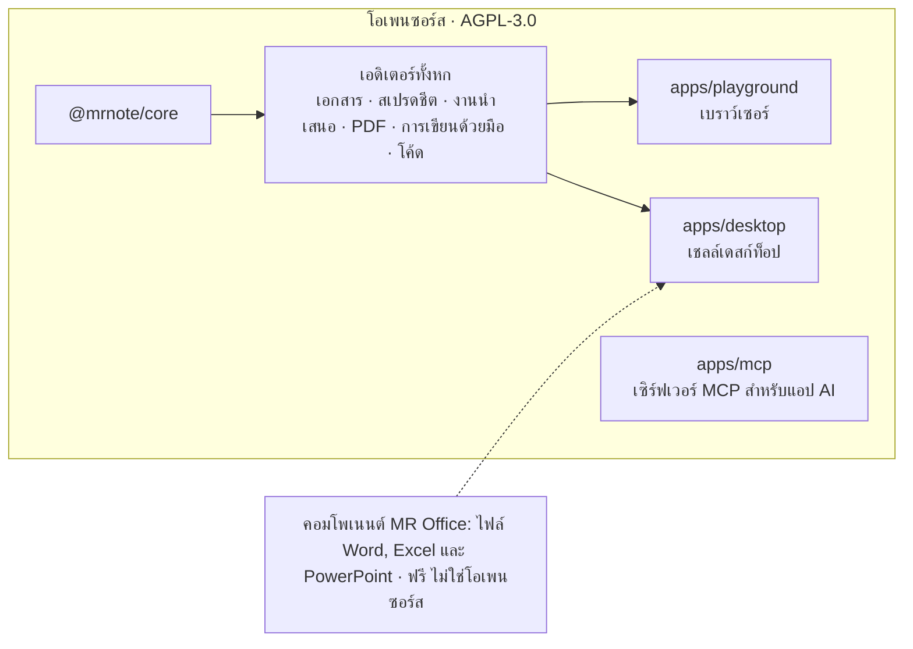

# MR Office — ไทย

<p align="center"><sub>🌐 <a href="../README.md">English</a> · <a href="../i18n/README.en-GB.md">English (UK)</a> · <a href="../i18n/README.zh.md">简体中文</a> · <a href="../i18n/README.zh-TW.md">繁體中文</a> · <a href="../i18n/README.ja.md">日本語</a> · <a href="../i18n/README.ko.md">한국어</a> · <a href="../i18n/README.de.md">Deutsch</a> · <a href="../i18n/README.fr.md">Français</a> · <a href="../i18n/README.es.md">Español</a> · <a href="../i18n/README.es-419.md">Español (Latinoamérica)</a> · <a href="../i18n/README.pt-BR.md">Português (Brasil)</a> · <a href="../i18n/README.it.md">Italiano</a> · <a href="../i18n/README.nl.md">Nederlands</a> · <a href="../i18n/README.sv.md">Svenska</a> · <a href="../i18n/README.da.md">Dansk</a> · <a href="../i18n/README.no.md">Norsk</a> · <a href="../i18n/README.fi.md">Suomi</a> · <a href="../i18n/README.id.md">Bahasa Indonesia</a> · <a href="../i18n/README.th.md">ไทย</a> · <a href="../i18n/README.vi.md">Tiếng Việt</a></sub></p>

<p align="center"><b>ตัวแก้ไขโอเพนซอร์สของ MR Office ได้แก่ เอกสาร สเปรดชีต งานนำเสนอ PDF การเขียนด้วยมือ และโค้ด ที่ทำงานในเบราว์เซอร์</b></p>

<p align="center"><a href="https://mroffice.ai/th"><b>▶ ลองใช้ออนไลน์</b></a> · <a href="https://mroffice.ai/th/office/download"><b>⬇ ดาวน์โหลด</b></a> · <a href="https://mroffice.ai">🌐 mroffice.ai</a><br><a href="https://mroffice.ai/th/developers">🧑‍💻 นักพัฒนา</a> · <a href="https://mroffice.ai/th/developers/embed">🧩 ฝัง</a> · <a href="https://mroffice.ai/th/developers/mcp">🤖 MCP สำหรับแอป AI</a> · <a href="https://www.npmjs.com/package/mroffice-embed">📦 npm SDK</a> · <a href="https://mroffice.ai/th/developers/oauth">🔑 ลงชื่อเข้าใช้ด้วย MR Office</a></p>

<p align="center"><a href="../LICENSE"></a> <a href="https://github.com/XinaTian/MROffice/releases"></a> <a href="https://github.com/XinaTian/MROffice/actions/workflows/ci.yml"></a> <a href="https://github.com/XinaTian/MROffice/stargazers"></a></p>

<p align="center"><a href="https://mroffice.ai/th"></a></p>

<p align="center"><a href="https://demo.mroffice.ai/media/mr-office-demo.mp4">🔊 ดูวิดีโอแนะนำ 50 วินาทีพร้อมเสียง</a></p>

<table>
<tr>
<td align="center" width="50%"><a href="https://mroffice.ai/th"></a><br><b>เอกสาร</b></td>
<td align="center" width="50%"><a href="https://mroffice.ai/th"></a><br><b>สเปรดชีต</b></td>
</tr>
<tr>
<td align="center" width="50%"><a href="https://mroffice.ai/th"></a><br><b>งานนำเสนอ</b></td>
<td align="center" width="50%"><a href="https://mroffice.ai/th"></a><br><b>PDF</b></td>
</tr>
<tr>
<td align="center" width="50%"><a href="https://mroffice.ai/th"></a><br><b>การเขียนด้วยมือ</b></td>
<td align="center" width="50%"><a href="https://mroffice.ai/th"></a><br><b>โค้ด</b></td>
</tr>
</table>

MR Office คือพื้นที่ทำงานสำหรับโน้ต AI และไฟล์จริง ที่เก็บนี้เผยแพร่ซอร์สโค้ดของตัวแก้ไข ซึ่งเป็นชุดเดียวกับที่ทำงานใน MR Office คุณสามารถบิลด์ รัน และฝังใช้งานเองได้ นี่คือตัวแก้ไขโอเพนซอร์ส ไม่ใช่ชุดโปรแกรมสำนักงานโอเพนซอร์สที่ครบถ้วน การอ่านและเขียนไฟล์ Microsoft Office ยังอยู่ใน MR Office (ดูด้านล่าง)

## สำหรับนักพัฒนา

ทุกอย่างสำหรับนักพัฒนาอยู่ที่ **[MR Office Developers](https://mroffice.ai/th/developers)** — บริการตนเอง ไม่ต้องสมัคร: ลงชื่อเข้าใช้ด้วยบัญชี MR Office ใดก็ได้แล้วเริ่มได้เลย

### ฝังโปรแกรมแก้ไขในเว็บแอปของคุณ (แนะนำ)

MR Office โฮสต์โปรแกรมแก้ไขให้ เซิร์ฟเวอร์ของคุณลงนามโทเค็นเซสชันอายุสั้น แล้วหน้าเว็บของคุณใช้เปิดโปรแกรมแก้ไข แก้ไขไฟล์ Word, Excel, PowerPoint และ PDF จริง (.docx, .xlsx, .pptx, .pdf) ได้ พร้อมการแก้ไขร่วมกัน การอัปโหลด ทุกรูปแบบการส่งออก การพิมพ์ และการบันทึกที่ส่งกลับไปยังเซิร์ฟเวอร์ของคุณผ่าน callback ที่ลงนามแล้ว แพ็กเกจฟรี: localhost 1,000 เซสชันต่อเดือน โดเมนของคุณเอง 100 เซสชันต่อเดือน สูงสุด 2 แอป เป็นบริการเชิงพาณิชย์แบบโฮสต์ แอปของคุณจึงไม่อยู่ภายใต้สัญญาอนุญาต AGPL ของรีโพนี้

1. ในโฟลเดอร์ของโปรเจกต์ ให้รัน `npx mroffice-embed init` (หรือสร้างแอปในคอนโซลนักพัฒนา): คลิก "อนุญาต" ในเบราว์เซอร์ครั้งเดียว แล้วคีย์ของแอปจะถูกเขียนลงใน `.env.local` / `.env`
2. เซิร์ฟเวอร์ของคุณสร้างโทเค็นเซสชันด้วย `createSessionToken` จาก `mroffice-embed/server` คีย์ลับไม่ออกจากเซิร์ฟเวอร์เลย
3. หน้าเว็บของคุณเปิดโปรแกรมแก้ไขด้วย `open()` จาก `mroffice-embed` (หรือสคริปต์ `https://mroffice.ai/embed/v1/embed.js`)

```js
// server: GET /api/mroffice/session (check who is signed in first)
import { createSessionToken } from "mroffice-embed/server";
const token = await createSessionToken({
  appId: process.env.MROFFICE_APP_ID,
  secretKey: process.env.MROFFICE_SECRET_KEY, // mro_sk_..., server only
  file: { key: "contract-42", name: "contract.docx", url: signedUrlToTheFile },
  user: { id: user.id, name: user.name },
  mode: "edit",
});

// page
import { open } from "mroffice-embed";
open({ container: "#editor", token: () => fetch("/api/mroffice/session").then((r) => r.json()).then((b) => b.token) });
```

[คู่มือการฝัง](https://mroffice.ai/th/developers/embed) · [คู่มือแบบ Markdown (สำหรับเอเจนต์ AI)](https://mroffice.ai/developers/embed.md) · [ราคาและขีดจำกัด](https://mroffice.ai/th/developers/pricing) · [คอนโซลนักพัฒนา](https://mroffice.ai/th/developers/console) · [เดโมสด](https://mroffice.ai/th/developers/embed/demo)

### แอป AI: เซิร์ฟเวอร์ MCP

แอป AI เปิด อ่าน แก้ไข และส่งออกเอกสารในโปรแกรมแก้ไข MR Office ตัวจริงผ่านเซิร์ฟเวอร์ MCP: เชื่อมต่อเอนด์พอยต์ที่โฮสต์ `https://mcp.mroffice.ai/mcp` (ลงชื่อเข้าใช้ด้วยบัญชี MR Office ไม่ต้องใช้คีย์) หรือรัน `npx -y mroffice-mcp` บนคอมพิวเตอร์ของคุณ ซอร์สโค้ดอยู่ใน `apps/mcp` [คู่มือ MCP →](https://mroffice.ai/th/developers/mcp)

### ลงชื่อเข้าใช้ด้วย MR Office (OAuth)

MR Office เป็นเซิร์ฟเวอร์อนุญาต OAuth 2.1 (PKCE, เอกสารเมตาดาตาของ client ID, การลงทะเบียนแบบไดนามิก): แอปของคุณให้ผู้คนลงชื่อเข้าใช้ด้วยบัญชี MR Office และทำงานภายในขอบเขตที่พวกเขาอนุญาตได้ [คู่มือ OAuth →](https://mroffice.ai/th/developers/oauth)

### โฮสต์โปรแกรมแก้ไขโอเพนซอร์สเอง

โปรแกรมแก้ไขทั้งหกในรีโพนี้นำไปรวมในผลิตภัณฑ์ของคุณได้ภายใต้ AGPL-3.0: หากผู้อื่นใช้เวอร์ชันที่แก้ไขผ่านเครือข่าย คุณต้องเสนอซอร์สโค้ดฉบับสมบูรณ์ให้ และคงการระบุ "MR Office" ไว้ (NOTICE.md) โปรแกรมเหล่านี้เปิดรูปแบบของตัวเอง, CSV, HTML, Markdown และ PDF ส่วนไฟล์ Word, Excel และ PowerPoint ไม่อยู่ในโปรแกรมแก้ไขโอเพนซอร์ส (การฝังแบบโฮสต์ด้านบนรองรับ) สัญญาอนุญาตเชิงพาณิชย์ติดต่อ support@mr-note.com [คู่มือโอเพนซอร์ส →](https://mroffice.ai/th/developers/open-source)

กำลังเตรียมแพ็กเกจ npm ในชื่อ `mroffice-core`, `mroffice-docs`, `mroffice-sheets`, `mroffice-slides`, `mroffice-pdf`, `mroffice-ink` และ `mroffice-code` ระหว่างที่ยังไม่เผยแพร่ ให้บิลด์โปรแกรมแก้ไขจากรีโพนี้ (ดูด้านล่าง)

## ตัวแก้ไข

สิ่งที่ตัวแก้ไขแต่ละตัวทำได้ในที่เก็บนี้:

- **เอกสาร** — โปรแกรมประมวลผลคำแบบแบ่งหน้า: สไตล์ ฟอนต์ รายการ ตาราง หัวกระดาษและท้ายกระดาษ ส่วนและคอลัมน์ รูปร่างและสมการ หน้าปกและสารบัญ ข้อคิดเห็นและการติดตามการเปลี่ยนแปลง และการเขียนด้วยหมึกบนหน้า บันทึกเป็นรูปแบบของตัวเอง (.mrdoc) เปิด HTML, Markdown และข้อความธรรมดาได้
- **สเปรดชีต** — เซลล์และสูตร รูปแบบตัวเลข การจัดรูปแบบตามเงื่อนไข การเรียงลำดับและตัวกรอง การตรึงแนว และหลายแผ่นงาน พร้อมผลรวมและค่าเฉลี่ยของส่วนที่เลือก การคำนวณระหว่างเซลล์ (เช่น =A1*B1+10) จะคำนวณในเบราว์เซอร์ทันทีที่พิมพ์ ส่วนสูตรที่ใช้ฟังก์ชัน (SUM, IF, VLOOKUP …) จะเก็บไว้ตามที่เขียน บันทึกเป็นรูปแบบของตัวเอง (.mrsheet) เปิดและบันทึก CSV และ TSV ได้
- **งานนำเสนอ** — สไลด์พร้อมธีมของตัวเอง 8 แบบ เค้าโครง มุมมองต้นแบบสไลด์และเค้าโครง ข้อความ รูปร่าง กล่องข้อความ ตาราง WordArt และสมการ ข้อคิดเห็น ส่วน การเปลี่ยนสไลด์และภาพเคลื่อนไหวพร้อมแสดงตัวอย่าง และการนำเสนอสไลด์ บันทึกเป็นรูปแบบของตัวเอง (.mrslides)
- **PDF** — อ่าน ค้นหา นำเสนอ และพิมพ์ไฟล์ PDF คัดลอกและอ่านออกเสียงข้อความ และทำเครื่องหมายข้อความที่เลือก (เน้น ขีดเส้นใต้ ขีดทับ เส้นหยัก) พร้อมโน้ตและบานหน้าต่างข้อคิดเห็นขณะเปิดไฟล์ การบันทึกจะคืนไฟล์ตามที่เปิดไว้
- **การเขียนด้วยมือ** — โน้ตเขียนมือด้วยปากกาที่รับรู้แรงกด ปากกาเน้นข้อความ ยางลบ บ่วงบาศ และไม้บรรทัด และแปลงหมึกเป็นรูปร่าง บันทึกเป็นรูปแบบของตัวเอง (.mrink)
- **โค้ด** — ตัวแก้ไขโค้ดขนาดเล็กที่เน้นไวยากรณ์ได้หลายภาษา มีเค้าร่าง และค้นหาและแทนที่ รัน JavaScript/TypeScript, Python, SQL, Lua และเชลล์ได้ในเบราว์เซอร์โดยตรง

การคำนวณสูตรที่มีฟังก์ชัน การวาดแผนภูมิ และการจัดวาง SmartArt ทำงานด้วยเอนจินของ MR Office เองในแอปเดสก์ท็อป MR Office: ตัวแก้ไขโอเพนซอร์สจะเก็บสูตร แผนภูมิ และ SmartArt ในไฟล์ไว้ และแสดง SmartArt ตามที่บันทึกไว้

## รันตัวแก้ไข

**▶ [ลองใช้เดโมออนไลน์ ไม่ต้องติดตั้ง](https://mroffice.ai/th)**

ตัวแก้ไขทั้งหกอยู่ใน `packages/` (`@mrnote/docs`, `sheets`, `slides`, `pdf`, `ink`, `code` ใช้ `@mrnote/core` ร่วมกัน) และทำงานร่วมกันใน `apps/playground`:

```bash
npm install
npm run fonts     # the open substitutes for Office's fonts
npm run build
npm run preview   # http://localhost:5178
```

`npm run dev` เริ่มเซิร์ฟเวอร์สำหรับพัฒนาที่ที่อยู่เดียวกัน และ `npm run smoke` ตรวจสอบผลการบิลด์ README ของแต่ละแพ็กเกจอธิบายโดยละเอียดว่าทำอะไรได้และฝังใช้งานอย่างไร

## แอปเดสก์ท็อป

[`apps/desktop`](../apps/desktop) คือ **MR Office Editors** ซอร์สโค้ดของเปลือกแอปเดสก์ท็อป MR Office (Electron) ที่ใช้ตัวตนแอปของตัวเอง เมื่อติดตั้งคอมโพเนนต์ MR Office ฟรีจาก Releases จะเป็นแอปเดสก์ท็อป MR Office ที่ใช้ไฟล์ Word, Excel, PowerPoint และ PDF ลงชื่อเข้าใช้ และ AI ได้ หากไม่มีคอมโพเนนต์ จะรันเฉพาะตัวแก้ไขโอเพนซอร์ส ซึ่งเปิดไฟล์ .mrdoc, .mrsheet, .mrslides และ .mrink รวมถึง CSV, HTML, Markdown และ PDF เปลือกและตัวแก้ไขเป็นซอร์สโค้ด AGPL ส่วนคอมโพเนนต์เป็นแบบคอมไพล์แล้ว ใช้ฟรีแต่ไม่ใช่โอเพนซอร์ส หลังจาก `npm run build` ให้เริ่มด้วย:

```bash
npm run desktop
```

## หากต้องการใช้งานครบทุกฟีเจอร์ โปรดติดตั้งแอปเดสก์ท็อป MR Office (ฟรี)

แอปเดสก์ท็อป MR Office ใช้ได้ฟรี มีตัวแก้ไขเหล่านี้และบริการครบถ้วน และใช้งานแบบออฟไลน์บนคอมพิวเตอร์ของคุณได้ โดยเพิ่มสิ่งที่ตัวแก้ไขโอเพนซอร์สไม่มี:

- เปิดและบันทึกไฟล์ Word, Excel และ PowerPoint (.docx, .xlsx, .pptx)
- คำนวณสูตรที่มีฟังก์ชัน (SUM, IF, VLOOKUP …)
- แผนภูมิ
- การแก้ไข SmartArt
- บันทึกการแก้ไข PDF กลับลงในไฟล์

**[ดาวน์โหลด MR Office (ฟรี) →](https://mroffice.ai/th/office/download)**

### ไฟล์ Word, Excel, PowerPoint และ PDF

การเปิดและบันทึกไฟล์ Word, Excel และ PowerPoint (.docx, .xlsx, .pptx) และการบันทึกการแก้ไข PDF กลับลงในไฟล์ มีให้ในแอปเดสก์ท็อป MR Office (ฟรี) ซึ่งมีตัวแก้ไขเหล่านี้ทั้งหมดและใช้งานแบบออฟไลน์บนคอมพิวเตอร์ของคุณได้:

## ส่วนต่างๆ ทำงานร่วมกันอย่างไร



## สัญญาอนุญาต

เป็นโอเพนซอร์สภายใต้ GNU Affero General Public License v3.0 (LICENSE) พร้อมข้อกำหนดเพิ่มเติมใน NOTICE.md: คงการระบุ "MR Office" และลิงก์ไปยัง https://mroffice.ai ไว้ และไม่ได้ให้สิทธิ์ในชื่อหรือโลโก้ MR Office ขอสัญญาอนุญาตเชิงพาณิชย์ได้ที่ support@mr-note.com ซอฟต์แวร์และข้อมูลของบุคคลที่สามระบุไว้ใน THIRD_PARTY_NOTICES.md การมีส่วนร่วม: ดู CONTRIBUTING.md

## เพิ่มเติม

เว็บไซต์และผลิตภัณฑ์ฉบับเต็ม: **https://mroffice.ai** · คำถามและข้อเสนอแนะ: support@mr-note.com

<p align="center">ถ้า MR Office มีประโยชน์กับคุณ การกด ⭐ บน GitHub จะช่วยให้คนอื่นค้นพบได้</p>
