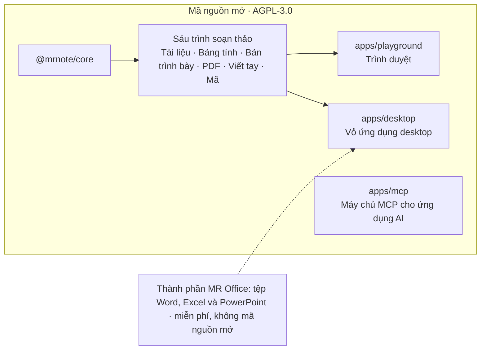

# MR Office — Tiếng Việt

<p align="center"><sub>🌐 <a href="../README.md">English</a> · <a href="../i18n/README.en-GB.md">English (UK)</a> · <a href="../i18n/README.zh.md">简体中文</a> · <a href="../i18n/README.zh-TW.md">繁體中文</a> · <a href="../i18n/README.ja.md">日本語</a> · <a href="../i18n/README.ko.md">한국어</a> · <a href="../i18n/README.de.md">Deutsch</a> · <a href="../i18n/README.fr.md">Français</a> · <a href="../i18n/README.es.md">Español</a> · <a href="../i18n/README.es-419.md">Español (Latinoamérica)</a> · <a href="../i18n/README.pt-BR.md">Português (Brasil)</a> · <a href="../i18n/README.it.md">Italiano</a> · <a href="../i18n/README.nl.md">Nederlands</a> · <a href="../i18n/README.sv.md">Svenska</a> · <a href="../i18n/README.da.md">Dansk</a> · <a href="../i18n/README.no.md">Norsk</a> · <a href="../i18n/README.fi.md">Suomi</a> · <a href="../i18n/README.id.md">Bahasa Indonesia</a> · <a href="../i18n/README.th.md">ไทย</a> · <a href="../i18n/README.vi.md">Tiếng Việt</a></sub></p>

<p align="center"><b>Các trình soạn thảo mã nguồn mở của MR Office — tài liệu, bảng tính, bản trình bày, PDF, viết tay và mã — chạy trong trình duyệt.</b></p>

<p align="center"><a href="https://mroffice.ai/vi"><b>▶ Dùng thử trực tuyến</b></a> · <a href="https://mroffice.ai/vi/office/download"><b>⬇ Tải xuống</b></a> · <a href="https://mroffice.ai">🌐 mroffice.ai</a><br><a href="https://mroffice.ai/vi/developers">🧑‍💻 Nhà phát triển</a> · <a href="https://mroffice.ai/vi/developers/embed">🧩 Nhúng</a> · <a href="https://mroffice.ai/vi/developers/mcp">🤖 MCP cho ứng dụng AI</a> · <a href="https://www.npmjs.com/package/mroffice-embed">📦 SDK npm</a> · <a href="https://mroffice.ai/vi/developers/oauth">🔑 Đăng nhập bằng MR Office</a></p>

<p align="center"><a href="../LICENSE"></a> <a href="https://github.com/XinaTian/MROffice/releases"></a> <a href="https://github.com/XinaTian/MROffice/actions/workflows/ci.yml"></a> <a href="https://github.com/XinaTian/MROffice/stargazers"></a></p>

<p align="center"><a href="https://mroffice.ai/vi"></a></p>

<p align="center"><a href="https://demo.mroffice.ai/media/mr-office-demo.mp4">🔊 Xem video giới thiệu 50 giây có âm thanh</a></p>

<table>
<tr>
<td align="center" width="50%"><a href="https://mroffice.ai/vi"></a><br><b>Tài liệu</b></td>
<td align="center" width="50%"><a href="https://mroffice.ai/vi"></a><br><b>Bảng tính</b></td>
</tr>
<tr>
<td align="center" width="50%"><a href="https://mroffice.ai/vi"></a><br><b>Bản trình bày</b></td>
<td align="center" width="50%"><a href="https://mroffice.ai/vi"></a><br><b>PDF</b></td>
</tr>
<tr>
<td align="center" width="50%"><a href="https://mroffice.ai/vi"></a><br><b>Viết tay</b></td>
<td align="center" width="50%"><a href="https://mroffice.ai/vi"></a><br><b>Mã</b></td>
</tr>
</table>

MR Office là không gian làm việc cho ghi chú, AI và tệp thực. Kho này công bố mã nguồn các trình soạn thảo của nó: chính những trình soạn thảo MR Office đang chạy, bạn có thể tự dựng, chạy và nhúng. Đây là các trình soạn thảo mã nguồn mở, không phải một bộ ứng dụng văn phòng mã nguồn mở hoàn chỉnh: việc đọc và ghi tệp Microsoft Office vẫn nằm trong MR Office (xem bên dưới).

## Dành cho nhà phát triển

Mọi thứ cho nhà phát triển có tại **[MR Office Developers](https://mroffice.ai/vi/developers)** — tự phục vụ, không cần đăng ký: đăng nhập bằng bất kỳ tài khoản MR Office nào và bắt đầu.

### Nhúng trình soạn thảo vào ứng dụng web của bạn (khuyên dùng)

MR Office lưu trữ các trình soạn thảo; máy chủ của bạn ký một token phiên ngắn hạn và trang của bạn mở trình soạn thảo bằng token đó. Nó chỉnh sửa tệp Word, Excel, PowerPoint và PDF thật (.docx, .xlsx, .pptx, .pdf), có cộng tác, tải lên, mọi định dạng xuất, in, và các lần lưu được gửi về máy chủ của bạn qua callback có chữ ký. Gói miễn phí: 1.000 phiên mỗi tháng trên localhost, 100 trên tên miền của bạn, tối đa 2 ứng dụng. Đây là dịch vụ thương mại được lưu trữ, nên ứng dụng của bạn không bị ràng buộc bởi giấy phép AGPL của kho này.

1. Trong thư mục dự án, chạy `npx mroffice-embed init` (hoặc tạo ứng dụng trong bảng điều khiển nhà phát triển): bấm "Cho phép" một lần trong trình duyệt, khóa của ứng dụng sẽ được ghi vào `.env.local` / `.env`.
2. Máy chủ của bạn tạo token phiên bằng `createSessionToken` từ `mroffice-embed/server`; khóa bí mật không bao giờ rời máy chủ.
3. Trang của bạn mở trình soạn thảo bằng `open()` từ `mroffice-embed` (hoặc tập lệnh `https://mroffice.ai/embed/v1/embed.js`).

```js
// server: GET /api/mroffice/session (check who is signed in first)
import { createSessionToken } from "mroffice-embed/server";
const token = await createSessionToken({
  appId: process.env.MROFFICE_APP_ID,
  secretKey: process.env.MROFFICE_SECRET_KEY, // mro_sk_..., server only
  file: { key: "contract-42", name: "contract.docx", url: signedUrlToTheFile },
  user: { id: user.id, name: user.name },
  mode: "edit",
});

// page
import { open } from "mroffice-embed";
open({ container: "#editor", token: () => fetch("/api/mroffice/session").then((r) => r.json()).then((b) => b.token) });
```

[Hướng dẫn nhúng](https://mroffice.ai/vi/developers/embed) · [Hướng dẫn dạng Markdown (cho tác tử AI)](https://mroffice.ai/developers/embed.md) · [Giá và giới hạn](https://mroffice.ai/vi/developers/pricing) · [Bảng điều khiển nhà phát triển](https://mroffice.ai/vi/developers/console) · [Bản demo trực tiếp](https://mroffice.ai/vi/developers/embed/demo)

### Ứng dụng AI: máy chủ MCP

Ứng dụng AI mở, đọc, chỉnh sửa và xuất tài liệu trong trình soạn thảo MR Office thật thông qua máy chủ MCP: kết nối endpoint được lưu trữ `https://mcp.mroffice.ai/mcp` (đăng nhập bằng tài khoản MR Office, không cần khóa), hoặc chạy `npx -y mroffice-mcp` trên máy tính của bạn. Mã nguồn nằm trong `apps/mcp`. [Hướng dẫn MCP →](https://mroffice.ai/vi/developers/mcp)

### Đăng nhập bằng MR Office (OAuth)

MR Office là máy chủ ủy quyền OAuth 2.1 (PKCE, tài liệu siêu dữ liệu client ID, đăng ký động): ứng dụng của bạn có thể cho người dùng đăng nhập bằng tài khoản MR Office và hành động trong phạm vi họ cho phép. [Hướng dẫn OAuth →](https://mroffice.ai/vi/developers/oauth)

### Tự lưu trữ các trình soạn thảo mã nguồn mở

Sáu trình soạn thảo trong kho này có thể được tích hợp vào sản phẩm của bạn theo AGPL-3.0: nếu người khác dùng phiên bản đã sửa đổi qua mạng, bạn phải cung cấp cho họ toàn bộ mã nguồn và giữ ghi công "MR Office" (NOTICE.md). Chúng mở định dạng riêng, CSV, HTML, Markdown và PDF; tệp Word, Excel và PowerPoint không nằm trong các trình soạn thảo mã nguồn mở (bản nhúng được lưu trữ ở trên hỗ trợ). Giấy phép thương mại: liên hệ support@mr-note.com. [Hướng dẫn mã nguồn mở →](https://mroffice.ai/vi/developers/open-source)

Các trình soạn thảo có trên npm dưới dạng thành phần React: `npm i mroffice-docs mroffice-core` (cùng `mroffice-sheets`, `mroffice-slides`, `mroffice-pdf`, `mroffice-ink`, `mroffice-code`); README của từng gói hướng dẫn cách nhúng.

## Các trình soạn thảo

Những gì mỗi trình soạn thảo làm được trong kho này:

- **Tài liệu** — trình xử lý văn bản theo trang: kiểu, phông chữ, danh sách, bảng, đầu trang và chân trang, phần và cột, hình dạng và phương trình, trang bìa và mục lục, chú thích và theo dõi thay đổi, cùng nét mực trên trang. Lưu ở định dạng riêng (.mrdoc); mở HTML, Markdown và văn bản thuần.
- **Bảng tính** — ô và công thức, định dạng số, định dạng có điều kiện, sắp xếp và lọc, cố định ngăn và nhiều trang tính, kèm tổng và trung bình của vùng chọn. Phép tính giữa các ô (=A1*B1+10) được tính trong trình duyệt khi gõ; công thức có hàm (SUM, IF, VLOOKUP …) được giữ nguyên như đã viết. Lưu ở định dạng riêng (.mrsheet); mở và lưu CSV, TSV.
- **Bản trình bày** — trang chiếu với tám chủ đề riêng, bố cục, dạng xem trang chiếu cái và bố cục, văn bản, hình dạng, hộp văn bản, bảng, WordArt và phương trình, chú thích, phần, chuyển tiếp và hoạt ảnh có xem trước, cùng trình chiếu. Lưu ở định dạng riêng (.mrslides).
- **PDF** — đọc, tìm kiếm, trình chiếu và in tệp PDF, sao chép và đọc to văn bản, và đánh dấu văn bản đã chọn (tô sáng, gạch chân, gạch ngang, gạch lượn sóng) kèm ghi chú và ngăn chú thích khi tệp đang mở; khi lưu sẽ trả lại tệp như lúc mở.
- **Viết tay** — ghi chú viết tay với bút cảm ứng lực nhấn, bút đánh dấu, tẩy, lasso và thước, và chuyển nét mực thành hình dạng. Lưu ở định dạng riêng (.mrink).
- **Mã** — trình soạn thảo mã gọn nhẹ với tô sáng cú pháp cho nhiều ngôn ngữ, dàn ý, tìm và thay thế; JavaScript/TypeScript, Python, SQL, Lua và shell chạy ngay trong trình duyệt.

Việc tính công thức có hàm, vẽ biểu đồ và dàn trang SmartArt do bộ máy riêng của MR Office thực hiện, trong ứng dụng máy tính MR Office: các trình soạn thảo mã nguồn mở giữ nguyên công thức, biểu đồ và SmartArt trong tệp, và hiển thị SmartArt như khi được lưu.

## Chạy các trình soạn thảo

**▶ [Dùng thử bản demo trực tuyến — không cần cài đặt](https://mroffice.ai/vi)**

Sáu trình soạn thảo nằm trong `packages/` (`@mrnote/docs`, `sheets`, `slides`, `pdf`, `ink`, `code`, dùng chung `@mrnote/core`) và chạy cùng nhau trong `apps/playground`:

```bash
npm install
npm run fonts     # the open substitutes for Office's fonts
npm run build
npm run preview   # http://localhost:5178
```

`npm run dev` khởi động máy chủ phát triển tại cùng địa chỉ, và `npm run smoke` kiểm tra một bản dựng. README của mỗi gói mô tả chi tiết gói làm được gì và cách nhúng.

## Ứng dụng máy tính

[`apps/desktop`](../apps/desktop) chứa **MR Office Editors**: mã nguồn lớp vỏ của ứng dụng máy tính MR Office (Electron), với danh tính ứng dụng riêng. Khi có thành phần MR Office miễn phí từ Releases, đây là ứng dụng máy tính MR Office, với tệp Word, Excel, PowerPoint và PDF, đăng nhập và AI. Không có thành phần đó, chỉ các trình soạn thảo nguồn mở chạy; chúng mở các tệp .mrdoc, .mrsheet, .mrslides và .mrink cùng CSV, HTML, Markdown và PDF. Lớp vỏ và các trình soạn thảo là mã nguồn AGPL; thành phần là bản đã biên dịch, dùng miễn phí và không phải nguồn mở. Sau `npm run build`, khởi chạy bằng:

```bash
npm run desktop
```

## Để dùng đầy đủ tính năng, hãy cài ứng dụng máy tính MR Office (miễn phí)

Ứng dụng máy tính MR Office miễn phí, có các trình soạn thảo này cùng toàn bộ dịch vụ và chạy ngoại tuyến trên máy tính của bạn. Ứng dụng bổ sung những gì các trình soạn thảo mã nguồn mở còn thiếu:

- Mở và lưu tệp Word, Excel và PowerPoint (.docx, .xlsx, .pptx)
- Tính công thức có hàm (SUM, IF, VLOOKUP …)
- Biểu đồ
- Chỉnh sửa SmartArt
- Ghi các chỉnh sửa PDF trở lại tệp

**[Tải MR Office (miễn phí) →](https://mroffice.ai/vi/office/download)**

### Tệp Word, Excel, PowerPoint và PDF

Mở và lưu tệp Word, Excel và PowerPoint (.docx, .xlsx, .pptx), cũng như ghi các chỉnh sửa PDF trở lại tệp, do ứng dụng máy tính MR Office (miễn phí) cung cấp; ứng dụng có tất cả các trình soạn thảo này và chạy ngoại tuyến trên máy tính của bạn:

## Các phần kết hợp với nhau thế nào



## Giấy phép

Mã nguồn mở theo GNU Affero General Public License v3.0 (LICENSE), kèm các điều khoản bổ sung trong NOTICE.md: giữ ghi công "MR Office" và liên kết đến https://mroffice.ai, và không cấp quyền đối với tên hay biểu trưng MR Office. Giấy phép thương mại có tại support@mr-note.com. Phần mềm và dữ liệu của bên thứ ba được liệt kê trong THIRD_PARTY_NOTICES.md. Đóng góp: xem CONTRIBUTING.md.

## Thêm

Trang web và sản phẩm đầy đủ: **https://mroffice.ai** · Câu hỏi và góp ý: support@mr-note.com

<p align="center">Nếu MR Office hữu ích với bạn, một ⭐ trên GitHub sẽ giúp người khác tìm thấy nó.</p>
