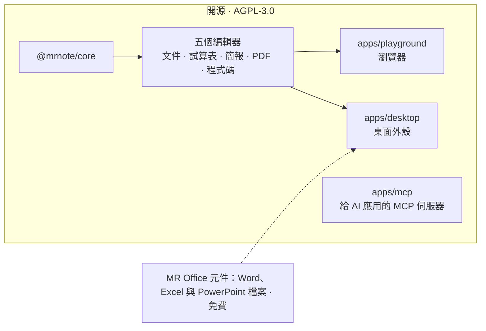

# MR Office — 繁體中文

<p align="center"><sub>🌐 <a href="../README.md">English</a> · <a href="../i18n/README.en-GB.md">English (UK)</a> · <a href="../i18n/README.zh.md">简体中文</a> · <a href="../i18n/README.zh-TW.md">繁體中文</a> · <a href="../i18n/README.ja.md">日本語</a> · <a href="../i18n/README.ko.md">한국어</a> · <a href="../i18n/README.de.md">Deutsch</a> · <a href="../i18n/README.fr.md">Français</a> · <a href="../i18n/README.es.md">Español</a> · <a href="../i18n/README.es-419.md">Español (Latinoamérica)</a> · <a href="../i18n/README.pt-BR.md">Português (Brasil)</a> · <a href="../i18n/README.it.md">Italiano</a> · <a href="../i18n/README.nl.md">Nederlands</a> · <a href="../i18n/README.sv.md">Svenska</a> · <a href="../i18n/README.da.md">Dansk</a> · <a href="../i18n/README.no.md">Norsk</a> · <a href="../i18n/README.fi.md">Suomi</a> · <a href="../i18n/README.id.md">Bahasa Indonesia</a> · <a href="../i18n/README.th.md">ไทย</a> · <a href="../i18n/README.vi.md">Tiếng Việt</a></sub></p>

<p align="center"><b>MR Office 的開源編輯器，最接近 Microsoft Office 的編輯器 — 文件、試算表、簡報、PDF 與程式碼 — 在瀏覽器中執行。</b></p>

<p align="center"><a href="https://mroffice.ai/zh-TW"><b>▶ 線上試用</b></a> · <a href="https://mroffice.ai/zh-TW/office/download"><b>⬇ 下載</b></a> · <a href="https://mroffice.ai">🌐 mroffice.ai</a><br><a href="https://mroffice.ai/zh-TW/developers">🧑‍💻 開發人員</a> · <a href="https://mroffice.ai/zh-TW/developers/embed">🧩 嵌入</a> · <a href="https://mroffice.ai/zh-TW/developers/mcp">🤖 AI 應用程式的 MCP</a> · <a href="https://www.npmjs.com/package/mroffice-embed">📦 npm SDK</a> · <a href="https://mroffice.ai/zh-TW/developers/oauth">🔑 使用 MR Office 登入</a></p>

<p align="center"><a href="../LICENSE"></a> <a href="https://github.com/XinaTian/MROffice/releases"></a> <a href="https://github.com/XinaTian/MROffice/actions/workflows/ci.yml"></a> <a href="https://github.com/XinaTian/MROffice/stargazers"></a></p>

<p align="center"><a href="https://mroffice.ai/zh-TW"></a></p>

<p align="center"><a href="https://demo.mroffice.ai/media/mr-office-demo.mp4">🔊 觀看 50 秒介紹影片（有聲）</a></p>

<table>
<tr>
<td align="center" width="50%"><a href="https://mroffice.ai/zh-TW"></a><br><b>文件</b></td>
<td align="center" width="50%"><a href="https://mroffice.ai/zh-TW"></a><br><b>試算表</b></td>
</tr>
<tr>
<td align="center" width="50%"><a href="https://mroffice.ai/zh-TW"></a><br><b>簡報</b></td>
<td align="center" width="50%"><a href="https://mroffice.ai/zh-TW"></a><br><b>PDF</b></td>
</tr>
<tr>
<td align="center" width="50%"><a href="https://mroffice.ai/zh-TW"></a><br><b>程式碼</b></td>
</tr>
</table>

MR Office 是一個結合筆記、AI 與真實檔案的工作空間。此儲存庫發佈其編輯器的原始碼：這些正是 MR Office 所使用的編輯器，你可以自行建置、執行並嵌入。搭配免費的 MR Office 桌面應用程式或託管嵌入服務，它們能開啟並儲存真實的 Word、Excel 與 PowerPoint 檔案。

## 開發人員

開發人員需要的一切都在 **[MR Office Developers](https://mroffice.ai/zh-TW/developers)**——自助開通，無需申請：用任何 MR Office 帳號登入即可開始。

### 把編輯器嵌入你的網頁應用程式（建議）

MR Office 託管這些編輯器；你的伺服器簽發短效期的工作階段權杖，你的頁面即可開啟編輯器。它能編輯真實的 Word、Excel、PowerPoint 與 PDF 檔案（.docx、.xlsx、.pptx、.pdf），支援協同編輯、上傳、所有匯出格式、列印，並透過簽章回呼將儲存結果送回你的伺服器。免費方案：在 localhost 上每月 1,000 個工作階段，在你自己的網域上每月 100 個，最多 2 個應用程式。作為託管服務，它不會對你自己的應用程式施加任何 AGPL 義務。

1. 在你的專案資料夾執行 `npx mroffice-embed init`（或在開發人員主控台建立應用程式）：在瀏覽器按一次「允許」，應用程式的金鑰就會寫入 `.env.local` / `.env`。
2. 你的伺服器用 `mroffice-embed/server` 的 `createSessionToken` 簽發工作階段權杖；秘密金鑰只留在伺服器上。
3. 你的網頁用 `mroffice-embed` 的 `open()` 開啟編輯器（或用指令碼 `https://mroffice.ai/embed/v1/embed.js`）。

```js
// server: GET /api/mroffice/session (check who is signed in first)
import { createSessionToken } from "mroffice-embed/server";
const token = await createSessionToken({
  appId: process.env.MROFFICE_APP_ID,
  secretKey: process.env.MROFFICE_SECRET_KEY, // mro_sk_..., server only
  file: { key: "contract-42", name: "contract.docx", url: signedUrlToTheFile },
  user: { id: user.id, name: user.name },
  mode: "edit",
});

// page
import { open } from "mroffice-embed";
open({ container: "#editor", token: () => fetch("/api/mroffice/session").then((r) => r.json()).then((b) => b.token) });
```

[嵌入指南](https://mroffice.ai/zh-TW/developers/embed) · [Markdown 版指南（給 AI 程式設計助理）](https://mroffice.ai/developers/embed.md) · [價格與限制](https://mroffice.ai/zh-TW/developers/pricing) · [開發人員主控台](https://mroffice.ai/zh-TW/developers/console) · [線上展示](https://mroffice.ai/zh-TW/developers/embed/demo)

### AI 應用程式：MCP 伺服器

AI 應用程式可透過 MCP 伺服器在真正的 MR Office 編輯器中開啟、讀取、編輯和匯出文件：連線到託管端點 `https://mcp.mroffice.ai/mcp`（用 MR Office 帳號登入，不需金鑰），或在自己的電腦執行 `npx -y mroffice-mcp`。原始碼在 `apps/mcp`。 [MCP 指南 →](https://mroffice.ai/zh-TW/developers/mcp)

### 使用 MR Office 帳號登入（OAuth）

MR Office 是 OAuth 2.1 授權伺服器（PKCE、用戶端 ID 中繼資料文件、動態註冊）：你的應用程式可以讓使用者用 MR Office 帳號登入，並在其允許的範圍內操作。 [OAuth 指南 →](https://mroffice.ai/zh-TW/developers/oauth)

### 自行架設開放原始碼編輯器

此儲存庫中的五個編輯器可在 AGPL-3.0 下建置為您自己的產品：若使用者透過網路使用修改後的版本，您必須向其提供完整的原始碼，並保留「MR Office」署名（NOTICE.md）。它們可開啟自有格式、CSV、HTML、Markdown 與 PDF；若需處理 Word、Excel 與 PowerPoint 檔案，請使用上方的託管嵌入功能。商業授權可向 support@mr-note.com 洽詢。 [開放原始碼指南 →](https://mroffice.ai/zh-TW/developers/open-source)

編輯器以 React 元件形式發佈於 npm：`npm i mroffice-docs mroffice-core`（以及 `mroffice-sheets`、`mroffice-slides`、`mroffice-pdf`、`mroffice-code`）；各套件的 README 說明如何嵌入。

## 編輯器一覽

各編輯器在本儲存庫中能做的事：

- **文件** — 分頁文書處理器：在 [常用] 索引標籤中提供字型、段落格式、清單與樣式；在 [插入] 索引標籤中提供封面與空白頁、分頁符號、表格、圖片、圖案、SmartArt、圖表、連結、書籤、註解、頁首、頁尾與頁碼、方程式、符號、文字方塊與 文字藝術師。儲存自有格式（.mrdoc）；可開啟 HTML、Markdown 與純文字。
- **試算表** — 在 [常用] 索引標籤中提供儲存格與公式，包含字型、對齊、數字格式、條件式格式、儲存格樣式以及插入或刪除儲存格；在 [插入] 索引標籤中提供表格、圖片、圖案、圖示、核取方塊、圖表與走勢圖；支援多個工作表，並可對選取範圍進行加總與平均。儲存格之間的算術運算（=A1*B1+10）會在您輸入時於瀏覽器中計算；含函數的公式（SUM、IF、VLOOKUP …）則保持原樣。儲存自有格式（.mrsheet）；可開啟與儲存 CSV 與 TSV。
- **簡報** — 在 [常用] 索引標籤中提供含版面配置與節的投影片、文字、字型與段落，以及圖案及其排列；在 [插入] 索引標籤中提供表格、圖片、圖示、SmartArt、圖表、文字方塊、文字藝術師、頁首與頁尾、方程式、符號與視訊；支援演講者備忘稿、註解與簡報播放。儲存自有格式（.mrslides）。
- **PDF** — 閱讀、簡報與列印 PDF 檔案：單頁與雙頁檢視、連續捲動、旋轉、縮圖與閱讀模式、搜尋與複製文字，以及檔案開啟時的註解；儲存時會以開啟時的原始狀態傳回檔案。
- **程式碼** — 輕量級程式碼編輯器，支援多種語言的語法醒目提示、大綱、尋找、快速開啟、檔案總管與問題清單。

含函數的公式、圖表與 SmartArt 皆由 MR Office 的引擎計算與繪製，無論是在免費桌面應用程式或託管服務中皆然；此處的編輯器會保留檔案中的每一個公式、圖表與 SmartArt，並以儲存時的樣貌顯示 SmartArt。

## 執行編輯器

**▶ [線上試用，無需安裝](https://mroffice.ai/zh-TW)**

五個編輯器位於 `packages/`（`@mrnote/docs`、`sheets`、`slides`、`pdf`、`code`，共用 `@mrnote/core`），並在 `apps/playground` 中一起執行：

```bash
npm install
npm run fonts     # the open substitutes for Office's fonts
npm run build
npm run preview   # http://localhost:5178
```

`npm run dev` 在同一位址啟動開發伺服器，`npm run smoke` 檢查建置結果。各套件的 README 詳列了它能做的事和嵌入方式。

## 桌面應用程式

[`apps/desktop`](../apps/desktop) 包含 **MR Office Editors**：MR Office 桌面應用程式外殼（Electron）的原始碼，以自有身分發佈。搭配 Releases 中的免費 MR Office 元件，即為 MR Office 桌面應用程式，支援 Word、Excel、PowerPoint 與 PDF 檔案、登入與 AI。若無該元件，則獨立執行開源編輯器，可開啟 .mrdoc、.mrsheet 與 .mrslides 檔案、CSV、HTML、Markdown 與 PDF。外殼與編輯器皆為 AGPL 原始碼；元件可從 Releases 免費下載。執行 `npm run build` 後，以下列指令啟動：

```bash
npm run desktop
```

## 完整功能請安裝 MR Office 桌面版（免費）

MR Office 桌面應用程式免費，包含這些編輯器與完整服務，且可在你自己的電腦上離線運作。除了編輯器之外，它還額外提供：

- 開啟和儲存 Word、Excel、PowerPoint 檔案（.docx、.xlsx、.pptx）
- 帶函數的公式（SUM、IF、VLOOKUP 等）計算
- 圖表
- SmartArt 編輯
- PDF 編輯後寫回檔案

**[下載 MR Office（免費） →](https://mroffice.ai/zh-TW/office/download)**

### Word、Excel、PowerPoint 和 PDF 檔案

使用免費的 MR Office 桌面應用程式處理真實的 Word、Excel 與 PowerPoint 檔案（.docx、.xlsx、.pptx），並將 PDF 編輯直接存回檔案中；該應用程式包含所有這些編輯器，且可在你自己的電腦上離線運作：

## 各部分的關係



## 授權條款

依據 GNU Affero 通用公眾授權條款 v3.0（LICENSE）開源，並附加 NOTICE.md 中的條款：保留「MR Office」署名及指向 https://mroffice.ai 的連結，且不授予 MR Office 名稱與標誌的使用權。如需商業授權，請聯絡 support@mr-note.com。第三方軟體與資料見 THIRD_PARTY_NOTICES.md。貢獻程式碼請先閱讀 CONTRIBUTING.md。

## 更多

官網與完整產品：**https://mroffice.ai** · 問題與意見回饋：support@mr-note.com

<p align="center">如果 MR Office 對你有用，在 GitHub 上按個 ⭐，能讓更多人發現它。</p>
