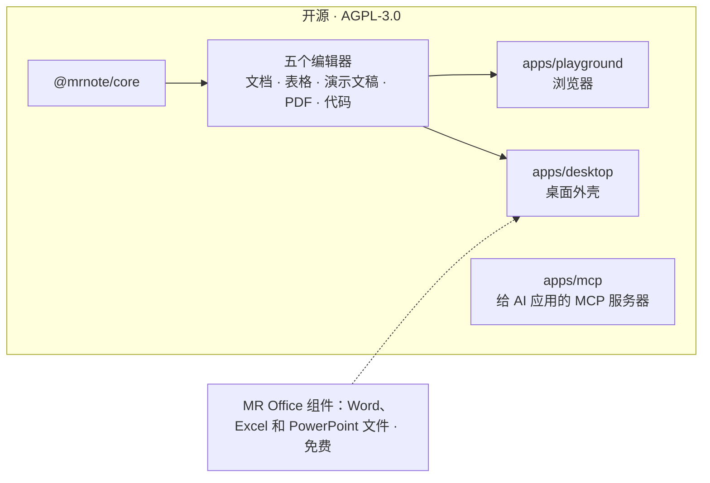

# MR Office — 简体中文

<p align="center"><sub>🌐 <a href="../README.md">English</a> · <a href="../i18n/README.en-GB.md">English (UK)</a> · <a href="../i18n/README.zh.md">简体中文</a> · <a href="../i18n/README.zh-TW.md">繁體中文</a> · <a href="../i18n/README.ja.md">日本語</a> · <a href="../i18n/README.ko.md">한국어</a> · <a href="../i18n/README.de.md">Deutsch</a> · <a href="../i18n/README.fr.md">Français</a> · <a href="../i18n/README.es.md">Español</a> · <a href="../i18n/README.es-419.md">Español (Latinoamérica)</a> · <a href="../i18n/README.pt-BR.md">Português (Brasil)</a> · <a href="../i18n/README.it.md">Italiano</a> · <a href="../i18n/README.nl.md">Nederlands</a> · <a href="../i18n/README.sv.md">Svenska</a> · <a href="../i18n/README.da.md">Dansk</a> · <a href="../i18n/README.no.md">Norsk</a> · <a href="../i18n/README.fi.md">Suomi</a> · <a href="../i18n/README.id.md">Bahasa Indonesia</a> · <a href="../i18n/README.th.md">ไทย</a> · <a href="../i18n/README.vi.md">Tiếng Việt</a></sub></p>

<p align="center"><b>MR Office 的开源编辑器，最接近 Microsoft Office 的编辑器——文档、表格、演示文稿、PDF 和代码——在浏览器中运行。</b></p>

<p align="center"><a href="https://mroffice.ai"><b>▶ 在线试用</b></a> · <a href="https://mroffice.ai/office/download"><b>⬇ 下载</b></a> · <a href="https://mroffice.ai">🌐 mroffice.ai</a><br><a href="https://mroffice.ai/developers">🧑‍💻 开发者</a> · <a href="https://mroffice.ai/developers/embed">🧩 嵌入</a> · <a href="https://mroffice.ai/developers/mcp">🤖 AI 应用的 MCP</a> · <a href="https://www.npmjs.com/package/mroffice-embed">📦 npm SDK</a> · <a href="https://mroffice.ai/developers/oauth">🔑 用 MR Office 登录</a></p>

<p align="center"><a href="../LICENSE"></a> <a href="https://github.com/XinaTian/MROffice/releases"></a> <a href="https://github.com/XinaTian/MROffice/actions/workflows/ci.yml"></a> <a href="https://github.com/XinaTian/MROffice/stargazers"></a></p>

<p align="center"><a href="https://mroffice.ai"></a></p>

<p align="center"><a href="https://demo.mroffice.ai/media/mr-office-demo.mp4">🔊 观看 50 秒介绍视频（有声）</a></p>

<table>
<tr>
<td align="center" width="50%"><a href="https://mroffice.ai"></a><br><b>文档</b></td>
<td align="center" width="50%"><a href="https://mroffice.ai"></a><br><b>表格</b></td>
</tr>
<tr>
<td align="center" width="50%"><a href="https://mroffice.ai"></a><br><b>演示文稿</b></td>
<td align="center" width="50%"><a href="https://mroffice.ai"></a><br><b>PDF</b></td>
</tr>
<tr>
<td align="center" width="50%"><a href="https://mroffice.ai"></a><br><b>代码</b></td>
</tr>
</table>

MR Office 是一个集笔记、AI 和真实文件于一体的工作空间。本仓库发布其编辑器的源代码：这些正是 MR Office 运行的编辑器，你可以自行构建、运行并嵌入。配合免费的 MR Office 桌面应用或托管嵌入服务，它们可以打开并保存真实的 Word、Excel 和 PowerPoint 文件。

## 开发者

开发者需要的一切都在 **[MR Office Developers](https://mroffice.ai/developers)**——自助开通，无需申请：用任意 MR Office 账号登录即可开始。

### 把编辑器嵌入你的网页应用（推荐）

MR Office 托管这些编辑器；你的服务器签发短期会话令牌，你的页面即可打开编辑器。它可编辑真实的 Word、Excel、PowerPoint 和 PDF 文件（.docx、.xlsx、.pptx、.pdf），支持协同编辑、上传、所有导出格式、打印，并通过签名回调将保存内容发送回你的服务器。免费方案：localhost 上每月 1,000 个会话，你自己的域名上每月 100 个会话，最多 2 个应用。作为托管服务，它不会对你的应用施加任何 AGPL 义务。

1. 在你的项目文件夹里运行 `npx mroffice-embed init`（或在开发者控制台创建应用）：在浏览器里点一次“允许”，应用的密钥就写入 `.env.local` / `.env`。
2. 你的服务器用 `mroffice-embed/server` 的 `createSessionToken` 签发会话令牌；密钥始终只在服务器上。
3. 你的页面用 `mroffice-embed` 的 `open()` 打开编辑器（或用脚本 `https://mroffice.ai/embed/v1/embed.js`）。

```js
// server: GET /api/mroffice/session (check who is signed in first)
import { createSessionToken } from "mroffice-embed/server";
const token = await createSessionToken({
  appId: process.env.MROFFICE_APP_ID,
  secretKey: process.env.MROFFICE_SECRET_KEY, // mro_sk_..., server only
  file: { key: "contract-42", name: "contract.docx", url: signedUrlToTheFile },
  user: { id: user.id, name: user.name },
  mode: "edit",
});

// page
import { open } from "mroffice-embed";
open({ container: "#editor", token: () => fetch("/api/mroffice/session").then((r) => r.json()).then((b) => b.token) });
```

[嵌入指南](https://mroffice.ai/developers/embed) · [Markdown 版指南（给 AI 编程助手）](https://mroffice.ai/developers/embed.md) · [价格与限额](https://mroffice.ai/developers/pricing) · [开发者控制台](https://mroffice.ai/developers/console) · [在线演示](https://mroffice.ai/developers/embed/demo)

### AI 应用：MCP 服务器

AI 应用可以通过 MCP 服务器在真正的 MR Office 编辑器里打开、读取、编辑和导出文档：连接托管端点 `https://mcp.mroffice.ai/mcp`（用 MR Office 账号登录，无需密钥），或在自己电脑上运行 `npx -y mroffice-mcp`。源码在 `apps/mcp`。 [MCP 指南 →](https://mroffice.ai/developers/mcp)

### 用 MR Office 账号登录（OAuth）

MR Office 是一个 OAuth 2.1 授权服务器（PKCE、客户端 ID 元数据文档、动态注册）：你的应用可以让用户用 MR Office 账号登录，并在其允许的权限范围内操作。 [OAuth 指南 →](https://mroffice.ai/developers/oauth)

### 自行部署开源编辑器

本仓库中的五个编辑器可在 AGPL-3.0 下构建到你自己的产品中：如果人们通过网络使用修改后的版本，你必须向他们提供其完整源代码，并保留“MR Office”署名（NOTICE.md）。它们可打开自有格式、CSV、HTML、Markdown 和 PDF；如需处理 Word、Excel 和 PowerPoint 文件，请使用上方的托管嵌入。商业许可证可从 support@mr-note.com 获取。 [开源指南 →](https://mroffice.ai/developers/open-source)

这些编辑器以 React 组件形式发布在 npm 上：`npm i mroffice-docs mroffice-core`（以及 `mroffice-sheets`、`mroffice-slides`、`mroffice-pdf`、`mroffice-code`）；每个包的 README 展示了如何嵌入它。

## 编辑器一览

各编辑器在本仓库中能做的事：

- **文档** — 分页文字处理器：在“开始”选项卡中提供字体、段落格式、列表和样式；在“插入”选项卡中提供封面和空白页、分页符、表格、图片、形状、SmartArt、图表、链接、书签、批注、页眉、页脚和页码、公式、符号、文本框和 艺术字。保存自有格式（.mrdoc）；可打开 HTML、Markdown 和纯文本。
- **表格** — 单元格和公式，在“开始”选项卡中提供字体、对齐、数字格式、条件格式、单元格样式以及插入或删除单元格；在“插入”选项卡中提供表格、图片、形状、图标、复选框、图表和迷你图；支持多个工作表，可对所选区域求和和求平均值。单元格之间的算术运算（=A1*B1+10）会在你输入时于浏览器中计算；带函数的公式（SUM、IF、VLOOKUP……）按原样保留。保存自有格式（.mrsheet）；可打开和保存 CSV 和 TSV。
- **演示文稿** — 幻灯片，在“开始”选项卡中提供版式和节、文本、字体和段落，以及形状及其排列；在“插入”选项卡中提供表格、图片、图标、SmartArt、图表、文本框、艺术字、页眉和页脚、公式、符号和视频；支持演讲者备注、批注和演示。保存自有格式（.mrslides）。
- **PDF** — 阅读、演示和打印 PDF 文件：单页和双页视图、连续滚动、旋转、缩略图和阅读模式、搜索和复制文本，以及文件打开时的批注；保存时按打开时的原样返回文件。
- **代码** — 轻量级代码编辑器，支持多种语言的语法高亮、大纲、查找、快速打开、文件资源管理器和问题列表。

带函数的公式、图表和 SmartArt 由 MR Office 的引擎计算和绘制，在免费桌面应用和托管服务中均是如此；这里的编辑器会保留文件中的每一个公式、图表和 SmartArt，并按保存时的样子显示 SmartArt。

## 运行编辑器

**▶ [在线试用，无需安装](https://mroffice.ai)**

五个编辑器位于 `packages/`（`@mrnote/docs`、`sheets`、`slides`、`pdf`、`code`，共享 `@mrnote/core`），并在 `apps/playground` 中一起运行：

```bash
npm install
npm run fonts     # the open substitutes for Office's fonts
npm run build
npm run preview   # http://localhost:5178
```

`npm run dev` 在同一地址启动开发服务器，`npm run smoke` 检查构建结果。各包的 README 详细列出了它能做的事和嵌入方法。

## 桌面应用

[`apps/desktop`](../apps/desktop) 包含 **MR Office Editors**：MR Office 桌面应用外壳（Electron）的源码，拥有独立的身份标识。配合 Releases 中免费的 MR Office 组件，它就是 MR Office 桌面应用，支持 Word、Excel、PowerPoint 和 PDF 文件、登录和 AI。不配合该组件时，它单独运行开源编辑器，可打开 .mrdoc、.mrsheet 和 .mrslides 文件、CSV、HTML、Markdown 和 PDF。外壳和编辑器均为 AGPL 源代码；组件可从 Releases 免费下载。执行 `npm run build` 后，用以下命令启动：

```bash
npm run desktop
```

## 完整功能请安装 MR Office 桌面版（免费）

MR Office 桌面应用免费，包含这些编辑器和完整服务，并可在你自己的电脑上离线使用。在编辑器之上，它还增加了：

- 打开和保存 Word、Excel、PowerPoint 文件（.docx、.xlsx、.pptx）
- 带函数的公式（SUM、IF、VLOOKUP 等）计算
- 图表
- SmartArt 编辑
- PDF 编辑后写回文件

**[下载 MR Office（免费） →](https://mroffice.ai/office/download)**

### Word、Excel、PowerPoint 和 PDF 文件

使用免费的 MR Office 桌面应用处理真实的 Word、Excel 和 PowerPoint 文件（.docx、.xlsx、.pptx），并将 PDF 编辑直接保存到文件中；该应用包含所有这些编辑器，并可在你自己的电脑上离线使用：

## 各部分的关系



## 许可协议

依据 GNU Affero 通用公共许可证 v3.0（LICENSE）开源，并附加 NOTICE.md 中的条款：保留“MR Office”署名及指向 https://mroffice.ai 的链接，且不授予 MR Office 名称与标志的使用权。如需商业授权，请联系 support@mr-note.com。第三方软件与数据见 THIRD_PARTY_NOTICES.md。贡献代码请先阅读 CONTRIBUTING.md。

## 更多

官网与完整产品：**https://mroffice.ai** · 问题与反馈：support@mr-note.com

<p align="center">如果 MR Office 对你有用，在 GitHub 上点个 ⭐，能让更多人发现它。</p>
