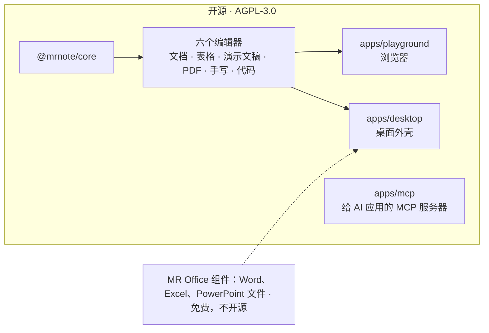

# MR Office — 简体中文

<p align="center"><sub>🌐 <a href="../README.md">English</a> · <a href="../i18n/README.en-GB.md">English (UK)</a> · <a href="../i18n/README.zh.md">简体中文</a> · <a href="../i18n/README.zh-TW.md">繁體中文</a> · <a href="../i18n/README.ja.md">日本語</a> · <a href="../i18n/README.ko.md">한국어</a> · <a href="../i18n/README.de.md">Deutsch</a> · <a href="../i18n/README.fr.md">Français</a> · <a href="../i18n/README.es.md">Español</a> · <a href="../i18n/README.es-419.md">Español (Latinoamérica)</a> · <a href="../i18n/README.pt-BR.md">Português (Brasil)</a> · <a href="../i18n/README.it.md">Italiano</a> · <a href="../i18n/README.nl.md">Nederlands</a> · <a href="../i18n/README.sv.md">Svenska</a> · <a href="../i18n/README.da.md">Dansk</a> · <a href="../i18n/README.no.md">Norsk</a> · <a href="../i18n/README.fi.md">Suomi</a> · <a href="../i18n/README.id.md">Bahasa Indonesia</a> · <a href="../i18n/README.th.md">ไทย</a> · <a href="../i18n/README.vi.md">Tiếng Việt</a></sub></p>

<p align="center"><b>MR Office 的开源编辑器：文档、表格、演示文稿、PDF、手写和代码，全部在浏览器中运行。</b></p>

<p align="center"><a href="https://mroffice.ai/zh"><b>▶ 在线试用，无需安装</b></a> · <a href="https://github.com/XinaTian/MROffice/releases">⬇ 从 Releases 下载 MR Office</a> · <a href="https://mroffice.ai">🌐 mroffice.ai</a></p>

<p align="center"><a href="../LICENSE"></a> <a href="https://github.com/XinaTian/MROffice/releases"></a> <a href="https://github.com/XinaTian/MROffice/actions/workflows/ci.yml"></a> <a href="https://github.com/XinaTian/MROffice/stargazers"></a></p>

<p align="center"><a href="https://mroffice.ai/zh"></a></p>

<p align="center"><a href="../docs/media/mr-office-demo.mp4">🔊 观看 50 秒介绍视频（有声）</a></p>

<table>
<tr>
<td align="center" width="50%"><a href="https://mroffice.ai/zh"></a><br><b>文档</b></td>
<td align="center" width="50%"><a href="https://mroffice.ai/zh"></a><br><b>表格</b></td>
</tr>
<tr>
<td align="center" width="50%"><a href="https://mroffice.ai/zh"></a><br><b>演示文稿</b></td>
<td align="center" width="50%"><a href="https://mroffice.ai/zh"></a><br><b>PDF</b></td>
</tr>
<tr>
<td align="center" width="50%"><a href="https://mroffice.ai/zh"></a><br><b>手写</b></td>
<td align="center" width="50%"><a href="https://mroffice.ai/zh"></a><br><b>代码</b></td>
</tr>
</table>

MR Office 是一个集笔记、AI 和真实文件于一体的工作空间。本仓库公开它的编辑器源代码：与 MR Office 中运行的是同一套编辑器，你可以自己构建、运行和嵌入。这是开源编辑器，不是一套完整开源的 Office 套件：Microsoft Office 文件的读写由 MR Office 提供（见下文）。

## 编辑器一览

各编辑器在本仓库中能做的事：

- **文档** — 分页文字处理器：样式、字体、列表、表格、页眉页脚、分节与分栏、形状和公式、封面和目录、批注与修订，以及在页面上手写。保存为自有格式（.mrdoc）；可打开 HTML、Markdown 和纯文本。
- **表格** — 单元格与公式、数字格式、条件格式、排序筛选、冻结窗格和多工作表，并显示选区的求和与平均值。单元格之间的四则运算（如 =A1*B1+10）在浏览器中随输入计算；含函数的公式（SUM、IF、VLOOKUP 等）按原样保留。保存为自有格式（.mrsheet）；可打开和保存 CSV、TSV。
- **演示文稿** — 带 8 个自有主题的幻灯片：版式、幻灯片母版与版式视图、文字、形状、文本框、表格、艺术字和公式、批注、分节、切换与动画（可预览），以及幻灯片放映。保存为自有格式（.mrslides）。
- **PDF** — 阅读、搜索、放映和打印 PDF，复制和朗读其中的文字；文件打开期间可对选中文字做高亮、下划线、删除线、波浪线标记，并添加便笺、使用批注面板；保存时交回打开时的原文件。
- **手写** — 支持压感的钢笔、荧光笔、橡皮、套索和标尺，笔迹可转换为图形。保存为自有格式（.mrink）。
- **代码** — 轻量代码编辑器，支持多种语言的语法高亮、大纲和查找替换；JavaScript/TypeScript、Python、SQL、Lua 和 Shell 可直接在浏览器中运行。

带函数的公式计算、图表绘制和 SmartArt 排版由 MR Office 自己的引擎完成，在 MR Office 桌面版中提供：开源编辑器会保留文件中的公式、图表和 SmartArt，并按保存时的样子显示 SmartArt。

## 运行编辑器

**▶ [在线试用，无需安装](https://mroffice.ai/zh)**

六个编辑器在 `packages/` 下（`@mrnote/docs`、`sheets`、`slides`、`pdf`、`ink`、`code`，共用 `@mrnote/core`），在 `apps/playground` 中一起运行：

```bash
npm install
npm run fonts     # the open substitutes for Office's fonts
npm run build
npm run preview   # http://localhost:5178
```

`npm run dev` 在同一地址启动开发服务器，`npm run smoke` 检查构建结果。各包的 README 详细列出了它能做的事和嵌入方法。

## 桌面应用

[`apps/desktop`](../apps/desktop) 是 **MR Office Editors**：MR Office 桌面版外壳（Electron）的源代码，使用独立的应用身份。装上 Releases 中免费的 MR Office 组件后，它就是 MR Office 桌面版：可以打开和保存 Word、Excel、PowerPoint 和 PDF 文件，可以登录并使用 AI。不装组件时，它只运行开源编辑器，打开 .mrdoc、.mrsheet、.mrslides、.mrink 文件以及 CSV、HTML、Markdown 和 PDF。外壳和编辑器是 AGPL 源代码；组件是编译好的，可以免费使用，但不开源。先 `npm run build`，再运行：

```bash
npm run desktop
```

## 完整功能请安装 MR Office 桌面版（免费）

MR Office 桌面版免费，包含这些编辑器和完整服务，在你自己的电脑上离线可用。开源编辑器没有的功能，桌面版都提供：

- 打开和保存 Word、Excel、PowerPoint 文件（.docx、.xlsx、.pptx）
- 带函数的公式（SUM、IF、VLOOKUP 等）计算
- 图表
- SmartArt 编辑
- PDF 编辑后写回文件

**[从 Releases 下载 MR Office →](https://github.com/XinaTian/MROffice/releases)** · [或前往 mroffice.ai](https://mroffice.ai)

### Word、Excel、PowerPoint 和 PDF 文件

打开和保存 Word、Excel、PowerPoint 文件（.docx、.xlsx、.pptx），以及把 PDF 的修改写回文件，由免费的 MR Office 桌面版提供。桌面版包含以上全部编辑器，在你自己的电脑上离线也能用：

## 各部分的关系



## 许可协议

依据 GNU Affero 通用公共许可证 v3.0（LICENSE）开源，并附加 NOTICE.md 中的条款：保留“MR Office”署名及指向 https://mroffice.ai 的链接，且不授予 MR Office 名称与标志的使用权。如需商业授权，请联系 support@mr-note.com。第三方软件与数据见 THIRD_PARTY_NOTICES.md。贡献代码请先阅读 CONTRIBUTING.md。

## 更多

官网与完整产品：**https://mroffice.ai** · 问题与反馈：support@mr-note.com

<p align="center">如果 MR Office 对你有用，在 GitHub 上点个 ⭐，能让更多人发现它。</p>
